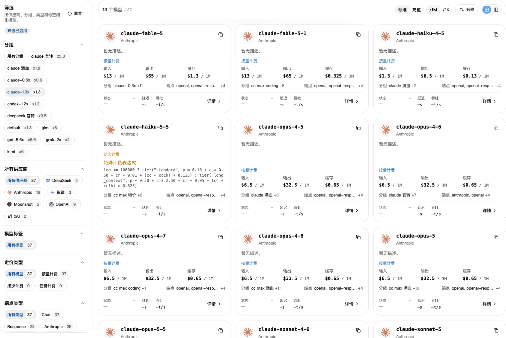
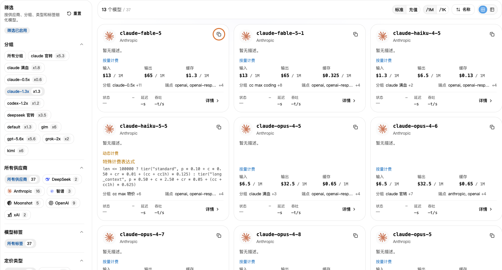

## 1. 先选分组

1. 打开 [API 密钥](https://nexusapi.link/keys)，找到你正在使用的 Key，记下“分组”。
2. 打开[模型广场](https://nexusapi.link/pricing)。
3. 在左侧选同一个分组。

**不要只看“所有分组”的价格。选中自己的分组，看到的才是对应分组价格。**

## 2. 复制模型名称

搜索你要用的模型，点击复制模型名称，粘贴到软件的“模型”一栏。不要凭印象手打名称。

找不到模型？把**软件名称、想用的模型、当前分组**发给客服，确认应该选哪个分组。

不确定模型能否用于你的软件？先看[按软件选模型](/tools#choose-model)；需要查具体名称时，看[模型推荐协议](/developer/model-protocols)。不要只凭模型名称相似就替换。

先选自己的分组，再点模型右上角的复制按钮。示例分组和价格仅供演示，以当前页面为准。

## 3. 看价格

- **标准**：调用时扣除的账户额度。
- **充值**：按站点设置换算的充值成本参考；个人优惠或套餐可能不同。
- **`/1M`**：每 100 万 Tokens 的价格；**`/1K`**：每 1,000 Tokens 的价格。比较时选同一个单位。

发给模型的内容算“输入”，模型回复的内容算“输出”。有缓存等其他费用时，点“详情”看说明。

详情如果列出缓存读取、缓存写入、阶梯价格或工具调用费用，按对应项目查看，不要把输入单价当成全部费用。不确定就把模型和分组发给客服。

**页面价格已包含所选分组的倍率，不用再乘一次。** 想看折扣，打开[倍率与折扣](/billing/multipliers-and-discounts)；想看实际扣费，打开[使用日志](/billing/usage-and-billing)。

## 4. 看速度和成功率

如果模型详情显示“性能”，打开后查看对应分组的数据：

- **首字延迟**：开始收到回复要等多久，通常越短越快。
- **输出速度**：开始回复后每秒输出多少 Tokens，通常越高越快。
- **成功率**：统计范围内请求成功的比例。

这些是历史统计，不是每次调用的保证，也不代表回答质量。没有数据不等于不能用；选不准时，把使用的软件和用途发给客服。

## 更换模型

1. 在模型广场选当前 Key 的分组，复制适用于目标软件的新模型名。跨分组更换，先按[密钥教程](/guide/api-key#change-key)确认分组。
2. 按你使用的软件改对应位置；只换模型，不必重新创建 Key：

| 使用方式 | 改哪里 |
| --- | --- |
| CC Switch | 编辑当前 NexusAPI 配置的主模型，保存后确认该配置已启用 |
| Claude Code 手动配置 | 按[教程第 3 步](/tools/claude-code#3-填入-key-和模型)修改用户配置的 `model` |
| Codex CLI 手动配置 | 按[教程第 2 步](/tools/codex-cli#2-保存地址和模型)修改配置顶部的 `model`，保留 NexusAPI Provider |
| Claude Code 编辑器扩展 | 按[教程第 3 步](/tools/cursor-vscode#3-填入-nexusapi-配置)修改用户设置里的 `ANTHROPIC_MODEL` 值 |
| 自己写程序 | 修改请求里的 `model`；换了协议时，还要按对应接口教程调整请求 |

3. 保存后重启对应工具或编辑器，在新对话发送“请只回复：连接成功，不要修改文件”。
4. 到[使用日志](https://nexusapi.link/usage-logs/common)确认本次模型和分组。测试会消耗少量额度，不要通过问 AI“你是什么模型”来判断配置是否生效。

旧会话可能保留原设置或历史上下文；先保存重要内容，再用新对话验证。
