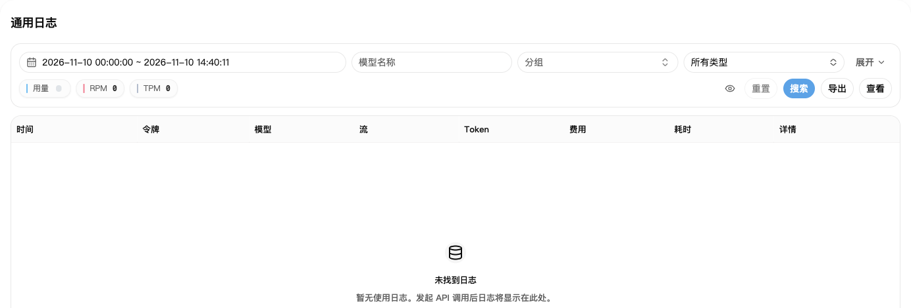
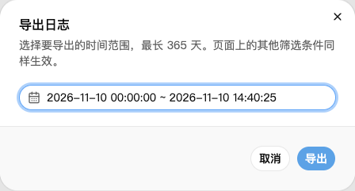

## 1. 找到调用记录

1. 打开[使用日志](https://nexusapi.link/usage-logs/common)。
2. 选发生调用的日期，点击“搜索”。
3. 记录太多时，再按模型或分组筛选。
4. 找到对应记录，点击费用或详情入口查看明细。

刚调用完没看到记录，稍等后刷新即可，不要为了查日志重复调用。

## 2. 主要看这几项

| 项目 | 看什么 |
| --- | --- |
| 时间、模型、分组 | 是不是你刚才的调用 |
| Tokens | 这次用了多少文字用量；详情可能分输入、输出、缓存 |
| 费用 | 这次扣了多少账户额度 |
| 耗时 | 这次调用用了多久 |

费用旁如显示订阅（套餐）或钱包图标，表示从哪里扣除。套餐扣减不等于钱包又扣一次；把鼠标移到图标上可看说明。

缓存或工具调用等费用，以该条记录的明细为准，不要只拿输入、输出用量猜总价。

**日志里的 `$0.10` 不一定是人民币 0.10 元。** 实付成本怎么对应，见[倍率与折扣](/billing/multipliers-and-discounts)。

## 3. 下载使用记录

1. 在使用日志里按需要筛选模型或分组。
2. 点击“导出”，选择开始和结束时间。
3. 再点“导出”，下载 CSV 文件，可用 Excel 打开。

导出会保留当前页面的其他筛选条件。一次只导出一份，完成后再导下一份。

目前单次查询或导出的时间跨度最多为 **365 天**，以后以页面提示为准；这不代表历史日志保证保留 365 天。范围太长时，按月分开查询或导出。

导出文件可能含 IP、请求编号等信息，转发前先检查并遮盖隐私。

## 4. 扣费有疑问怎么办

报错、没收到完整结果，或怀疑重复扣费时，把以下内容发给客服：

- 发生时间、模型和分组。
- 错误原文，以及是否收到完整回复。
- 对应日志截图；详情里有 Request ID（请求编号）时一起复制。

**不要发送完整 API Key。** 先保留记录，避免反复重试产生更多调用。
