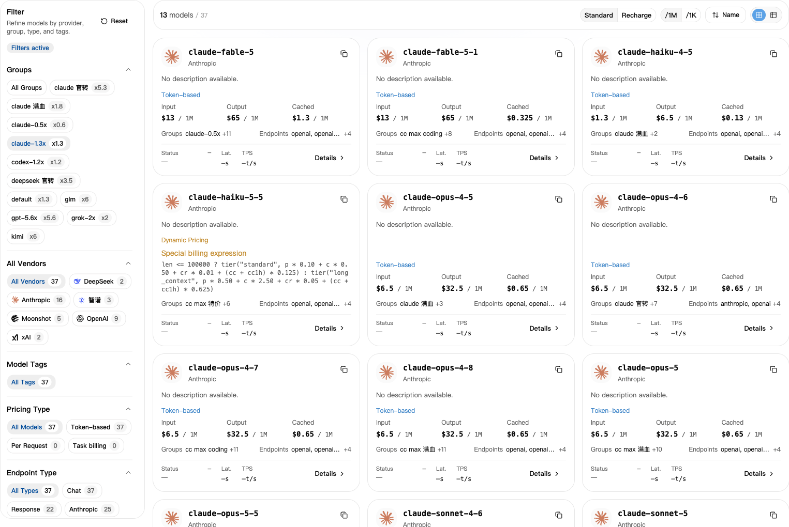
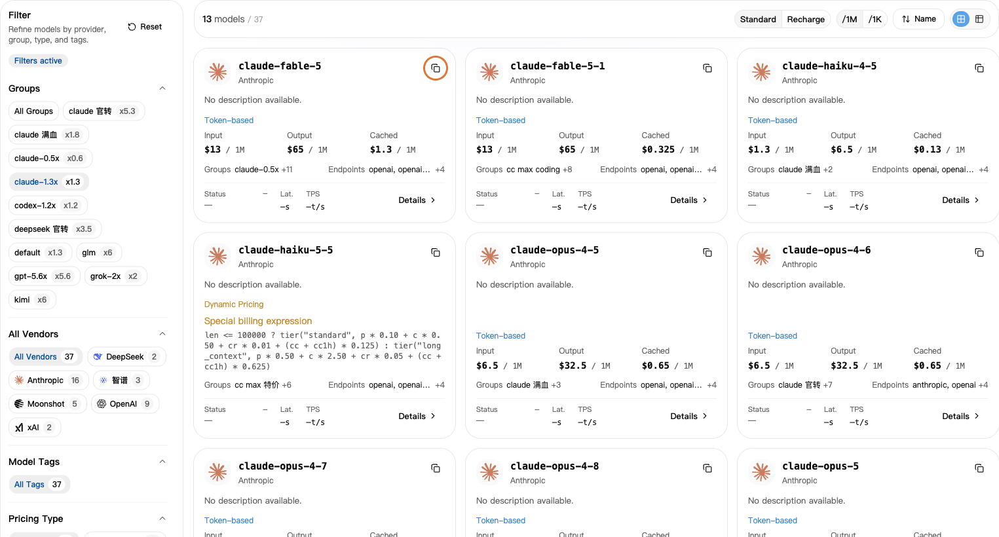

## 1. Select your group first

1. Open [API Keys](https://nexusapi.link/keys), find the key you use, and note its **Group**.
2. Open [Model Square](https://nexusapi.link/pricing).
3. Select that same group on the left.

**Do not rely on All Groups prices. Select your own group to see its prices.**

## 2. Copy the model name

Search for your model, click to copy its name, and paste it into the app's **Model** field. Do not type the name from memory.

Cannot find it? Send support your **app name, desired model and current group** to confirm which group to use.

Select your own group, then use the copy button at the top right of a model card. The group and prices shown are examples; check the live page.

Unsure whether a model works with your app? See [choose by app](/en/tools#choose-model) and [model protocols](/en/developer/model-protocols). Similar names do not imply compatibility.

## 3. Check the price

- **Standard:** account credits charged for usage.
- **Recharge:** a cost reference based on site settings; personal discounts and plans may differ.
- **`/1M`:** per million tokens. **`/1K`:** per thousand tokens. Use the same unit when comparing.

Content sent to the model is input; the reply is output. For cache or other charges, open **Details**.

If Details lists cache reads, cache writes, pricing tiers or tool-call charges, check each applicable item. The input price is not necessarily the whole cost. Ask support with your model and group if unsure.

**The displayed price already includes the selected group's multiplier. Do not multiply it again.** See [discount examples](/en/billing/multipliers-and-discounts) or [actual usage charges](/en/billing/usage-and-billing).

## 4. Check speed and success rate

If model details include **Performance**, open it and check your group's data:

- **Time to first token:** how long you wait for the reply to start; shorter is usually faster.
- **Output speed:** tokens produced per second after the reply starts; higher is usually faster.
- **Success rate:** the share of successful requests in the measured period.

These are historical statistics, not guarantees for individual requests or measures of answer quality. Missing data does not mean a model is unavailable. Tell support your app and intended use if you need help choosing.

## Change a model

1. Select your key's group in Model Square and copy a compatible model name. For a different group, first follow the [key guide](/en/guide/api-key#change-key).
2. Update the relevant setting. Changing only the model does not require a new key:

| Setup | Where to change it |
| --- | --- |
| CC Switch | Edit the current NexusAPI provider's primary model, save and confirm that provider is active |
| Manual Claude Code | Change `model` in the user settings shown in the [guide](/en/tools/claude-code) |
| Manual Codex CLI | Change top-level `model`, keeping the NexusAPI provider; see the [guide](/en/tools/codex-cli) |
| Claude Code editor extension | Change `ANTHROPIC_MODEL` in user settings; see the [guide](/en/tools/cursor-vscode) |
| Your own program | Change the request's `model`; if the protocol changes, follow the matching endpoint guide too |

3. Save and restart the tool or editor. In a new conversation, send "Reply only: connection successful. Do not modify files."
4. Check the model and group in [Usage Logs](https://nexusapi.link/usage-logs/common). The test uses credit. Do not ask the AI its identity to verify the route.

Old conversations may retain earlier settings or context. Save important content and verify in a new conversation.
