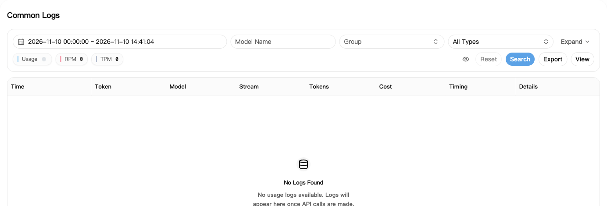
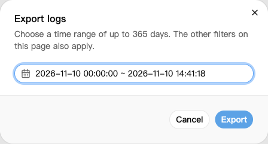

## 1. Find your request

1. Open [Usage Logs](https://nexusapi.link/usage-logs/common).
2. Select the request date and click **Search**.
3. Filter by model or group if there are too many records.
4. Find the request, then click its cost or details entry.

A new record may take a moment to appear. Refresh later; do not repeat a request just to check the logs.

## 2. Check these fields

| Field | What to check |
| --- | --- |
| Time, model, group | Is this your request? |
| Tokens | Usage for this request; details may separate input, output and cache |
| Cost | Credits deducted |
| Timing | How long the request took |

If a subscription or wallet icon appears beside the charge, it identifies the source of the deduction. A subscription deduction does not mean the wallet was also charged. Hover over the icon for its label.

Check the record's details for cache or tool-call charges; input and output usage alone may not explain the total.

**A `$0.10` log charge does not always mean CNY 0.10 paid.** See [multipliers and discounts](/en/billing/multipliers-and-discounts).

## 3. Download usage records

1. Filter Usage Logs by model or group as needed.
2. Click **Export** and choose the start and end times.
3. Click **Export** again to download a CSV file, which you can open in Excel.

The page's other filters also apply. Run one export at a time and wait for it to finish before starting another.

The current maximum time span for one search or export is **365 days**; follow the page's limit if it changes. This is not a guarantee that logs are retained for 365 days. Split longer ranges into monthly searches or exports.

Exported files may contain IP addresses and Request IDs. Check and redact private information before sharing.

## 4. Ask about a charge

For errors, incomplete replies or suspected duplicate charges, send support:

- Time, model and group.
- The error text and whether a complete reply arrived.
- A screenshot of the log, plus its Request ID if shown in details.

**Do not send your complete API key.** Keep the records and avoid repeated retries that create more requests.
