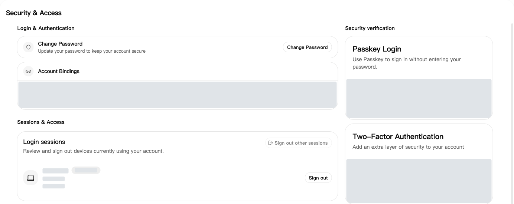
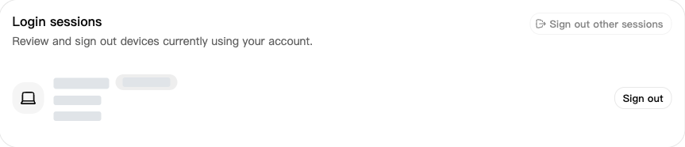
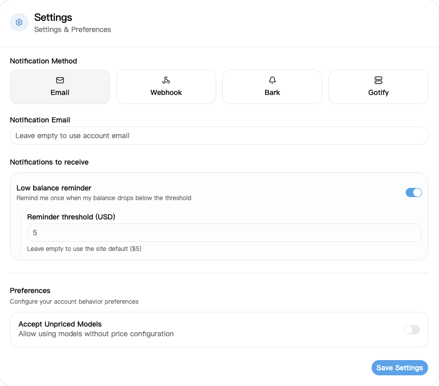

## 1. Sign in

Open [Sign In](https://nexusapi.link/sign-in) and enter your own account and password. Contact support if you need an account or cannot recover your password.

## 2. Change your password or check devices

1. Open [Security & Access](https://nexusapi.link/security).
2. To change your password, click **Change Password**, fill in the form and save.
3. Scroll to **Login Sessions**. Revoke unfamiliar sessions, or select **Sign out other sessions** to sign out other devices.

Login Sessions: check devices and sign out unfamiliar sessions if needed. Device details are hidden.

**Model apps use the key from [API Keys](/en/guide/api-key). Access tokens in Security & Access are for management APIs; do not create or enter one for a model app.**

## 3. If an account or key may be exposed

| Situation | Do this now |
| --- | --- |
| Exposed password or unfamiliar sign-in | Change your password and revoke unfamiliar sessions |
| Exposed API key | Disable or delete the old key, create a new one, and replace it in your app |

**Signing out of the website does not disable API keys.** Never share passwords, verification codes or complete keys.

## 4. Set a low balance reminder

1. Open [Profile](https://nexusapi.link/profile) and find notification settings.
2. Select **Email** and enter an address you can receive mail at. Leaving it empty uses your account email; enter one if your account has none.
3. Enable **Low balance reminder** and enter a **Reminder threshold**, or leave it empty for the site default.
4. Click **Save Settings**.

The threshold uses the credit unit shown on the page, not the amount paid in CNY. You receive one reminder when the balance falls from above the threshold to below it, not after every request. Do not rely only on email; you can also check your [wallet](https://nexusapi.link/wallet) before use.

## Display preferences and IP logging

### Change interface language

Open [Profile](https://nexusapi.link/profile), choose **Interface Language** and wait for confirmation. The preference syncs across signed-in devices and can also change API error-message language.

### Restore hidden menu entries

If **Sidebar Personal Settings** is available, enable the required items and click **Save Changes**. To restore defaults, use **Reset to Default**, then save. This only restores features already available to the account, not new permissions. Ask support if the option is missing.

### Record source IPs

In [Security & Access](https://nexusapi.link/security), change **Record IP Address**, then click **Save Settings**. It controls source-IP recording for subsequent usage and error logs. It does not backfill missing IPs in old records.

**IP logging is not an IP whitelist.** Logging records the source; the [whitelist](/en/guide/ip-whitelist) separately restricts a key's sources. Enabling logging does not prevent others from using a key.

### Check your own account operations

If **Audit Logs** is available in your menu:

1. Open [Audit Logs](https://nexusapi.link/usage-logs/audit) and select the period.
2. To narrow the list, choose **Category** or **Result**, then click **Search**.
3. Check the time, operation and result. Click **Reset** afterwards so old filters do not affect your next check.

This page covers your own account operations. For model requests and charges, use [Usage Logs](/en/billing/usage-and-billing), not audit records.

## Set up two-factor authentication

If [Security & Access](https://nexusapi.link/security) shows **Two-Factor Authentication**:

1. Click **Enable** and complete the security verification requested by the dialog.
2. Scan the setup QR code with an authenticator app and follow the steps.
3. **Store the provided backup codes securely first**, then enter the authenticator's current code and complete **Enable 2FA**.
4. Confirm the enabled status. Follow code prompts at sign-in; if your phone is unavailable, each backup code can be used once.

Use **Regenerate Backup Codes** to replace codes, verify your identity and save the new set. **All old backup codes become invalid.** Never share the QR code, setup secret or backup codes with support or in screenshots. If verification fails, contact support rather than repeatedly trying or deleting the account.
