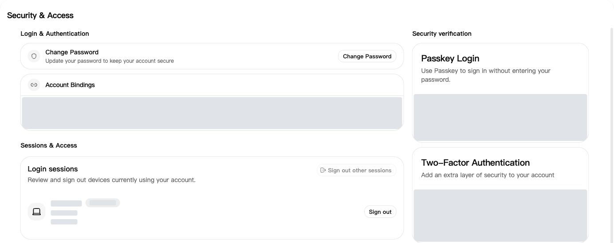
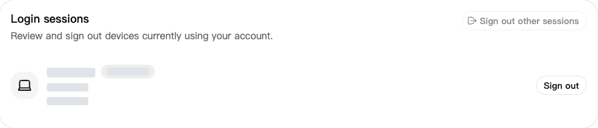
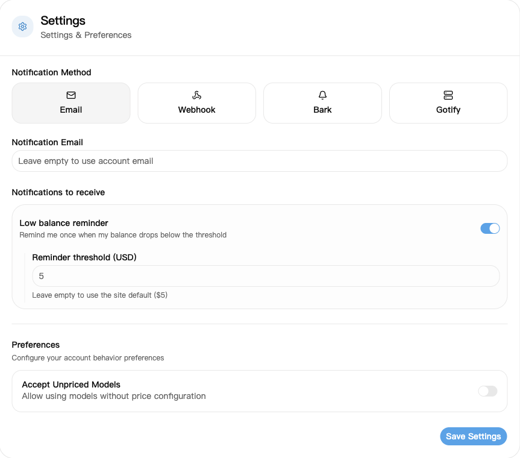

## 1. Sign in

Open [Sign In](https://nexusapi.link/sign-in) and enter your own account and password. Contact support if you need an account or cannot recover your password.

## 2. Change your password or check devices

1. Open [Security & Access](https://nexusapi.link/security).
2. To change your password, click **Change Password**, fill in the form and save.
3. Scroll to **Login Sessions**. Revoke unfamiliar sessions, or select **Sign out other sessions** to sign out other devices.

Login Sessions: check devices and sign out unfamiliar sessions if needed. Device details are hidden.

**Model apps use the key from [API Keys](/en/guide/api-key). Access tokens in Security & Access are for management APIs; do not create or enter one for a model app.**

## 3. If an account or key may be exposed

| Situation | Do this now |
| --- | --- |
| Exposed password or unfamiliar sign-in | Change your password and revoke unfamiliar sessions |
| Exposed API key | Disable or delete the old key, create a new one, and replace it in your app |

**Signing out of the website does not disable API keys.** Never share passwords, verification codes or complete keys.

## 4. Set a low balance reminder

1. Open [Profile](https://nexusapi.link/profile) and find notification settings.
2. Select **Email** and enter an address you can receive mail at. Leaving it empty uses your account email; enter one if your account has none.
3. Enable **Low balance reminder** and enter a **Reminder threshold**, or leave it empty for the site default.
4. Click **Save Settings**.

The threshold uses the credit unit shown on the page, not the amount paid in CNY. You receive one reminder when the balance falls from above the threshold to below it, not after every request. Do not rely only on email; you can also check your [wallet](https://nexusapi.link/wallet) before use.
