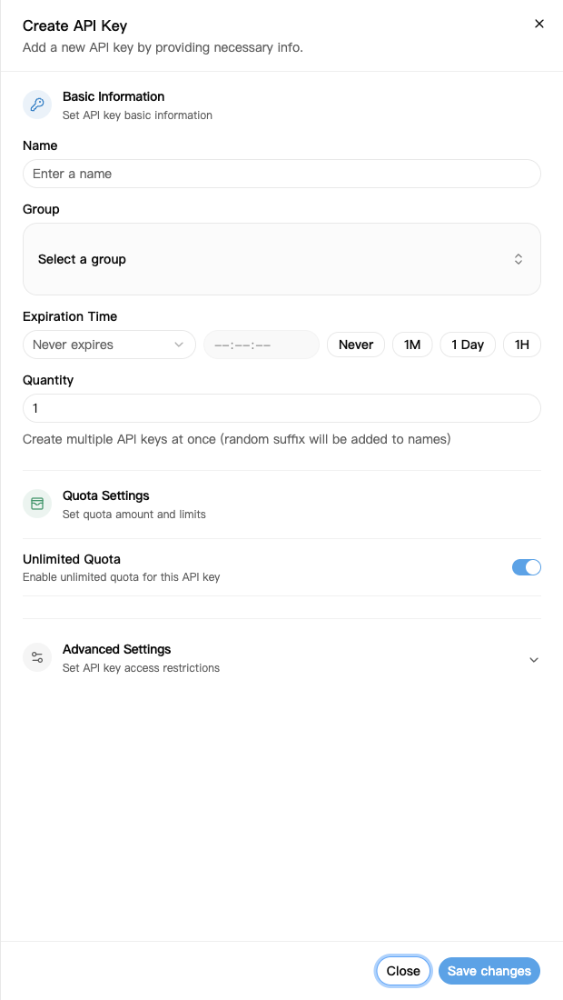
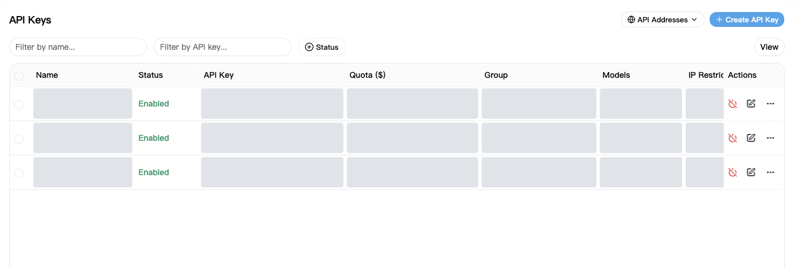
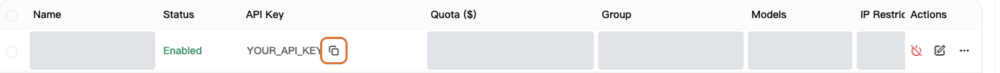

An API key is the credential your app needs to connect to NexusAPI.

To restrict a key to specific computers or servers, follow the [IP whitelist guide](/en/guide/ip-whitelist).

## 1. Create a key

1. Open [API Keys](https://nexusapi.link/keys).
2. Click **Create API Key** at the top right.
3. Fill in the settings below.
4. Click **Save changes**.

| Setting | What to enter |
| --- | --- |
| Name | Something you recognize, such as `My computer` |
| Group | The group provided by support; ask if unsure |
| Quantity | `1` |
| Expiration time | Keep the default for a first setup |
| Quota, Advanced Settings | Keep defaults unless you have a specific need |

Gray areas hide personal data; they do not indicate unavailable features. Example groups, models and prices are subject to the live page.

Unlimited quota does not mean free usage. Requests still use your balance or plan allowance.

In Advanced Settings, **Allow querying user quota** lets an app holding this key read your account's remaining and used credits. Keep the default for your own use; before sharing a key, decide whether its holder should see this information.

## 2. Copy it into your app

1. Return to the key list and find your new key.
2. Click its copy button. Do not manually copy the masked text containing asterisks.
3. Paste the complete key into your app's **API Key** field.
4. Follow [your app's guide](/en/tools) for the address and model name.

Copy the full key using the outlined button. The key shown is a placeholder.

To copy the platform address, click **API Addresses** at the top right of the key page. Follow [your app's guide](/en/tools) to decide whether to include `/v1`; do not add paths yourself.

**Use the key created here, not an access token from Security & Access.**

**Copy Connection Info** in the row's more menu copies both the address and the complete key. **It is not a public sharing link.** Use it only when a trusted app explicitly supports that import format; otherwise copy the key separately as above. Do not send connection info to a chat group or support.

## 3. If a key is exposed

Disable or delete the old key immediately, create a new one, and replace it in your app.

Do not post complete keys in chats, screenshots or public code. Support does not need your complete key.

## Change a group or key

**Changing a group does not require a new key:**

1. In [API Keys](https://nexusapi.link/keys), find the key in use and click its **Edit** button.
2. Choose an available group compatible with your app and save. If the group is missing, ask support rather than choosing at random.
3. Select the new group in [Model Square](https://nexusapi.link/pricing), check the model and price, then [update and test your app](/en/billing/models-pricing#change-model).

Editing a group does not generate a new key, but affects every program sharing it. To change just one program, create a separate key for it.

**Replacing a key:** normally, create the new key, update the app, restart and verify a request before disabling the unused old key. If a key was exposed, disable it immediately; do not wait for testing. Never send either key to support.

If the group shows **Follow user group**, **Inherited**, **Cross-group** or `auto`, ask support to confirm eligible groups, models and charges first. Do not assume one fixed multiplier or change the group just to match an example.

## Set quota, expiration and model restrictions

1. Find the key in [API Keys](https://nexusapi.link/keys) and click **Edit**.
2. Change only the required settings below.
3. Click **Save changes**. All apps sharing this key are affected.

| Restriction | Setting |
| --- | --- |
| Remaining allowance | In **Quota Settings**, turn off **Unlimited Quota** and enter the allowance in the unit shown |
| Expiration | Choose a date and time in **Expiration Time**, or never expires for no deadline |
| Allowed models | Expand **Advanced Settings** and select models in **Model Limits** |
| Allowed source IPs | Follow the [IP whitelist guide](/en/guide/ip-whitelist) |

**The quota is the remaining allowance, not a payment or an amount to add.** If the field uses `$`, entering `10` sets the key's remaining allowance to `$10` of account credits. It is not CNY 10 or an extra 10 added to the old quota. Follow the unit actually displayed.

This is not a monthly resetting budget. The account still needs balance or an applicable plan. Unlimited quota only removes this key's own allowance limit.

Clearing every selection in **Model Limits** removes the key's extra model restriction. **It does not unlock models unavailable in its group.** Use the earlier steps to change models or groups.

Use separate, recognizable keys for different apps, such as `Office computer` and `Server app`, to track and disable them separately. Avoid unlimited, non-expiring keys for temporary sharing.

If Claude Code needs auxiliary models, allow the confirmed eligible auxiliary models too. Allowing only the primary model can make some operations fail. Use the names in the [app guide](/en/tools/claude-code) or confirmed by support.

## Pause, resume or delete a key

- **Pause:** click the row's power button labelled **Disable**, then check that the row's status becomes **Disabled**. Subsequent requests using this key will be rejected.
- **Resume:** use **Enable** in the same place. If the key is expired or exhausted, first edit its expiration or remaining quota, save, then enable. Repeated clicks do not fix those restrictions.
- **Retire:** choose **Delete** from the row's more menu only after checking no app still needs it, then follow the confirmation. Deletion is not a temporary pause.

Closing the browser or signing out does not disable a key. If usage looks suspicious, disable the relevant key first, then [check its logs](/en/billing/usage-and-billing#find-key-usage).

### If a key does not work, check these four things

| Check | What to do |
| --- | --- |
| Disabled or expired | Find the key actually used by the app and check its status and expiration |
| Available allowance | Check Wallet balance and the key's remaining quota. Unlimited quota does not mean the account has funds |
| Allowed model | Check the group's models and the key's Model Limits, including auxiliary models required by Claude Code |
| Source IP | If the error explicitly rejects the IP, check the actual exit IP using the [whitelist guide](/en/guide/ip-whitelist). Do not allow every IP |

If it still fails, keep the exact error and follow [troubleshooting](/en/faq/self-check). Do not retry repeatedly or send the complete key to support.
