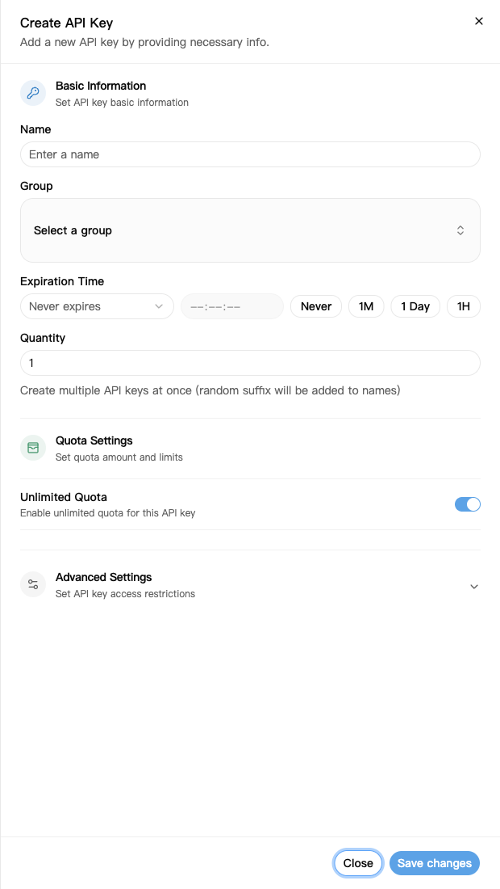
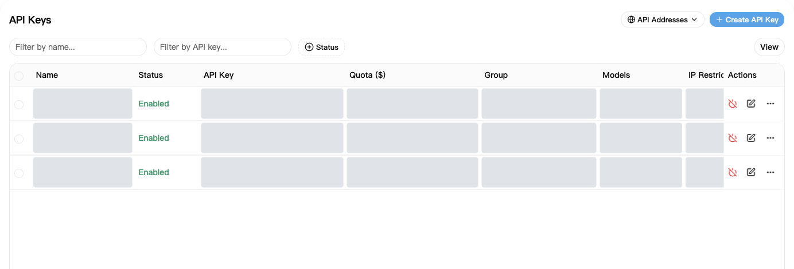
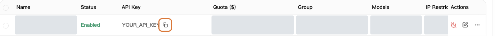

An API key is the credential your app needs to connect to NexusAPI.

## 1. Create a key

1. Open [API Keys](https://nexusapi.link/keys).
2. Click **Create API Key** at the top right.
3. Fill in the settings below.
4. Click **Save changes**.

| Setting | What to enter |
| --- | --- |
| Name | Something you recognize, such as `My computer` |
| Group | The group provided by support; ask if unsure |
| Quantity | `1` |
| Expiration time | Keep the default for a first setup |
| Quota, Advanced Settings | Keep defaults unless you have a specific need |

Gray areas hide personal data; they do not indicate unavailable features. Example groups, models and prices are subject to the live page.

Unlimited quota does not mean free usage. Requests still use your balance or plan allowance.

In Advanced Settings, **Allow querying user quota** lets an app holding this key read your account's remaining and used credits. Keep the default for your own use; before sharing a key, decide whether its holder should see this information.

## 2. Copy it into your app

1. Return to the key list and find your new key.
2. Click its copy button. Do not manually copy the masked text containing asterisks.
3. Paste the complete key into your app's **API Key** field.
4. Follow [your app's guide](/en/tools) for the address and model name.

Copy the full key using the outlined button. The key shown is a placeholder.

To copy the platform address, click **API Addresses** at the top right of the key page. Follow [your app's guide](/en/tools) to decide whether to include `/v1`; do not add paths yourself.

**Use the key created here, not an access token from Security & Access.**

## 3. If a key is exposed

Disable or delete the old key immediately, create a new one, and replace it in your app.

Do not post complete keys in chats, screenshots or public code. Support does not need your complete key.

## Change a group or key

**Changing a group does not require a new key:**

1. In [API Keys](https://nexusapi.link/keys), find the key in use and click its **Edit** button.
2. Choose an available group compatible with your app and save. If the group is missing, ask support rather than choosing at random.
3. Select the new group in [Model Square](https://nexusapi.link/pricing), check the model and price, then [update and test your app](/en/billing/models-pricing#change-model).

Editing a group does not generate a new key, but affects every program sharing it. To change just one program, create a separate key for it.

**Replacing a key:** normally, create the new key, update the app, restart and verify a request before disabling the unused old key. If a key was exposed, disable it immediately; do not wait for testing. Never send either key to support.
