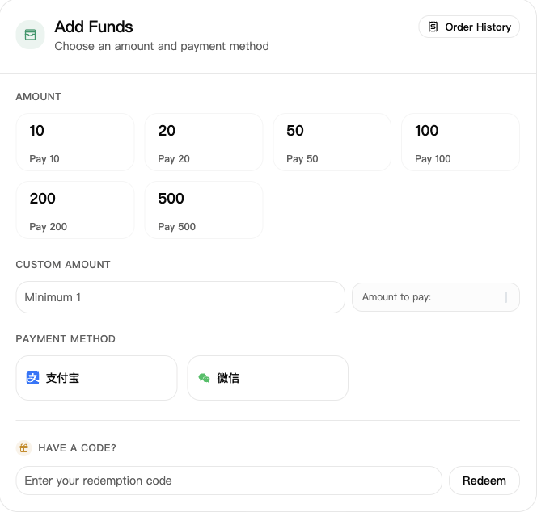

## 1. Add funds

1. Open [Wallet](https://nexusapi.link/wallet).
2. Under **Add Funds**, select an amount or enter a custom amount.
3. Check the amount payable and credits to be received, then choose a payment method.
4. Complete payment using the payment page.
5. Return to Wallet and refresh to check your balance.

The `$` balance is credit, not the amount you paid in yuan. See [multipliers and discounts](/en/billing/multipliers-and-discounts) for an example.

## 2. Codes and subscription plans

- **Redemption code:** paste it under **Have a code?** in Wallet, then click **Redeem**.
- **Subscription plan:** if plans are shown, check the duration, allowance and eligible groups before buying. A plan is different from wallet credit. Ask support before buying if unsure.

## 3. Paid, but no credit received

Refresh Wallet, then check **Order History**. If the payment is still missing, send support:

- Your login account.
- Payment time, amount and method.
- Order number and payment screenshot.

Hide sensitive details. **Do not send passwords, verification codes or complete API keys.**

## Find past payment orders

1. Open [Wallet](https://nexusapi.link/wallet) and click **Order History**.
2. If you have the order number, enter it in **Search by order number...**. Otherwise, page through records and compare payment times and amounts, then check the status. The search field does not filter by time or amount.
3. Refresh Wallet balance as well to confirm credit arrival. A payment screenshot alone does not confirm credits arrived.

| Order status | What to do next |
| --- | --- |
| Success | Refresh Wallet and check the balance. Send support the order number if unclear |
| Pending | Completion is not confirmed. If already charged, keep the receipt and ask support to check; do not pay again |
| Expired | If paid but no credits arrived, contact support. Expired does not mean the payment was refunded |

If missing or unclear, send support the payment time, order number and a redacted receipt. Do not pay again immediately. Model calls are in [Usage Logs](/en/billing/usage-and-billing), not payment orders.
