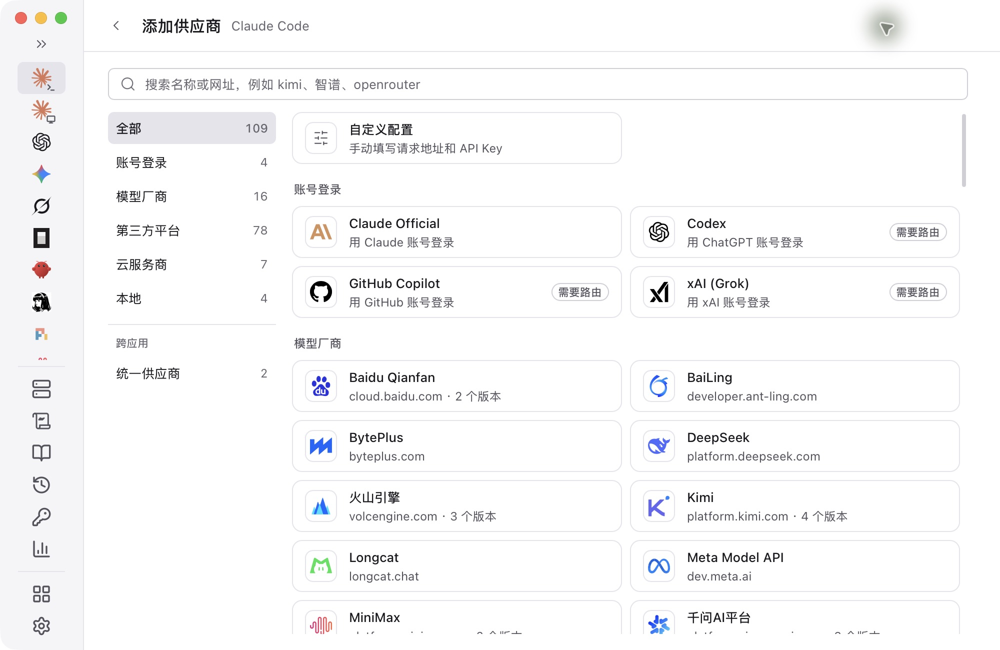
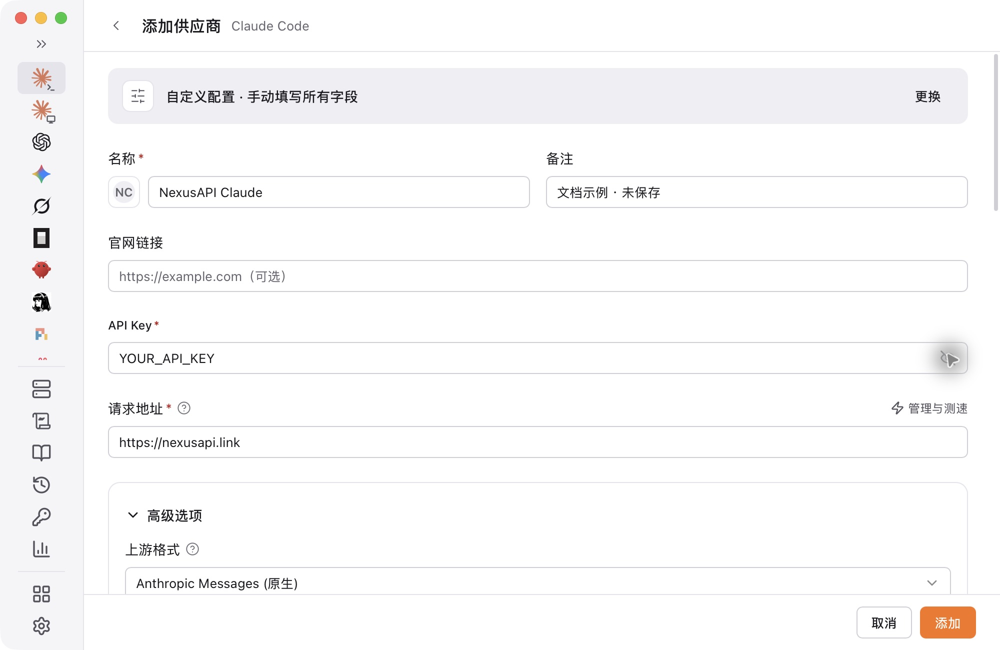
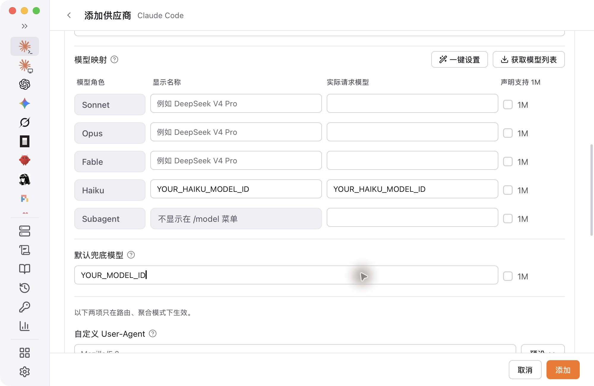

CC Switch manages settings. **First install [Claude Code](/en/tools/claude-code) or [Codex CLI](/en/tools/codex-cli), completing only that guide's installation step, then return here.** Skip if installed. No separate manual configuration is needed.

## 1. Install CC Switch

Open [official downloads](https://github.com/farion1231/cc-switch/releases/latest) and choose your system:

- Windows: use a Windows `.msi`; ARM computers need the `arm64` `.msi`.
- macOS: download the macOS `.dmg` and follow the installer.
- Linux: choose the appropriate `.deb` or `.AppImage`.

## 2. Add a custom provider

Select **Claude Code** or **Codex** in the sidebar, click **+ / Add provider** at the top right, then choose **Custom configuration**. Do not choose Claude Desktop or another site's preset.



## 3. Fill in the settings

[Create a key](/en/guide/api-key), select its group in [Model Square](https://nexusapi.link/pricing), and copy a model for your target tool. Enter the NexusAPI values in the table below:

| Field | Claude Code | Codex |
| --- | --- | --- |
| Name | NexusAPI Claude | NexusAPI Codex |
| Endpoint | `https://nexusapi.link` | `https://nexusapi.link/v1` |
| API Key | Your complete NexusAPI key | Your complete NexusAPI key |
| Primary model | Copied Claude Code / Messages model | Copied Codex / Responses model |

Claude Code: open advanced options. Put the copied main model in “默认兜底模型” (default fallback model). For Haiku, use an auxiliary model confirmed by support in the actual request model field. Replace all placeholders shown below.

Codex: use the model in the table; the Claude Code model mappings do not apply. Configure only your app, choose Direct, leave other options at defaults, then click Add / Save.



Claude Code form example. Replace placeholders; this draft was not saved or connected.



## 4. Enable and test

Click **Switch / Enable** for this NexusAPI provider. Saving alone does not switch the tool. Reopen the terminal and start the matching tool:

<Tabs>
<Tab title="Claude Code">
```bash
claude
```
</Tab>
<Tab title="Codex">
```bash
codex
```
</Tab>
</Tabs>

Send “Reply only: connection successful. Do not modify files.” Check a complete reply and the model and group in [Usage Logs](https://nexusapi.link/usage-logs/common). The test uses a little credit.

Command not found: install the CLI first. Still using the official service: check Enable and restart. Unavailable model: recopy one for your group. If the error names an auxiliary model, confirm eligible Haiku / Sonnet / Opus names. Send other errors to support with the key hidden.

Official project: [CC Switch](https://github.com/farion1231/cc-switch). Button labels can vary by version.

<span id="switch-back"></span>

## Change settings or switch back

- **Change model:** edit the active NexusAPI provider's primary model, save, confirm it remains active and restart. The new model must be available in your key's group; see [change model](/en/billing/models-pricing#change-model).
- **Switch back:** under the correct app, select the previously saved provider, click **Switch**, then restart. If it was deleted or never backed up, recover the configuration first; do not guess credentials.
- **Manual setup:** restore only the settings you changed from your own backup. Without a backup, ask support first. Do not delete the whole configuration directory or publish keys from backups.

Verify with a new request and the relevant service's usage records, not the AI's self-description.
