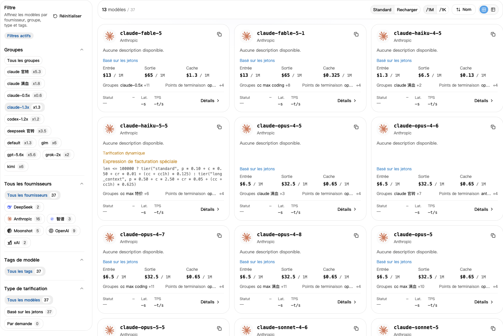
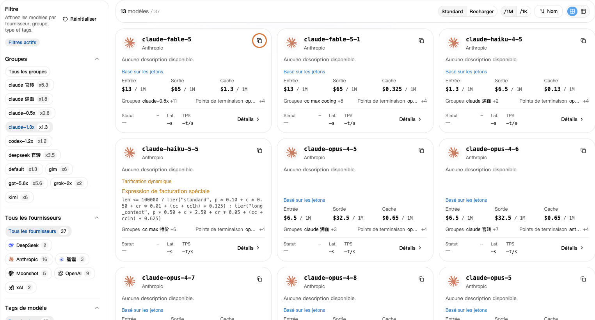

## 1. Sélectionner votre groupe

1. Dans [Clés API](https://nexusapi.link/keys), trouvez votre clé et notez son **Groupe**.
2. Ouvrez la [Place des modèles](https://nexusapi.link/pricing).
3. Sélectionnez ce même groupe à gauche.

**Ne vous fiez pas seulement à Tous les groupes. Sélectionnez votre groupe pour voir ses prix.**

## 2. Copier le nom du modèle

Recherchez votre modèle, cliquez pour copier son nom, puis collez-le dans le champ **Modèle** du logiciel. Ne le saisissez pas de mémoire.

Modèle introuvable ? Envoyez au support le **logiciel, le modèle souhaité et le groupe actuel** pour confirmer le groupe à utiliser.

Sélectionnez votre groupe, puis cliquez sur le bouton de copie en haut à droite du modèle. Le groupe et les tarifs illustrés sont des exemples ; vérifiez la page actuelle.

Compatibilité incertaine ? Consultez le [choix par logiciel](/fr/tools#choose-model) et les [protocoles](/fr/developer/model-protocols). Des noms similaires ne garantissent pas la compatibilité.

## 3. Lire le prix

- **Standard :** crédit débité lors d'un appel.
- **Recharger :** estimation du coût selon les réglages du site ; vos remises et forfaits peuvent différer.
- **`/1M` :** pour un million de tokens. **`/1K` :** pour mille tokens. Comparez avec la même unité.

Ce que vous envoyez est l'entrée ; la réponse est la sortie. Pour le cache ou d'autres frais, ouvrez **Détails**.

Si les détails indiquent des lectures ou écritures de cache, des paliers tarifaires ou des appels d'outils, consultez chaque poste applicable. Le prix d'entrée ne représente pas forcément le coût total. En cas de doute, indiquez votre modèle et votre groupe au support.

**Le prix inclut déjà le multiplicateur du groupe : ne le multipliez pas à nouveau.** Voir les [remises](/fr/billing/multipliers-and-discounts) ou les [débits réels](/fr/billing/usage-and-billing).

## 4. Vérifier la vitesse et le taux de réussite

Si les détails du modèle proposent **Performances**, consultez les données de votre groupe :

- **Délai avant le premier token :** attente avant le début de la réponse ; plus court signifie généralement plus rapide.
- **Vitesse de sortie :** tokens produits par seconde une fois la réponse commencée ; une valeur plus élevée est généralement plus rapide.
- **Taux de réussite :** part des requêtes réussies sur la période mesurée.

Ces statistiques historiques ne garantissent pas chaque appel et ne mesurent pas la qualité des réponses. L'absence de données ne signifie pas que le modèle est indisponible. Pour choisir, indiquez votre logiciel et votre usage au support.

## Changer de modèle

1. Dans la Place des modèles, choisissez le groupe de la clé et copiez un nom compatible. Pour changer de groupe, consultez d'abord le [guide des clés](/fr/guide/api-key#change-key).
2. Modifiez le champ approprié ; changer seulement de modèle ne nécessite pas une nouvelle clé :

| Configuration | Champ à modifier |
| --- | --- |
| CC Switch | Modèle principal du fournisseur NexusAPI actuel ; enregistrer et vérifier qu'il est actif |
| Claude Code manuel | `model` dans les réglages utilisateur du [guide](/fr/tools/claude-code) |
| Codex CLI manuel | `model` au début du fichier, en gardant le fournisseur NexusAPI ; voir le [guide](/fr/tools/codex-cli) |
| Extension Claude Code | `ANTHROPIC_MODEL` dans les réglages utilisateur ; voir le [guide](/fr/tools/cursor-vscode) |
| Votre programme | `model` dans la requête ; si le protocole change, adapter aussi la requête au guide de l'interface |

3. Enregistrez, redémarrez et ouvrez une nouvelle conversation : « Réponds uniquement : connexion réussie. Ne modifie aucun fichier. »
4. Vérifiez modèle et groupe dans les [journaux](https://nexusapi.link/usage-logs/common). Le test consomme du crédit. Ne demandez pas son identité à l'IA pour vérifier le routage.

Une ancienne conversation peut conserver réglages ou contexte. Sauvegardez le contenu important et vérifiez dans une nouvelle conversation.
