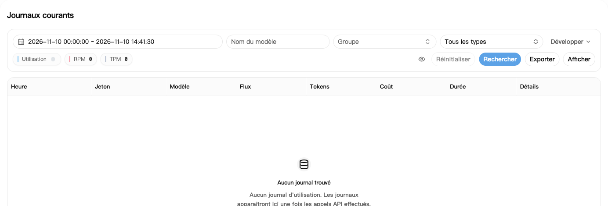
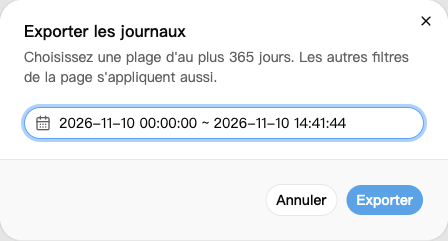

## 1. Retrouver un appel

1. Ouvrez les [journaux d'utilisation](https://nexusapi.link/usage-logs/common).
2. Sélectionnez la date et cliquez sur **Rechercher**.
3. Filtrez par modèle ou groupe si nécessaire.
4. Cliquez sur le coût ou les détails de l'appel.

Un nouvel appel peut apparaître avec un léger retard. Actualisez plus tard sans relancer l'appel.

## 2. Lire les champs utiles

| Champ | À vérifier |
| --- | --- |
| Heure, modèle, groupe | Est-ce votre appel ? |
| Tokens | Quantité utilisée ; les détails peuvent séparer entrée, sortie et cache |
| Coût | Crédit débité |
| Durée | Temps de traitement |

Une icône de forfait ou de portefeuille à côté du coût indique la source du débit. Un débit du forfait ne signifie pas que le portefeuille a aussi été débité. Survolez l'icône pour lire son libellé.

Pour les frais de cache ou d'appels d'outils, consultez les détails de la ligne ; l'entrée et la sortie seules ne suffisent pas toujours à expliquer le total.

**Un débit de `$0.10` ne signifie pas toujours 0,10 yuan payé.** Voir les [exemples de coût](/fr/billing/multipliers-and-discounts).

## 3. Télécharger les relevés d'utilisation

1. Filtrez les journaux par modèle ou groupe si nécessaire.
2. Cliquez sur **Exporter** et choisissez les dates de début et de fin.
3. Cliquez à nouveau sur **Exporter** pour télécharger un fichier CSV, lisible dans Excel.

Les autres filtres de la page s'appliquent aussi. Attendez la fin d'un export avant d'en lancer un autre.

La période maximale actuelle d'une recherche ou d'un export est de **365 jours** ; suivez la limite affichée si elle change. Cela ne garantit pas la conservation des journaux pendant 365 jours. Pour une période plus longue, procédez mois par mois.

Le fichier peut contenir des adresses IP et des identifiants de requête. Vérifiez-le et masquez les informations privées avant de le partager.

## 4. Un débit vous semble incorrect

Pour une erreur, une réponse incomplète ou un doublon suspect, envoyez au support :

- L'heure, le modèle et le groupe.
- Le texte d'erreur et si la réponse était complète.
- Une capture du journal et l’identifiant de requête (Request ID) s'il figure dans les détails.

**N'envoyez pas votre clé API complète.** Conservez les traces et évitez les tentatives répétées qui créent de nouveaux appels.
