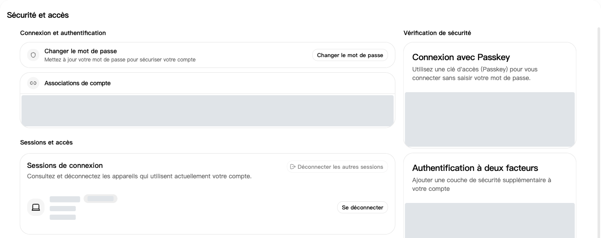
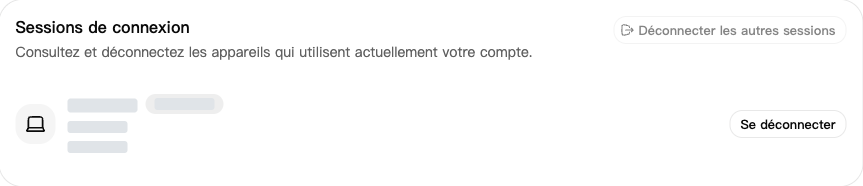
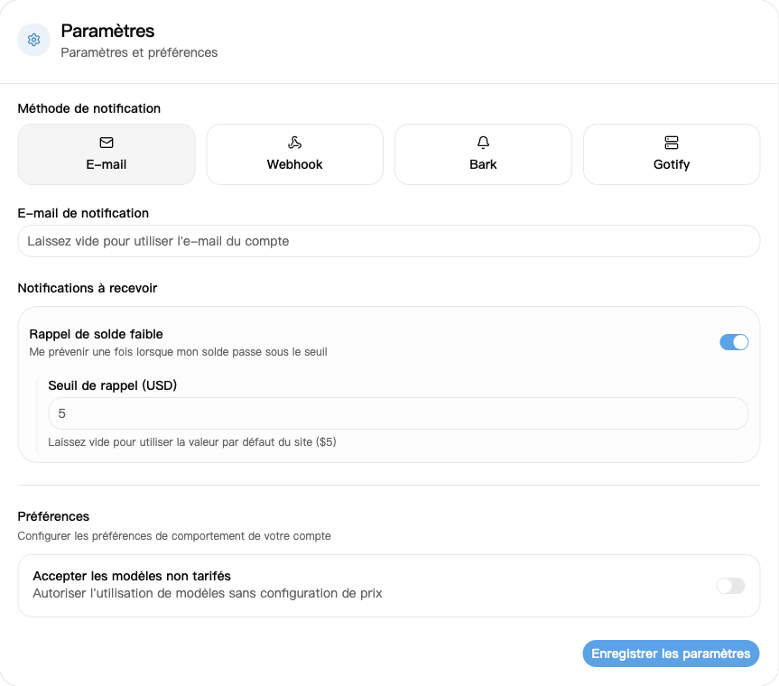

## 1. Se connecter

Ouvrez la [page de connexion](https://nexusapi.link/sign-in) et utilisez votre compte personnel. Contactez le support pour obtenir un compte ou si vous ne pouvez pas récupérer votre mot de passe.

## 2. Mot de passe et appareils

1. Ouvrez [Sécurité et accès](https://nexusapi.link/security).
2. Cliquez sur **Changer le mot de passe**, remplissez les champs et enregistrez.
3. Descendez aux **Sessions de connexion**. Révoquez les sessions inconnues, ou déconnectez les autres sessions pour quitter les autres appareils.

Sessions de connexion : vérifiez les appareils et déconnectez les sessions inconnues si nécessaire. Les informations des appareils sont masquées.

**Les logiciels de modèles utilisent une clé créée dans [Clés API](/fr/guide/api-key). Les jetons de Sécurité et accès servent aux API de gestion ; n'en créez pas pour un logiciel de modèles.**

## 3. En cas de fuite

| Situation | Action immédiate |
| --- | --- |
| Mot de passe divulgué ou connexion inconnue | Changez le mot de passe et révoquez les sessions inconnues |
| Clé API divulguée | Désactivez ou supprimez l'ancienne clé, créez-en une nouvelle et remplacez-la dans le logiciel |

**Se déconnecter du site ne désactive pas les clés API.** Ne partagez jamais vos mots de passe, codes de vérification ou clés complètes.

## 4. Configurer une alerte de solde faible

1. Ouvrez [Profil](https://nexusapi.link/profile) et cherchez les réglages de notification.
2. Choisissez **E-mail** et indiquez une adresse où vous recevez les messages. Un champ vide utilise l'adresse du compte ; renseignez-en une si le compte n'en a pas.
3. Activez **Rappel de solde faible** et saisissez le seuil, ou laissez-le vide pour utiliser la valeur du site.
4. Cliquez sur **Enregistrer les paramètres**.

Le seuil utilise l'unité de crédit affichée, pas le montant payé en yuans. L'alerte est envoyée une fois lorsque le solde passe sous le seuil, pas après chaque appel. Ne vous fiez pas uniquement aux e-mails ; vérifiez aussi votre [portefeuille](https://nexusapi.link/wallet) avant utilisation.
