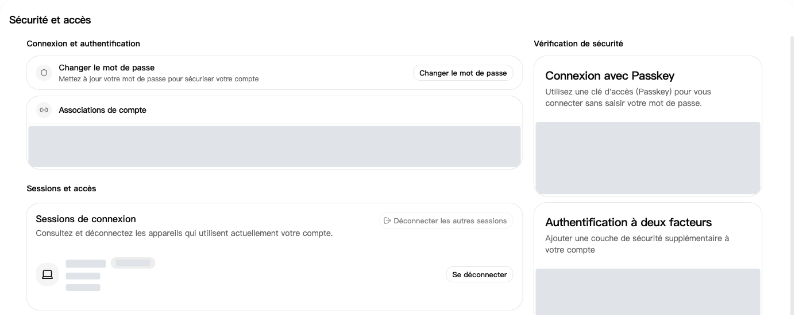
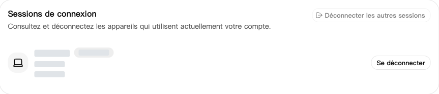
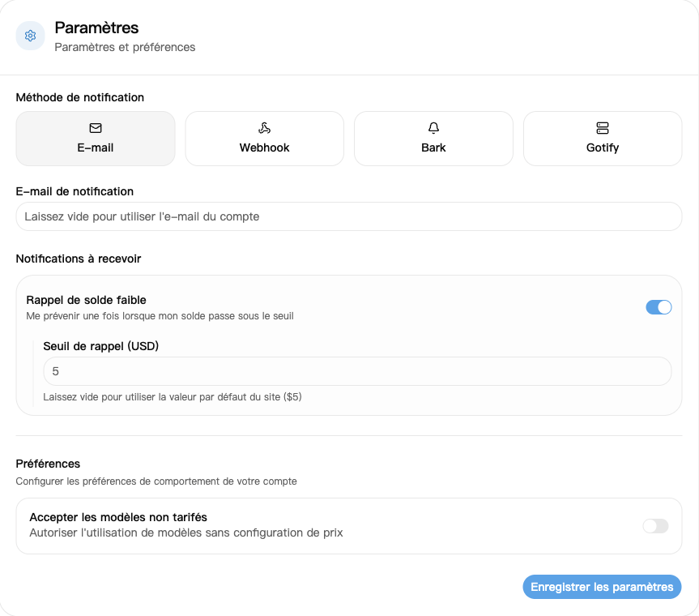

## 1. Se connecter

Ouvrez la [page de connexion](https://nexusapi.link/sign-in) et utilisez votre compte personnel. Contactez le support pour obtenir un compte ou si vous ne pouvez pas récupérer votre mot de passe.

## 2. Mot de passe et appareils

1. Ouvrez [Sécurité et accès](https://nexusapi.link/security).
2. Cliquez sur **Changer le mot de passe**, remplissez les champs et enregistrez.
3. Descendez aux **Sessions de connexion**. Révoquez les sessions inconnues, ou déconnectez les autres sessions pour quitter les autres appareils.

Sessions de connexion : vérifiez les appareils et déconnectez les sessions inconnues si nécessaire. Les informations des appareils sont masquées.

**Les logiciels de modèles utilisent une clé créée dans [Clés API](/fr/guide/api-key). Les jetons de Sécurité et accès servent aux API de gestion ; n'en créez pas pour un logiciel de modèles.**

## 3. En cas de fuite

| Situation | Action immédiate |
| --- | --- |
| Mot de passe divulgué ou connexion inconnue | Changez le mot de passe et révoquez les sessions inconnues |
| Clé API divulguée | Désactivez ou supprimez l'ancienne clé, créez-en une nouvelle et remplacez-la dans le logiciel |

**Se déconnecter du site ne désactive pas les clés API.** Ne partagez jamais vos mots de passe, codes de vérification ou clés complètes.

## 4. Configurer une alerte de solde faible

1. Ouvrez [Profil](https://nexusapi.link/profile) et cherchez les réglages de notification.
2. Choisissez **E-mail** et indiquez une adresse où vous recevez les messages. Un champ vide utilise l'adresse du compte ; renseignez-en une si le compte n'en a pas.
3. Activez **Rappel de solde faible** et saisissez le seuil, ou laissez-le vide pour utiliser la valeur du site.
4. Cliquez sur **Enregistrer les paramètres**.

Le seuil utilise l'unité de crédit affichée, pas le montant payé en yuans. L'alerte est envoyée une fois lorsque le solde passe sous le seuil, pas après chaque appel. Ne vous fiez pas uniquement aux e-mails ; vérifiez aussi votre [portefeuille](https://nexusapi.link/wallet) avant utilisation.

## Préférences d’affichage et journalisation IP

### Changer la langue

Dans [Profil](https://nexusapi.link/profile), choisissez **Langue de l'interface** et attendez la confirmation. Le choix se synchronise entre vos appareils connectés et peut changer la langue des erreurs API.

### Restaurer un menu masqué

Si **Paramètres personnels de la barre latérale** est disponible, activez les éléments voulus et cliquez sur **Enregistrer les modifications**. Pour rétablir les valeurs par défaut, cliquez sur **Réinitialiser par défaut**, puis enregistrez. Seuls les menus déjà autorisés peuvent être rétablis ; aucun droit supplémentaire n’est accordé. Contactez le support si l’option manque.

### Enregistrer les IP sources

Dans [Sécurité et accès](https://nexusapi.link/security), réglez **Enregistrer l'adresse IP**, puis enregistrez les paramètres. Cela concerne les prochains journaux de consommation et d’erreurs, sans compléter les anciennes IP absentes.

**Journaliser une IP n’est pas la mettre sur liste blanche.** La journalisation conserve la source ; la [liste blanche](/fr/guide/ip-whitelist) limite séparément les sources d’une clé. Activer l’enregistrement n’empêche pas autrui d’utiliser la clé.

### Vérifier vos propres opérations

Si **Journaux d’audit** est disponible dans le menu :

1. Ouvrez les [journaux d’audit](https://nexusapi.link/usage-logs/audit) et choisissez la période.
2. Pour affiner, choisissez **Catégorie** ou **Résultat**, puis **Rechercher**.
3. Vérifiez l’heure, l’opération et le résultat. Réinitialisez ensuite les filtres.

Cette page concerne votre propre compte. Les appels de modèles et leurs coûts sont dans les [journaux d’utilisation](/fr/billing/usage-and-billing), pas dans l’audit.

## Activer l’authentification à deux facteurs

Si [Sécurité et accès](https://nexusapi.link/security) affiche **Authentification à deux facteurs** :

1. Cliquez sur **Activer** et effectuez la vérification de sécurité demandée.
2. Scannez le QR code avec une application d’authentification et suivez les étapes.
3. **Conservez d’abord les codes de secours en lieu sûr**, puis saisissez le code actuel de l’application et terminez **Activer 2FA**.
4. Vérifiez l’état activé. À la connexion, suivez les demandes de code ; sans téléphone, chaque code de secours s’utilise une seule fois.

Pour remplacer les codes, utilisez **Régénérer les codes de secours**, vérifiez votre identité et conservez les nouveaux. **Tous les anciens deviennent invalides.** Ne transmettez ni QR code, ni secret de configuration, ni codes au support ou dans une capture. En cas d’échec, contactez le support sans multiplier les essais ni supprimer le compte.
