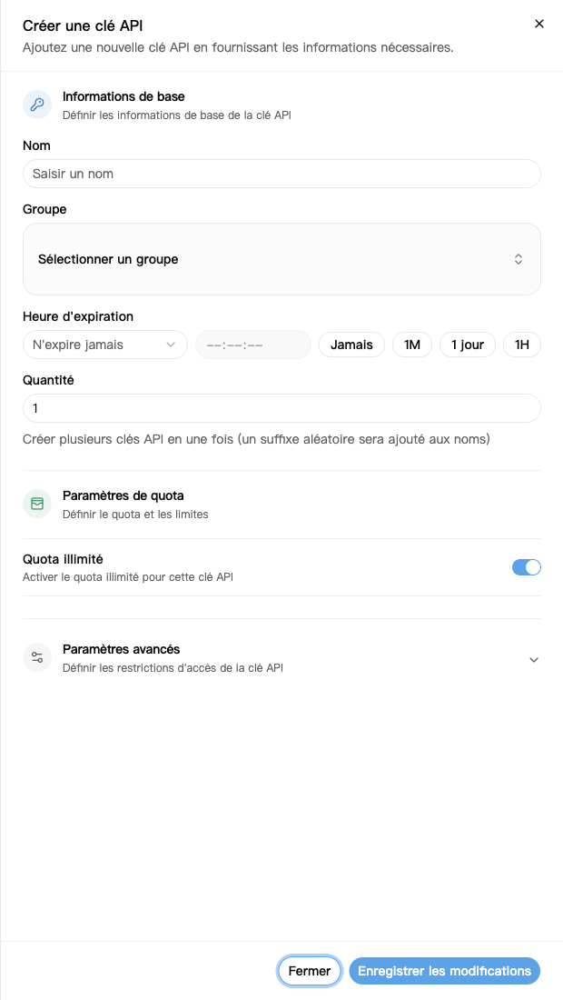
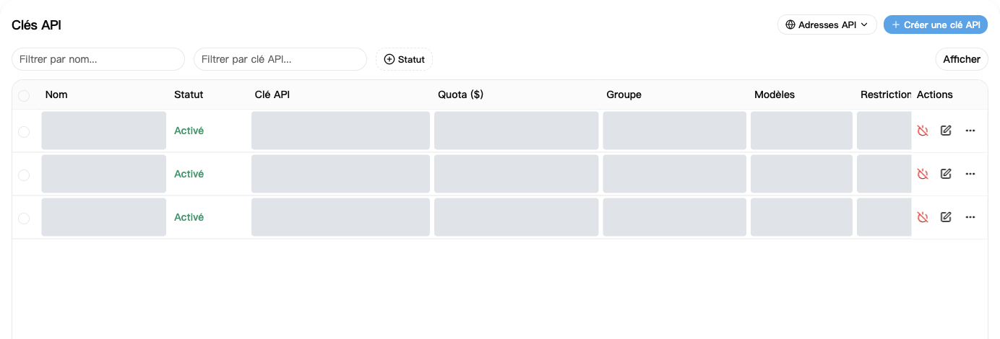
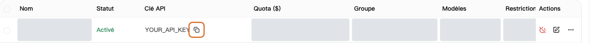

La clé API est la clé à saisir dans votre logiciel pour accéder à NexusAPI.

Pour limiter une clé à certains ordinateurs ou serveurs, suivez le [guide de la liste blanche IP](/fr/guide/ip-whitelist).

## 1. Créer une clé

1. Ouvrez [Clés API](https://nexusapi.link/keys).
2. Cliquez sur **Créer une clé API**, en haut à droite.
3. Remplissez les champs ci-dessous.
4. Cliquez sur **Enregistrer les modifications**.

| Champ | Quoi saisir |
| --- | --- |
| Nom | Un nom reconnaissable, par exemple `Mon ordinateur` |
| Groupe | Celui fourni par le support ; demandez si vous hésitez |
| Quantité | `1` |
| Expiration | Gardez la valeur par défaut pour commencer |
| Quota, paramètres avancés | Gardez les valeurs par défaut, sauf besoin particulier |

Les zones grises masquent les données personnelles et ne signalent pas une fonction indisponible. Vérifiez les groupes, modèles et prix sur la page actuelle.

Un quota illimité ne signifie pas gratuit : les appels consomment le solde ou le forfait.

Dans les paramètres avancés, **Autoriser la consultation du quota utilisateur** permet au logiciel détenant cette clé de consulter les crédits restants et utilisés de votre compte. Gardez la valeur par défaut pour votre usage personnel ; avant de partager une clé, vérifiez si son détenteur doit voir ces informations.

## 2. Copier la clé dans le logiciel

1. Revenez à la liste et trouvez votre nouvelle clé.
2. Cliquez sur le bouton de copie. Ne recopiez pas le texte masqué avec des astérisques.
3. Collez la clé complète dans le champ **API Key** du logiciel.
4. Pour l'adresse et le modèle, suivez le [guide du logiciel](/fr/tools).

Copiez la clé complète avec le bouton encadré. La clé affichée est un exemple fictif.

Pour copier l'adresse de la plateforme, cliquez sur **Adresses API** en haut à droite de la page des clés. Suivez le [guide du logiciel](/fr/tools) pour savoir s'il faut inclure `/v1` ; n'ajoutez pas de chemin vous-même.

**Utilisez cette clé, pas un jeton d'accès de Sécurité et accès.**

**Copier les infos de connexion**, dans le menu de la ligne, copie l’adresse et la clé complète. **Ce n’est pas un lien à partager publiquement.** Utilisez-le uniquement dans un logiciel de confiance prenant explicitement en charge ce format ; sinon, copiez la clé séparément. N’envoyez pas ces informations dans un groupe ni au support.

## 3. Si la clé a été divulguée

Désactivez ou supprimez immédiatement l'ancienne clé, créez-en une nouvelle et remplacez-la dans le logiciel.

Ne publiez jamais la clé complète dans une discussion, une capture ou du code public. Le support n'en a pas besoin.

## Changer de groupe ou de clé

**Changer de groupe ne nécessite pas une nouvelle clé :**

1. Dans [Clés API](https://nexusapi.link/keys), trouvez la clé utilisée et cliquez sur **Modifier**.
2. Choisissez un groupe autorisé et compatible avec votre logiciel, puis enregistrez. S'il manque, demandez au support plutôt que de choisir au hasard.
3. Dans la [Place des modèles](https://nexusapi.link/pricing), sélectionnez le nouveau groupe, vérifiez modèle et prix, puis [modifiez et testez le logiciel](/fr/billing/models-pricing#change-model).

Modifier le groupe ne génère pas une nouvelle clé, mais affecte tous les programmes qui la partagent. Pour n'en changer qu'un, créez-lui une clé séparée.

**Remplacer la clé :** créez la nouvelle, remplacez-la dans le logiciel, redémarrez et vérifiez un appel avant de désactiver l'ancienne devenue inutile. En cas de fuite, désactivez immédiatement l'ancienne sans attendre le test. N'envoyez aucune des clés au support.

Si le groupe affiche **Groupe utilisateur**, **Hérité**, **Inter-groupes** ou `auto`, faites confirmer les groupes, modèles et coûts par le support. Ne supposez pas un multiplicateur fixe et ne changez pas de groupe pour simplement reproduire un exemple.

## Régler quota, expiration et modèles autorisés

1. Dans [Clés API](https://nexusapi.link/keys), trouvez la clé et cliquez sur **Modifier**.
2. Modifiez uniquement les champs nécessaires ci-dessous.
3. Enregistrez les modifications. Tous les logiciels partageant cette clé sont concernés.

| Restriction | Réglage |
| --- | --- |
| Crédit restant de la clé | Dans **Paramètres de quota**, désactivez **Quota illimité** et saisissez la quantité dans l’unité affichée |
| Date limite | Choisissez date et heure dans **Heure d'expiration**, ou cliquez sur **Jamais** pour aucune échéance |
| Modèles autorisés | Dans **Paramètres avancés**, sélectionnez les modèles sous **Limites du modèle** |
| IP sources | Suivez le [guide IP](/fr/guide/ip-whitelist) |

**Le quota correspond au restant, pas à un paiement ni à une somme à ajouter.** Si le champ affiche `$`, saisir `10` fixe le restant à `$10` de crédits du compte, pas à 10 CNY ni à 10 ajoutés au précédent quota. Suivez l’unité affichée.

Ce n’est pas un budget réinitialisé chaque mois. Le compte doit toujours avoir du solde ou un forfait applicable. Le quota illimité retire seulement la limite propre à cette clé.

Vider toutes les sélections de modèles retire la restriction supplémentaire de la clé, **sans débloquer les modèles absents de son groupe**. Pour changer de modèle ou de groupe, suivez les étapes précédentes.

Utilisez des clés distinctes et reconnaissables pour chaque logiciel, par exemple `Ordinateur bureau` et `Application serveur`. Évitez de partager temporairement une clé illimitée et sans expiration.

Si Claude Code utilise des modèles auxiliaires, autorisez également ceux dont la disponibilité a été confirmée. N’autoriser que le modèle principal peut faire échouer certaines opérations. Utilisez les noms du [guide](/fr/tools/claude-code) ou confirmés par le support.

## Suspendre, réactiver ou supprimer une clé

- **Suspendre** : cliquez sur le bouton d’alimentation **Désactiver**, puis vérifiez l’état **Désactivé** sur la ligne. Les requêtes suivantes avec cette clé seront refusées.
- **Réactiver** : utilisez **Activer** au même endroit. Si elle est expirée ou épuisée, modifiez d’abord la date ou le quota restant, enregistrez, puis activez. Des clics répétés ne corrigent pas ces limites.
- **Retirer définitivement de l’usage** : choisissez **Supprimer** dans le menu de la ligne après avoir vérifié qu’aucun logiciel n’en dépend, puis suivez la confirmation. Ce n’est pas une pause temporaire.

Fermer le navigateur ou se déconnecter ne désactive pas la clé. En cas de consommation suspecte, désactivez-la d’abord, puis [vérifiez ses journaux](/fr/billing/usage-and-billing#find-key-usage).

### Une clé ne fonctionne pas : quatre vérifications

| Vérification | Action |
| --- | --- |
| Désactivation ou expiration | Retrouvez la clé réellement utilisée et vérifiez son état et son échéance |
| Crédit disponible | Vérifiez le portefeuille et le quota restant de la clé. Un quota illimité ne signifie pas un compte approvisionné |
| Modèle autorisé | Vérifiez les modèles du groupe et les limites de la clé, y compris les auxiliaires nécessaires à Claude Code |
| IP autorisée | Si l’erreur refuse explicitement l’IP, vérifiez la sortie réelle selon le [guide](/fr/guide/ip-whitelist). N’autorisez pas toutes les IP |

Si l’échec persiste, conservez l’erreur exacte et suivez le [dépannage](/fr/faq/self-check). Ne multipliez pas les essais et n’envoyez jamais la clé complète au support.
