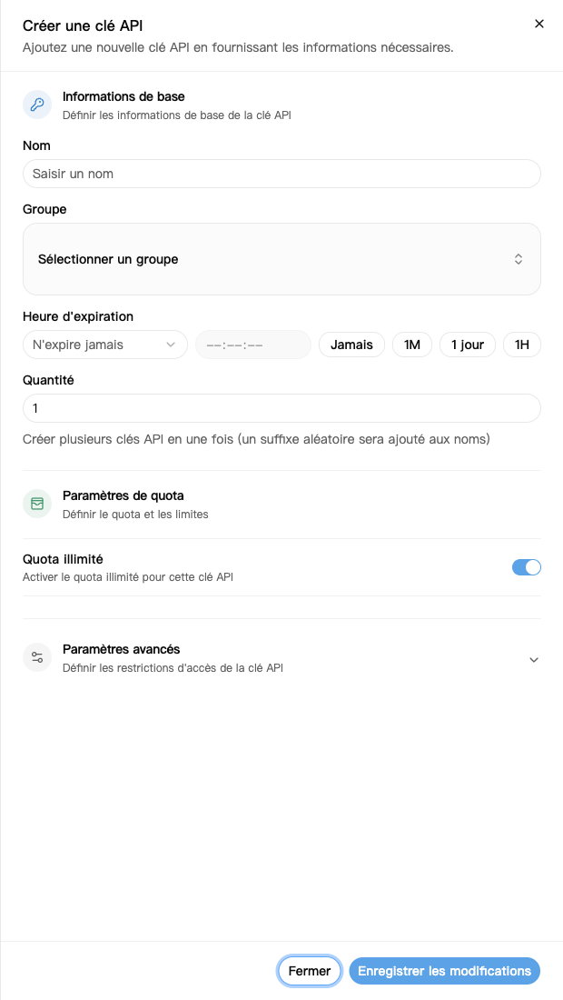
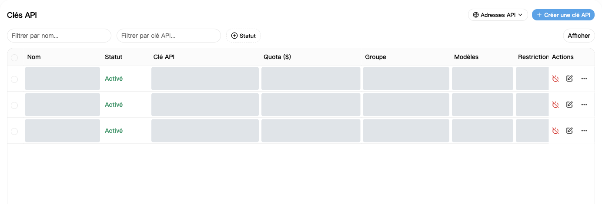
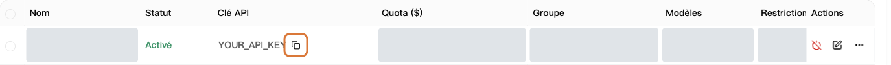

La clé API est la clé à saisir dans votre logiciel pour accéder à NexusAPI.

## 1. Créer une clé

1. Ouvrez [Clés API](https://nexusapi.link/keys).
2. Cliquez sur **Créer une clé API**, en haut à droite.
3. Remplissez les champs ci-dessous.
4. Cliquez sur **Enregistrer les modifications**.

| Champ | Quoi saisir |
| --- | --- |
| Nom | Un nom reconnaissable, par exemple `Mon ordinateur` |
| Groupe | Celui fourni par le support ; demandez si vous hésitez |
| Quantité | `1` |
| Expiration | Gardez la valeur par défaut pour commencer |
| Quota, paramètres avancés | Gardez les valeurs par défaut, sauf besoin particulier |

Les zones grises masquent les données personnelles et ne signalent pas une fonction indisponible. Vérifiez les groupes, modèles et prix sur la page actuelle.

Un quota illimité ne signifie pas gratuit : les appels consomment le solde ou le forfait.

Dans les paramètres avancés, **Autoriser la consultation du quota utilisateur** permet au logiciel détenant cette clé de consulter les crédits restants et utilisés de votre compte. Gardez la valeur par défaut pour votre usage personnel ; avant de partager une clé, vérifiez si son détenteur doit voir ces informations.

## 2. Copier la clé dans le logiciel

1. Revenez à la liste et trouvez votre nouvelle clé.
2. Cliquez sur le bouton de copie. Ne recopiez pas le texte masqué avec des astérisques.
3. Collez la clé complète dans le champ **API Key** du logiciel.
4. Pour l'adresse et le modèle, suivez le [guide du logiciel](/fr/tools).

Copiez la clé complète avec le bouton encadré. La clé affichée est un exemple fictif.

Pour copier l'adresse de la plateforme, cliquez sur **Adresses API** en haut à droite de la page des clés. Suivez le [guide du logiciel](/fr/tools) pour savoir s'il faut inclure `/v1` ; n'ajoutez pas de chemin vous-même.

**Utilisez cette clé, pas un jeton d'accès de Sécurité et accès.**

## 3. Si la clé a été divulguée

Désactivez ou supprimez immédiatement l'ancienne clé, créez-en une nouvelle et remplacez-la dans le logiciel.

Ne publiez jamais la clé complète dans une discussion, une capture ou du code public. Le support n'en a pas besoin.

## Changer de groupe ou de clé

**Changer de groupe ne nécessite pas une nouvelle clé :**

1. Dans [Clés API](https://nexusapi.link/keys), trouvez la clé utilisée et cliquez sur **Modifier**.
2. Choisissez un groupe autorisé et compatible avec votre logiciel, puis enregistrez. S'il manque, demandez au support plutôt que de choisir au hasard.
3. Dans la [Place des modèles](https://nexusapi.link/pricing), sélectionnez le nouveau groupe, vérifiez modèle et prix, puis [modifiez et testez le logiciel](/fr/billing/models-pricing#change-model).

Modifier le groupe ne génère pas une nouvelle clé, mais affecte tous les programmes qui la partagent. Pour n'en changer qu'un, créez-lui une clé séparée.

**Remplacer la clé :** créez la nouvelle, remplacez-la dans le logiciel, redémarrez et vérifiez un appel avant de désactiver l'ancienne devenue inutile. En cas de fuite, désactivez immédiatement l'ancienne sans attendre le test. N'envoyez aucune des clés au support.
