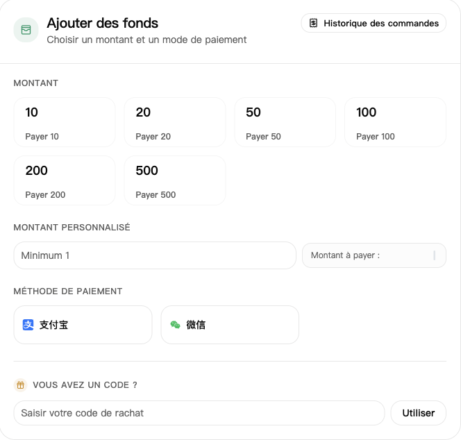

## 1. Ajouter des fonds

1. Ouvrez le [Portefeuille](https://nexusapi.link/wallet).
2. Dans **Ajouter des fonds**, choisissez un montant ou saisissez-le.
3. Vérifiez le montant à payer et le crédit reçu, puis choisissez le moyen de paiement.
4. Suivez les instructions de paiement.
5. Revenez au portefeuille et actualisez pour vérifier le solde.

Le solde en `$` est du crédit, pas le montant payé en yuans. Voir les [exemples de remises](/fr/billing/multipliers-and-discounts).

## 2. Codes et abonnements

- **Code d’échange :** collez-le dans le champ prévu dans le Portefeuille, puis cliquez sur **Utiliser**.
- **Abonnement :** si des forfaits sont proposés, vérifiez la durée, le crédit inclus et les groupes autorisés. Un forfait n'est pas le solde du portefeuille. Demandez au support avant d'acheter si vous hésitez.

## 3. Paiement effectué, crédit absent

Actualisez le portefeuille, puis consultez **Historique des commandes**. Si le crédit manque toujours, envoyez au support :

- Votre compte de connexion.
- L'heure, le montant et le moyen de paiement.
- Le numéro de commande et une capture du paiement.

Masquez les données sensibles. **N'envoyez ni mot de passe, ni code de vérification, ni clé API complète.**

## Consulter les anciens paiements

1. Ouvrez le [portefeuille](https://nexusapi.link/wallet), puis l’historique des commandes.
2. Si vous avez le numéro, saisissez-le dans **Rechercher par numéro de commande...**. Sinon, parcourez les pages et comparez heures et montants, puis vérifiez l’état. Le champ de recherche ne filtre pas par date ou montant.
3. Actualisez aussi le solde pour confirmer le crédit. Une capture du paiement ne confirme pas à elle seule le crédit du compte.

| État de la commande | Suite à donner |
| --- | --- |
| Succès | Actualisez le portefeuille et vérifiez le solde. En cas de doute, donnez le numéro au support |
| En attente | La finalisation n’est pas confirmée. Si déjà débité, conservez le justificatif et contactez le support, sans repayer |
| Expiré | Si vous avez payé sans recevoir les crédits, contactez le support. Cet état ne signifie pas un remboursement |

En cas d’absence ou de doute, transmettez l’heure, le numéro et un justificatif masqué au support, sans payer immédiatement à nouveau. Les appels de modèles sont dans les [journaux](/fr/billing/usage-and-billing), pas les commandes de paiement.
