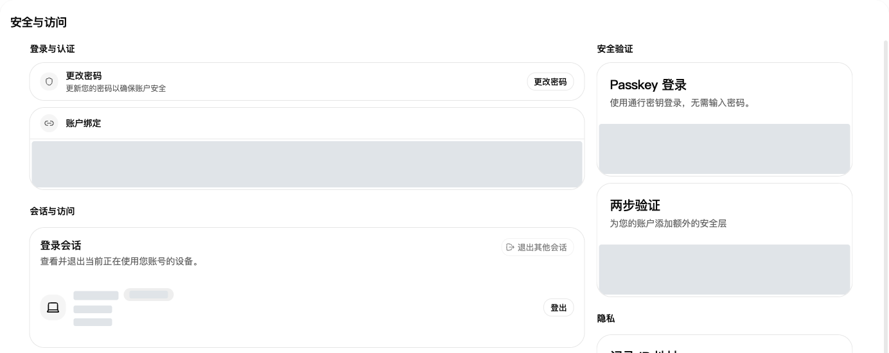
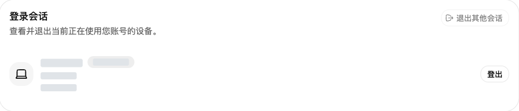
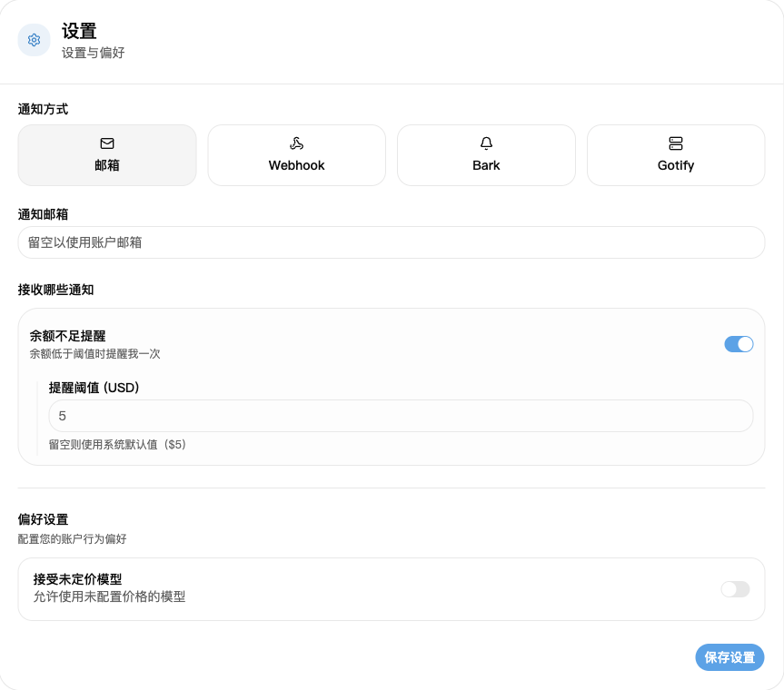

## 1. 登录账号

打开[登录页](https://nexusapi.link/sign-in)，输入自己的账号和密码。还没有账号，或无法找回密码，请联系客服。

## 2. 修改密码、查看登录设备

1. 打开[安全与访问](https://nexusapi.link/security)。
2. 修改密码：点击“更改密码”，按提示填写并保存。
3. 查看设备：向下找到“登录会话”。有不认识的设备，撤销对应会话；要退出其他设备，选择“退出其他会话”。

登录会话：检查设备，必要时退出陌生会话。图中设备信息已隐藏。

**配置模型软件，只用 [API 密钥](/guide/api-key)页创建的 Key。“安全与访问”里的访问令牌用于管理接口，不用为模型软件创建或填写。**

## 3. 怀疑账号或密钥泄露

| 情况 | 立即做什么 |
| --- | --- |
| 密码泄露或出现陌生登录 | 修改密码，退出陌生设备的登录会话 |
| API Key 泄露 | 在 API 密钥页停用或删除旧 Key，创建新 Key，再替换软件配置 |

**只退出网页登录，不会停用 API Key。** 不要把密码、验证码或完整 Key 发给任何人。

## 4. 设置余额不足提醒

1. 打开[个人资料](https://nexusapi.link/profile)，找到通知设置。
2. 选择“邮箱”，填能收到邮件的通知邮箱；留空时使用账号邮箱，没有邮箱先填写。
3. 开启“余额不足提醒”，填写提醒阈值；不确定填多少，留空使用站点默认值。
4. 点击“保存设置”。

阈值按页面显示的额度单位填写，不是人民币充值金额。余额从阈值以上降到以下时提醒一次，不会每次调用都提醒；不要只靠邮件判断余额，使用前仍可到[钱包](https://nexusapi.link/wallet)查看。
