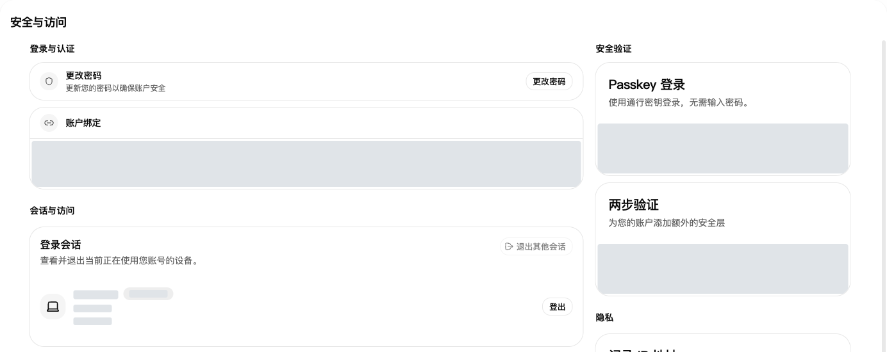
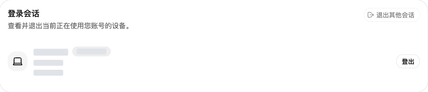
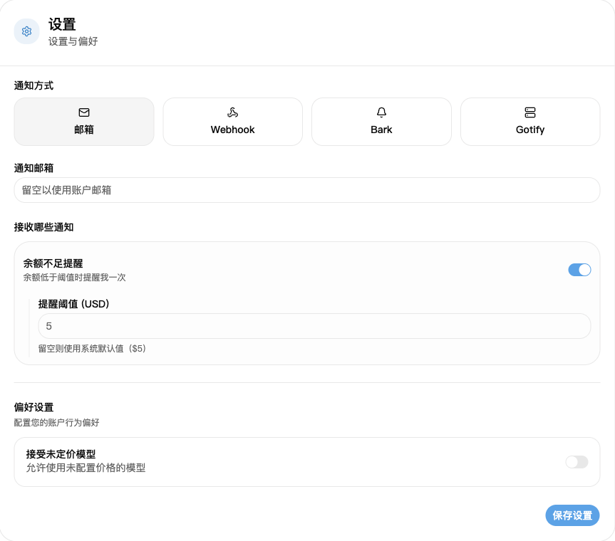

## 1. 登录账号

打开[登录页](https://nexusapi.link/sign-in)，输入自己的账号和密码。还没有账号，或无法找回密码，请联系客服。

## 2. 修改密码、查看登录设备

1. 打开[安全与访问](https://nexusapi.link/security)。
2. 修改密码：点击“更改密码”，按提示填写并保存。
3. 查看设备：向下找到“登录会话”。有不认识的设备，撤销对应会话；要退出其他设备，选择“退出其他会话”。

登录会话：检查设备，必要时退出陌生会话。图中设备信息已隐藏。

**配置模型软件，只用 [API 密钥](/guide/api-key)页创建的 Key。“安全与访问”里的访问令牌用于管理接口，不用为模型软件创建或填写。**

## 3. 怀疑账号或密钥泄露

| 情况 | 立即做什么 |
| --- | --- |
| 密码泄露或出现陌生登录 | 修改密码，退出陌生设备的登录会话 |
| API Key 泄露 | 在 API 密钥页停用或删除旧 Key，创建新 Key，再替换软件配置 |

**只退出网页登录，不会停用 API Key。** 不要把密码、验证码或完整 Key 发给任何人。

## 4. 设置余额不足提醒

1. 打开[个人资料](https://nexusapi.link/profile)，找到通知设置。
2. 选择“邮箱”，填能收到邮件的通知邮箱；留空时使用账号邮箱，没有邮箱先填写。
3. 开启“余额不足提醒”，填写提醒阈值；不确定填多少，留空使用站点默认值。
4. 点击“保存设置”。

阈值按页面显示的额度单位填写，不是人民币充值金额。余额从阈值以上降到以下时提醒一次，不会每次调用都提醒；不要只靠邮件判断余额，使用前仍可到[钱包](https://nexusapi.link/wallet)查看。

## 个人显示设置与 IP 记录

### 修改界面语言

打开[个人资料](https://nexusapi.link/profile)，在“界面语言”选择语言，等待保存成功。这个设置会同步到已登录设备，也可能改变 API 错误消息的语言。

### 恢复被隐藏的菜单

如果个人资料中有“左侧边栏个人设置”，开启需要的项目并点击“保存更改”；需要恢复默认时，点“重置为默认”后再保存。只能恢复账号已开放的菜单，不能增加权限。没有目标选项时联系客服。

### 记录调用来源 IP

在[安全与访问](https://nexusapi.link/security)的“记录 IP 地址”区域，打开或关闭开关，再点击“保存设置”。它决定后续用量、错误日志是否记录来源 IP；不会补写旧记录中缺失的 IP。

**“记录 IP 地址”不是“IP 白名单”。** 前者用于日志记录，后者限制 Key 的调用来源，按 [IP 白名单教程](/guide/ip-whitelist)单独设置。不要以为打开记录就能阻止别人用 Key。

### 查看自己的操作记录

如果菜单显示“审计日志”，可查看自己账号的操作：

1. 打开[审计日志](https://nexusapi.link/usage-logs/audit)，选择要核对的时间范围。
2. 需要缩小范围时，选择“分类”或“结果”，再点“搜索”。
3. 核对时间、操作和结果。查完点“重置”，避免旧筛选影响下次查看。

这里只查自己账号的操作。模型调用和扣费明细仍查[使用日志](/billing/usage-and-billing)，不要把两种日志混在一起。

## 设置两步验证

如果[安全与访问](https://nexusapi.link/security)显示“两步验证”，可以增加登录保护：

1. 点击该区域的“启用”，按弹窗完成安全验证。
2. 用验证器应用扫描设置二维码，按页面步骤操作。
3. **先妥善保存页面提供的备用代码**，再输入验证器的当前验证码，完成“启用 2FA”。
4. 回到页面确认状态为已启用。以后登录按提示输入验证码；手机不可用时，备用代码每个只能使用一次。

更换备用代码用“重新生成备用代码”，按提示验证身份并保存新代码；**旧备用代码会全部失效**。二维码、设置密钥和备用代码都不要发给客服或放进截图。无法完成验证时联系客服，不要反复尝试或自行删除账号。
