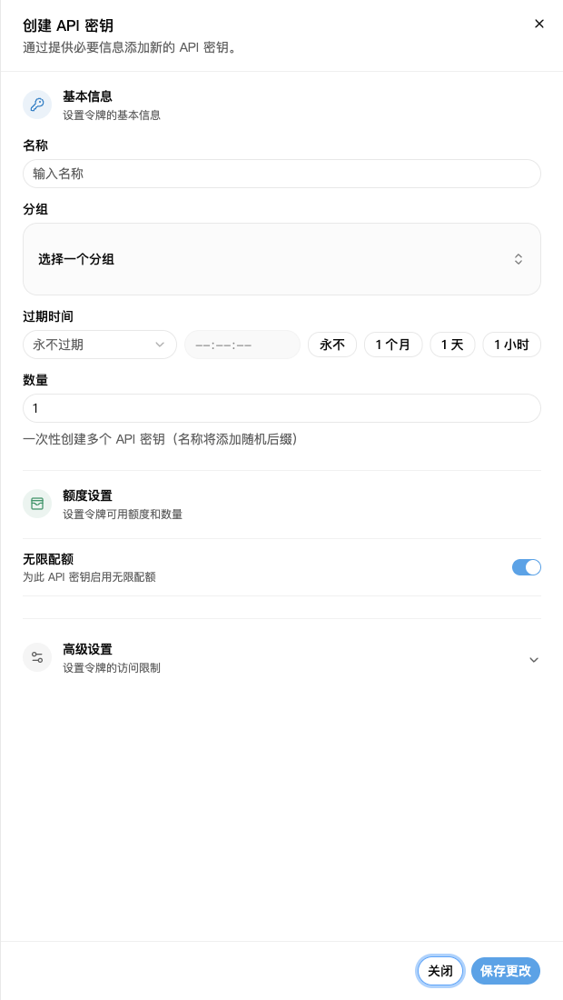
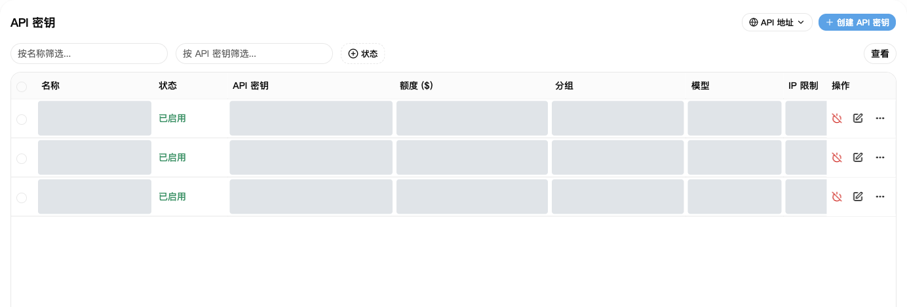

API 密钥就是软件连接 NexusAPI 时要填的 Key。

需要只允许指定电脑或服务器使用 Key？按 [IP 白名单设置教程](/guide/ip-whitelist)填写。

## 1. 创建密钥

1. 打开 [API 密钥](https://nexusapi.link/keys)。
2. 点击右上角“创建 API 密钥”。
3. 按下表填写。
4. 点击“保存更改”。

| 项目 | 怎么填 |
| --- | --- |
| 名称 | 自己能认出来即可，例如 `我的电脑` |
| 分组 | 选客服提供的分组；不知道选哪个，先问客服 |
| 创建数量 | 填 `1` |
| 过期时间 | 第一次使用可保持默认 |
| 配额、高级设置 | 没有特殊要求，保持默认 |

截图中的灰色区域是已隐藏的个人数据，不代表功能不可用。示例分组、模型和价格以实际页面为准。

“无限配额”不代表免费，调用仍会扣除账户余额或套餐额度。

高级设置里的“允许查询用户额度”：开启后，持有这把 Key 的软件可以查询你的账户剩余和已用额度。自己使用可保持默认；分享 Key 前，先确认是否允许对方查看这些信息。

## 2. 复制到软件

1. 回到密钥列表，找到刚创建的密钥。
2. 点击复制按钮，复制完整 Key，不要手动抄带星号的文字。
3. 粘贴到软件的“API Key”一栏。
4. 地址和模型名称，照[对应软件教程](/tools)填写。

复制完整 Key：点框出的复制按钮；图中 Key 为占位符。

需要复制平台地址时，点击密钥页右上角的“API 地址”。软件是否要加 `/v1`，仍按[对应软件教程](/tools)填写，不要自己拼接路径。

**用这里创建的 Key，不要用“安全与访问”里的访问令牌。**

更多菜单中的“复制连接信息”会同时复制地址和完整 Key，**不是可以公开分享的普通链接**。只有你信任的软件明确支持这种导入格式时才使用；普通配置按上面的步骤单独复制 Key。不要把连接信息发到群里或交给客服。

## 3. 密钥泄露了怎么办

立即在密钥列表停用或删除旧 Key，重新创建一个，再替换软件里的 Key。

不要把完整 Key 发到群里、截图里或公开代码里。客服也不需要你的完整 Key。

## 更换分组或 Key

**改分组，不必重新创建 Key：**

1. 在 [API 密钥](https://nexusapi.link/keys)找到正在使用的 Key，点击该行“编辑”。
2. 在“分组”中选择已向你开放、适用于目标软件的分组，保存更改。找不到目标分组先联系客服，不要随便选。
3. 到[模型广场](https://nexusapi.link/pricing)选新分组，确认模型和价格，再按[换模型步骤](/billing/models-pricing#change-model)修改软件并测试。

编辑分组不会生成新 Key，但会影响所有共用这把 Key 的程序。只想改一个程序时，给它单独创建一把 Key 更容易管理。

如果分组显示“跟随用户”“继承”“跨分组”或 `auto`，先向客服确认实际可用分组、模型和费用，不要按一个固定倍率猜价格，也不要为了跟教程一致随意改组。

**换 Key：** 正常更换时，先创建新 Key，替换软件里的旧 Key，重启并确认调用成功后，再停用不再需要的旧 Key。Key 已泄露时，立即停用旧 Key，不要等测试结束。不要把新旧 Key 发给客服。

## 设置额度、有效期和模型限制

1. 在 [API 密钥](https://nexusapi.link/keys)找到目标 Key，点击“编辑”。
2. 按下表修改需要限制的项目，其他不动。
3. 点击“保存更改”。修改会影响所有共用这把 Key 的软件。

| 想限制什么 | 怎么设置 |
| --- | --- |
| 这把 Key 还能用多少 | 在“额度设置”关闭“无限配额”，按字段显示的单位填写额度 |
| 用到什么时候 | 在“过期时间”选择日期和时间；不设期限则点“永不” |
| 只能用哪些模型 | 展开“高级设置”，在“模型限制”中选择允许的模型 |
| 只能从哪些 IP 调用 | 按 [IP 白名单教程](/guide/ip-whitelist)填写 |

**额度填的是剩余可用量，不是充值金额，也不是追加金额。** 例如字段单位为 `$`，填 `10` 表示这把 Key 剩余 `$10` 账户额度；不是人民币 10 元，也不是在原额度上再加 10。以页面实际显示单位为准。

这不是每月自动重置的预算。Key 有额度，也仍需账号有可用余额或适用套餐；开启“无限配额”只是取消这把 Key 自身的额度限制。

“模型限制”全部取消选择，表示不对这把 Key 额外限制模型，**不会解锁其分组没有的模型**。想换模型或分组，按上面的更换步骤操作。

Claude Code 需要调用辅助模型时，允许列表也要包含已确认可用的辅助模型；只选主模型可能导致部分操作报错。具体名称按[软件教程](/tools/claude-code)或客服确认结果填写。

建议不同软件使用不同名称的 Key，例如 `办公电脑`、`服务器应用`，便于分别查看消耗和停用。不要给临时共享的 Key 开无限额度且永不过期。

## 暂停、恢复或删除 Key

- **临时不用**：在密钥列表找到提示为“禁用”的电源按钮，点击后确认该行状态变为“已禁用”。软件后续用这把 Key 调用会被拒绝。
- **恢复使用**：点击同一位置的“启用”。若提示到期或额度耗尽，先编辑有效期或剩余额度、保存，再启用；反复点启用不能解决这些限制。
- **不再使用**：在该行更多菜单中选“删除”，确认没有其他软件依赖它后再按提示操作。不要把删除当成临时暂停。

只关闭浏览器或退出网站不会停用 Key。怀疑消耗异常时，先禁用相关 Key，再按[日志教程](/billing/usage-and-billing#find-key-usage)核对。

### Key 不能用，先查这 4 项

| 检查什么 | 怎么处理 |
| --- | --- |
| 已禁用、已过期 | 找到软件正在使用的 Key，按上面步骤检查状态和有效期 |
| 可用额度 | 同时看钱包余额和 Key 剩余额度；“无限配额”不代表账户有余额 |
| 模型权限 | 核对分组可用模型和 Key 的模型限制；Claude Code 也要检查所需辅助模型 |
| 来源 IP | 报错明确提到 IP 不允许时，按 [IP 白名单教程](/guide/ip-whitelist)核对实际出口，不要放开所有 IP |

仍不能用，保留报错原文，按[报错自查](/faq/self-check)处理。不要连续重试，也不要把完整 Key 发给客服。
