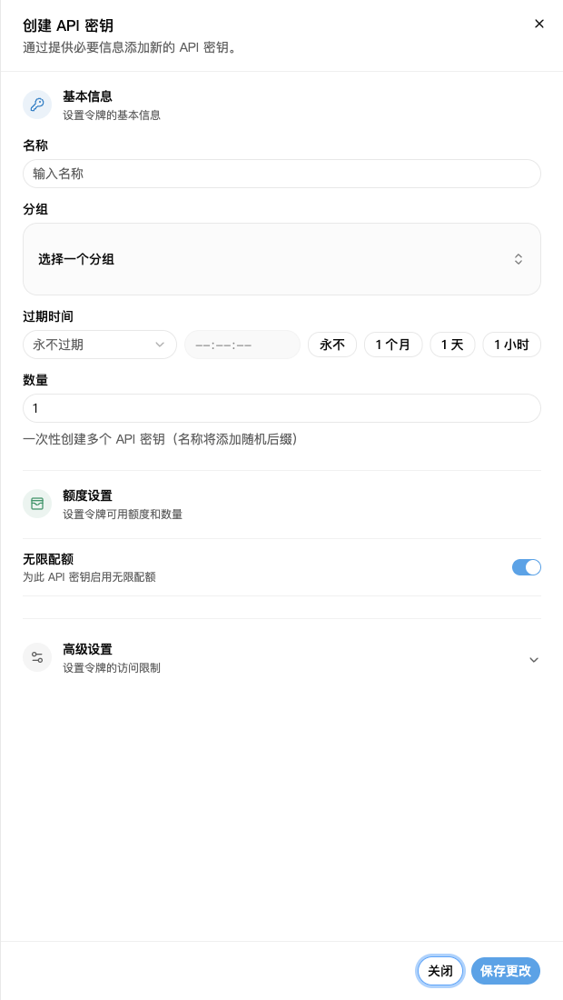
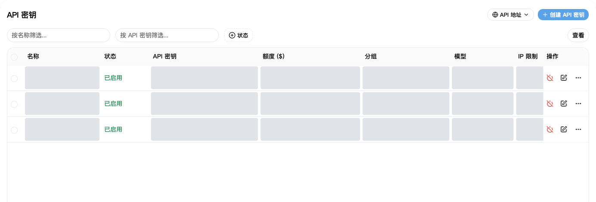
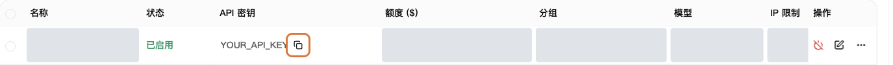

API 密钥就是软件连接 NexusAPI 时要填的 Key。

## 1. 创建密钥

1. 打开 [API 密钥](https://nexusapi.link/keys)。
2. 点击右上角“创建 API 密钥”。
3. 按下表填写。
4. 点击“保存更改”。

| 项目 | 怎么填 |
| --- | --- |
| 名称 | 自己能认出来即可，例如 `我的电脑` |
| 分组 | 选客服提供的分组；不知道选哪个，先问客服 |
| 创建数量 | 填 `1` |
| 过期时间 | 第一次使用可保持默认 |
| 配额、高级设置 | 没有特殊要求，保持默认 |

截图中的灰色区域是已隐藏的个人数据，不代表功能不可用。示例分组、模型和价格以实际页面为准。

“无限配额”不代表免费，调用仍会扣除账户余额或套餐额度。

高级设置里的“允许查询用户额度”：开启后，持有这把 Key 的软件可以查询你的账户剩余和已用额度。自己使用可保持默认；分享 Key 前，先确认是否允许对方查看这些信息。

## 2. 复制到软件

1. 回到密钥列表，找到刚创建的密钥。
2. 点击复制按钮，复制完整 Key，不要手动抄带星号的文字。
3. 粘贴到软件的“API Key”一栏。
4. 地址和模型名称，照[对应软件教程](/tools)填写。

复制完整 Key：点框出的复制按钮；图中 Key 为占位符。

需要复制平台地址时，点击密钥页右上角的“API 地址”。软件是否要加 `/v1`，仍按[对应软件教程](/tools)填写，不要自己拼接路径。

**用这里创建的 Key，不要用“安全与访问”里的访问令牌。**

## 3. 密钥泄露了怎么办

立即在密钥列表停用或删除旧 Key，重新创建一个，再替换软件里的 Key。

不要把完整 Key 发到群里、截图里或公开代码里。客服也不需要你的完整 Key。

## 更换分组或 Key

**改分组，不必重新创建 Key：**

1. 在 [API 密钥](https://nexusapi.link/keys)找到正在使用的 Key，点击该行“编辑”。
2. 在“分组”中选择已向你开放、适用于目标软件的分组，保存更改。找不到目标分组先联系客服，不要随便选。
3. 到[模型广场](https://nexusapi.link/pricing)选新分组，确认模型和价格，再按[换模型步骤](/billing/models-pricing#change-model)修改软件并测试。

编辑分组不会生成新 Key，但会影响所有共用这把 Key 的程序。只想改一个程序时，给它单独创建一把 Key 更容易管理。

**换 Key：**正常更换时，先创建新 Key，替换软件里的旧 Key，重启并确认调用成功后，再停用不再需要的旧 Key。Key 已泄露时，立即停用旧 Key，不要等测试结束。不要把新旧 Key 发给客服。
