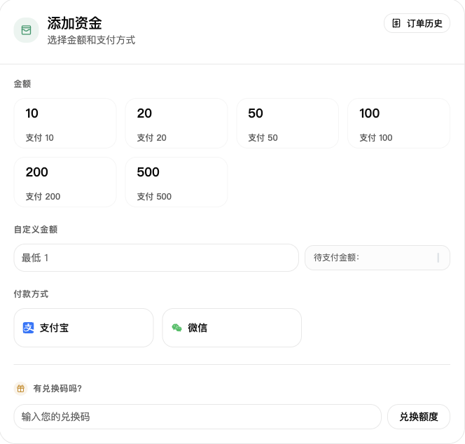

## 1. 充值

1. 打开[钱包](https://nexusapi.link/wallet)。
2. 在“添加资金”里选金额，或输入自定义金额。
3. 看清待支付金额和到账额度，再选择付款方式。
4. 按支付页面提示完成付款。
5. 回到钱包刷新，确认余额增加。

钱包里的 `$` 是可用额度，不是人民币支付金额。看不懂时，见[倍率与折扣](/billing/multipliers-and-discounts)。

## 2. 有兑换码或想买套餐

- **兑换码**：在钱包“有兑换码吗？”中粘贴兑换码，点击“兑换额度”。
- **订阅套餐**：如果钱包显示套餐，购买前看清使用期限、包含额度和可用分组；套餐和充值余额不是一回事。不清楚是否适合，先问客服再买。

## 3. 已付款，但没有到账

先刷新钱包，再点“订单历史”查看订单状态。仍未到账，把下面这些发给客服：

- 登录账号。
- 付款时间、金额和付款方式。
- 订单号、付款截图。

截图请遮盖敏感信息。**不要提供密码、验证码或完整 API Key。**

## 查看历史付款订单

1. 打开[钱包](https://nexusapi.link/wallet)，点击“订单历史”。
2. 有订单号时，在“按订单号搜索...”输入订单号；没有订单号时，翻页比对付款时间和金额，找到记录后查看状态。搜索框不是时间或金额筛选框。
3. 核对充值是否到账时，同时回钱包刷新余额；付款截图不能代替到账确认。

| 订单状态 | 接下来怎么做 |
| --- | --- |
| 成功 | 回钱包刷新并核对余额；有疑问提供订单号给客服 |
| 待确认 | 尚未确认完成；若已扣款，保留凭证找客服核对，不要再次支付 |
| 已过期 | 若已付款但未到账，找客服核对；“已过期”不代表款项已经退回 |

找不到订单或状态不清楚时，把付款时间、订单号和遮盖隐私的付款截图发给客服，不要直接再次付款。模型调用明细在[使用日志](/billing/usage-and-billing)，不是付款订单。
