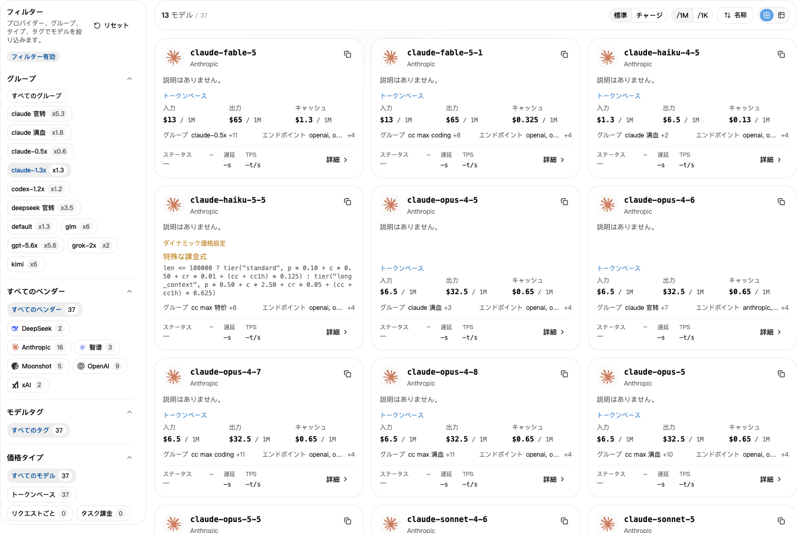
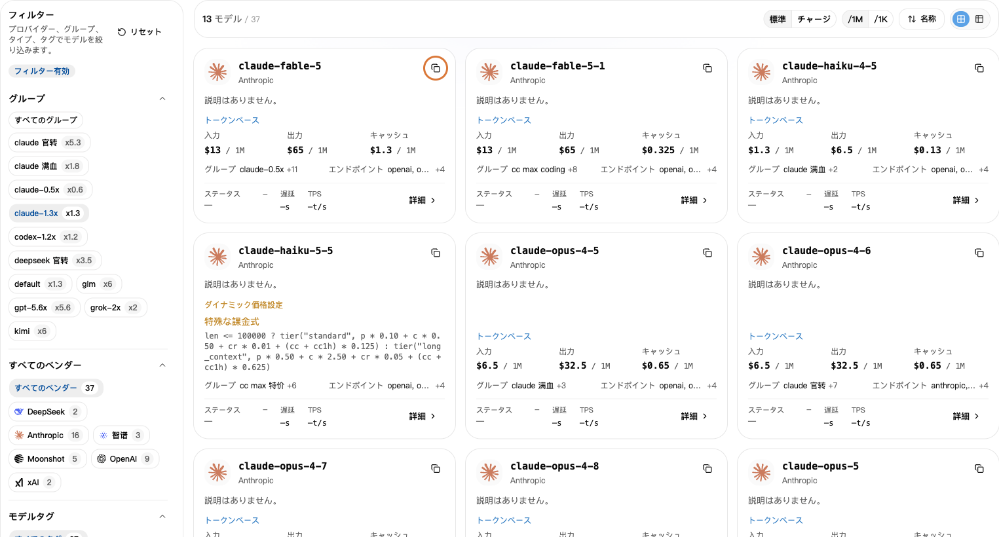

## 1. 先にグループを選ぶ

1. [APIキー](https://nexusapi.link/keys)で使用中のキーを探し、グループを確認。
2. [モデル広場](https://nexusapi.link/pricing)を開く。
3. 左側で同じグループを選択。

**「すべてのグループ」の価格だけで判断せず、自分のグループを選んでください。**

## 2. モデル名をコピー

使うモデルを検索し、モデル名をコピーしてアプリの「モデル」欄に貼り付けます。記憶で手入力しないでください。

見つからない場合は、**アプリ名、使いたいモデル、現在のグループ**をサポートに送り、どのグループを使うか確認してください。

自分のグループを選び、モデル右上のコピーボタンを押します。グループと価格は例です。現在のページで確認してください。

アプリとの対応が不明なら[アプリ別の選び方](/ja/tools#choose-model)と[推奨プロトコル](/ja/developer/model-protocols)へ。名前が似ているだけで置き換えないでください。

## 3. 料金を見る

- **標準：** 呼び出し時に差し引かれる利用クレジット。
- **チャージ：** サイト設定による費用の目安。個別の割引やプランとは異なる場合あり。
- **`/1M`：** 100万トークンあたり。**`/1K`：** 1,000トークンあたり。比較時は単位をそろえる。

送った内容が入力、返ってきた内容が出力です。キャッシュなどの料金は「詳細」で確認してください。

詳細にキャッシュ読み取り・書き込み、段階別料金、ツール呼び出し料金がある場合は、それぞれ確認してください。入力単価だけが総額とは限りません。不明ならモデルとグループをサポートに伝えてください。

**表示価格には選択したグループの倍率が含まれます。もう一度掛けないでください。** [割引の例](/ja/billing/multipliers-and-discounts)と[実際の利用料金](/ja/billing/usage-and-billing)も確認できます。

## 4. 速度と成功率を見る

モデル詳細に「パフォーマンス」がある場合は、使用するグループのデータを確認します。

- **最初のトークンまでの時間：** 返信が始まるまでの待ち時間。通常は短いほど速くなります。
- **出力速度：** 返信開始後、1秒に出力されるトークン数。通常は多いほど速くなります。
- **成功率：** 集計期間内で成功したリクエストの割合。

過去の統計であり、毎回の動作保証や回答品質の指標ではありません。データがないことは利用不可を意味しません。迷ったらアプリと用途をサポートに伝えてください。

## モデルを変更する

1. モデル広場でキーのグループを選び、対応する新モデル名をコピーする。別グループなら先に[キーの手順](/ja/guide/api-key#change-key)を確認する。
2. 次の場所を変更する。モデル変更だけならキーの再作成は不要です。

| 利用方法 | 変更する場所 |
| --- | --- |
| CC Switch | 現在の NexusAPI 設定のメインモデルを編集し、保存後も有効な設定か確認 |
| Claude Code 手動設定 | [手順](/ja/tools/claude-code)にあるユーザー設定の `model` |
| Codex CLI 手動設定 | [手順](/ja/tools/codex-cli)に従い、先頭の `model` を変更。NexusAPI Provider は維持 |
| Claude Code エディター拡張 | [手順](/ja/tools/cursor-vscode)にあるユーザー設定の `ANTHROPIC_MODEL` |
| 自作プログラム | リクエストの `model`。プロトコルも変える場合は対応するインターフェースの手順に従う |

3. 保存後にツールやエディターを再起動し、新しい会話で「接続成功、とだけ返信してください。ファイルは変更しないでください」と送る。
4. [利用履歴](https://nexusapi.link/usage-logs/common)でモデルとグループを確認する。テストはクレジットを使います。AIに名前を聞いて判断しないでください。

旧会話は以前の設定や文脈を保持する場合があります。重要な内容を保存し、新しい会話で確認してください。
