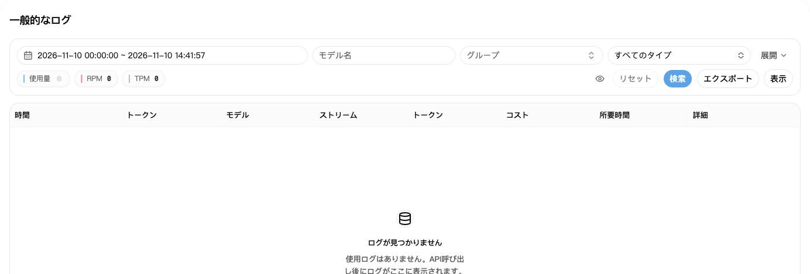
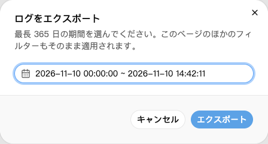

## 1. 呼び出し記録を探す

1. [利用履歴](https://nexusapi.link/usage-logs/common)を開く。
2. 呼び出した日付を選び、検索。
3. 記録が多ければモデルやグループで絞り込む。
4. 該当する記録の料金または詳細を開く。

直後はまだ表示されないことがあります。少し待って更新してください。ログ確認のためだけに再送しないでください。

## 2. 主に見る項目

| 項目 | 確認すること |
| --- | --- |
| 時刻・モデル・グループ | 自分の呼び出しか |
| Tokens | 今回の利用量。詳細では入力・出力・キャッシュに分かれる場合あり |
| 料金 | 差し引かれた利用クレジット |
| 所要時間 | 呼び出しにかかった時間 |

料金の横にプランやウォレットのアイコンがある場合は、差し引き元を示します。プランの消費はウォレットからも二重に引かれたという意味ではありません。アイコンにマウスを合わせると説明が表示されます。

キャッシュやツール呼び出しの料金は、その記録の詳細を確認してください。入力と出力の利用量だけでは合計を説明できない場合があります。

**ログの `$0.10` が実際の支払いで人民元0.10元とは限りません。** [倍率と割引](/ja/billing/multipliers-and-discounts)で例を確認してください。

## 3. 利用記録をダウンロード

1. 利用履歴で必要に応じてモデルやグループを絞り込む。
2. 「エクスポート」を押し、開始日時と終了日時を選ぶ。
3. もう一度「エクスポート」を押してCSVファイルを保存する。Excelで開けます。

ページのほかの絞り込み条件も適用されます。エクスポートは同時に1件までです。完了してから次を開始してください。

現在、1回の検索やエクスポートで指定できる期間は最大 **365日** です。変更された場合は画面表示に従ってください。ログが365日間保存される保証ではありません。期間が長い場合は月ごとに分けてください。

ファイルにIPアドレスやリクエスト番号が含まれる場合があります。共有前に個人情報を確認して隠してください。

## 4. 料金がおかしいと思ったら

エラー、返信の途切れ、二重請求の疑いがある場合は、次をサポートに送ってください。

- 発生時刻、モデル、グループ。
- エラー原文、返信が最後まで届いたか。
- ログの画像。詳細にRequest ID（リクエスト番号）があれば一緒にコピー。

**APIキーの全文は送らないでください。** 記録を残し、何度も再試行して呼び出しを増やさないようにしてください。
