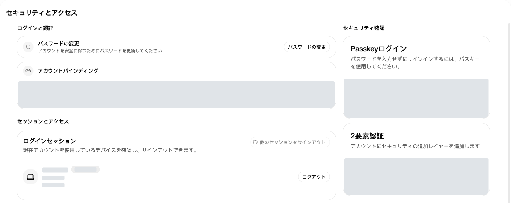
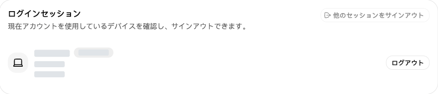
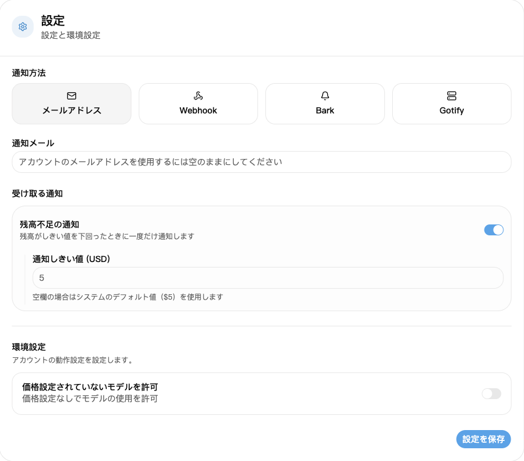

## 1. ログインする

[ログイン画面](https://nexusapi.link/sign-in)で自分のアカウントとパスワードを入力します。アカウントがない、パスワードを復旧できない場合はサポートへ連絡してください。

## 2. パスワード変更と端末確認

1. [セキュリティとアクセス](https://nexusapi.link/security)を開く。
2. パスワード変更ボタンから入力し、保存。
3. 下のログインセッションで端末を確認。不明なセッションを取り消すか、他のセッションからログアウトする項目を選ぶ。

ログインセッションで端末を確認し、不明なセッションを必要に応じてログアウトします。端末情報は非表示にしています。

**モデルを使うアプリには、[APIキー](/ja/guide/api-key)で作ったキーを入力します。「セキュリティとアクセス」のアクセストークンは管理API用なので、モデル用アプリのために作成・入力する必要はありません。**

## 3. アカウントやキーの漏えいが疑われる場合

| 状況 | すぐ行うこと |
| --- | --- |
| パスワード漏えい・不審なログイン | パスワードを変更し、不審なセッションを取り消す |
| APIキー漏えい | 古いキーを無効化または削除し、新しいキーをアプリに設定 |

**サイトからログアウトするだけではAPIキーは無効になりません。** パスワード、認証コード、キーの全文を他人に送らないでください。

## 4. 残高不足の通知を設定

1. [プロフィール](https://nexusapi.link/profile)で通知設定を開く。
2. 「メール」を選び、受信できる通知先を入力する。空欄ならアカウントのメールアドレスを使用します。未登録なら入力してください。
3. 残高不足の通知をオンにし、通知のしきい値を入力する。不明なら空欄にしてサイトの初期値を使う。
4. 「設定を保存」を押す。

しきい値は画面に表示されるクレジット単位で、人民元での支払額ではありません。残高がしきい値を下回ったときに1回通知され、毎回の呼び出しでは通知されません。メールだけに頼らず、利用前に[ウォレット](https://nexusapi.link/wallet)でも確認してください。

## 表示設定とIP記録

### 表示言語の変更

[プロフィール](https://nexusapi.link/profile)の「インターフェース言語」で選択し、保存成功を待ちます。ログイン端末間で同期され、APIエラーの言語も変わる場合があります。

### 非表示メニューを戻す

「サイドバー個人設定」があれば項目を有効にして「変更を保存」を押します。既定値に戻す場合は「デフォルトにリセット」を押してから保存してください。利用可能なメニューだけを戻す操作で、権限は増えません。項目がなければサポートへ。

### 送信元IPの記録

[セキュリティとアクセス](https://nexusapi.link/security)で「IPアドレスを記録」を切り替え、「設定を保存」を押します。以後の利用・エラーログのIP記録を設定するもので、過去の欠落分は補完しません。

**IP記録とホワイトリストは別機能です。** 記録は送信元を保存し、[ホワイトリスト](/ja/guide/ip-whitelist)はキーの送信元を制限します。記録を有効にしても他人のキー利用は防げません。

### 自分の操作記録を見る

メニューに「監査ログ」がある場合：

1. [監査ログ](https://nexusapi.link/usage-logs/audit)を開き、期間を選びます。
2. 絞り込む場合は「カテゴリ」または「結果」を選び、「検索」を押します。
3. 時刻、操作、結果を確認します。終了後はリセットし、古い条件を残さないようにします。

ここで確認するのは自分のアカウント操作です。モデル呼び出しや料金は[利用ログ](/ja/billing/usage-and-billing)で確認してください。

## 2要素認証を設定する

[セキュリティとアクセス](https://nexusapi.link/security)に「2要素認証」がある場合：

1. その欄の「有効にする」を押し、求められた安全確認を完了する。
2. 認証アプリで設定用QRコードを読み取り、画面の手順に従う。
3. **先にバックアップコードを安全に保存**し、認証アプリの現在のコードを入力して「2FA を有効にする」を完了する。
4. 有効になったことを確認する。ログイン時は指示に従い、電話が使えない場合のバックアップコードは各1回のみ使用できる。

交換時は「バックアップコードを再生成」で本人確認し、新しいコードを保存します。**古いコードはすべて無効になります。** QRコード、設定用秘密情報、バックアップコードをサポートや画像で共有しないでください。認証できない場合は、連続試行やアカウント削除をせずサポートへ連絡してください。
