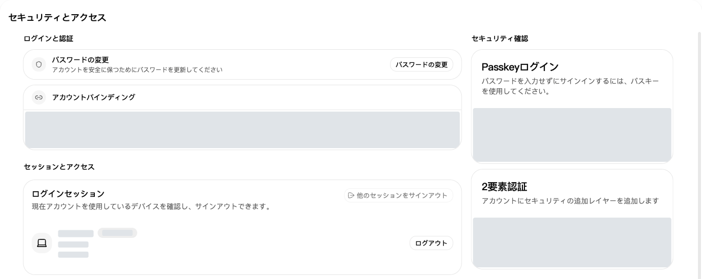
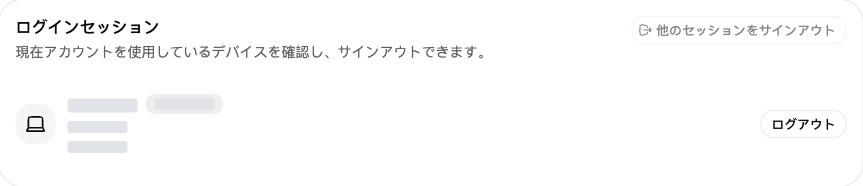
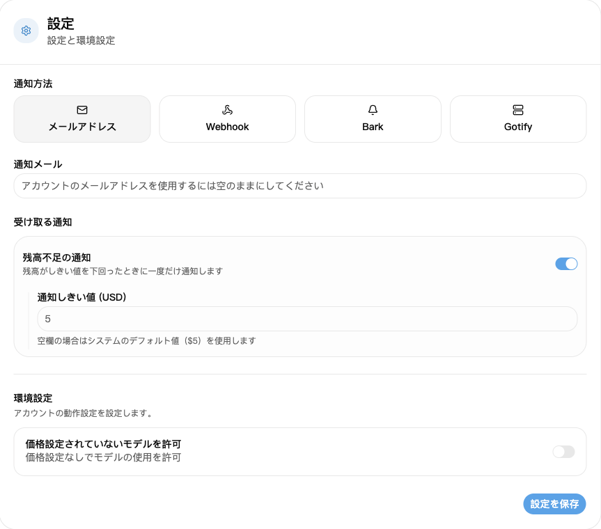

## 1. ログインする

[ログイン画面](https://nexusapi.link/sign-in)で自分のアカウントとパスワードを入力します。アカウントがない、パスワードを復旧できない場合はサポートへ連絡してください。

## 2. パスワード変更と端末確認

1. [セキュリティとアクセス](https://nexusapi.link/security)を開く。
2. パスワード変更ボタンから入力し、保存。
3. 下のログインセッションで端末を確認。不明なセッションを取り消すか、他のセッションからログアウトする項目を選ぶ。

ログインセッションで端末を確認し、不明なセッションを必要に応じてログアウトします。端末情報は非表示にしています。

**モデルを使うアプリには、[APIキー](/ja/guide/api-key)で作ったキーを入力します。「セキュリティとアクセス」のアクセストークンは管理API用なので、モデル用アプリのために作成・入力する必要はありません。**

## 3. アカウントやキーの漏えいが疑われる場合

| 状況 | すぐ行うこと |
| --- | --- |
| パスワード漏えい・不審なログイン | パスワードを変更し、不審なセッションを取り消す |
| APIキー漏えい | 古いキーを無効化または削除し、新しいキーをアプリに設定 |

**サイトからログアウトするだけではAPIキーは無効になりません。** パスワード、認証コード、キーの全文を他人に送らないでください。

## 4. 残高不足の通知を設定

1. [プロフィール](https://nexusapi.link/profile)で通知設定を開く。
2. 「メール」を選び、受信できる通知先を入力する。空欄ならアカウントのメールアドレスを使用します。未登録なら入力してください。
3. 残高不足の通知をオンにし、通知のしきい値を入力する。不明なら空欄にしてサイトの初期値を使う。
4. 「設定を保存」を押す。

しきい値は画面に表示されるクレジット単位で、人民元での支払額ではありません。残高がしきい値を下回ったときに1回通知され、毎回の呼び出しでは通知されません。メールだけに頼らず、利用前に[ウォレット](https://nexusapi.link/wallet)でも確認してください。
