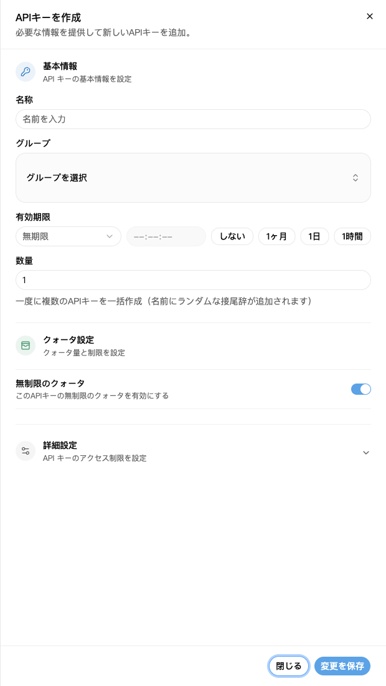
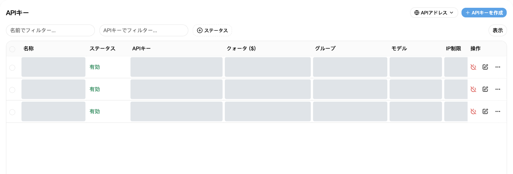
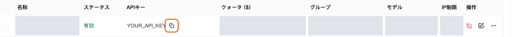

APIキーは、アプリからNexusAPIに接続するときに入力するキーです。

## 1. キーを作る

1. [APIキー](https://nexusapi.link/keys)を開く。
2. 右上の「APIキーを作成」をクリック。
3. 次の表に沿って入力。
4. 保存ボタンをクリック。

| 項目 | 入力する内容 |
| --- | --- |
| 名前 | 自分がわかる名前。例：`自分のPC` |
| グループ | サポートに案内されたもの。不明なら先に確認 |
| 個数 | `1` |
| 有効期限 | 初めてなら初期設定のままで可 |
| クォータ・詳細設定 | 特別な要望がなければ初期設定のまま |

灰色部分は個人情報を隠した箇所で、機能が使えないという意味ではありません。グループ・モデル・価格は現在の画面で確認してください。

「無制限」は無料という意味ではありません。利用分は残高またはプランから消費されます。

詳細設定の「ユーザーのクォータ照会を許可」をオンにすると、このキーを持つアプリからアカウントの残りクレジットと使用済みクレジットを照会できます。自分で使う場合は初期設定のままで構いません。キーを共有する前に、相手にこの情報を見せてよいか確認してください。

## 2. アプリに貼り付ける

1. 一覧に戻り、作ったキーを探す。
2. コピーボタンで全文をコピー。星印の表示を手入力しない。
3. アプリの「APIキー」欄に貼り付ける。
4. アドレスとモデル名は[アプリ別手順](/ja/tools)のとおりに入力。

枠で示したボタンでキー全体をコピーします。画像のキーは仮の値です。

プラットフォームのアドレスは、キー一覧右上の「APIアドレス」からコピーできます。`/v1` が必要かどうかは[アプリ別手順](/ja/tools)に従い、自分でパスを付け足さないでください。

**ここで作ったキーを使います。「セキュリティとアクセス」のアクセストークンは使いません。**

## 3. キーが漏れたら

古いキーをすぐ無効化または削除し、新しいキーを作ってアプリの設定を入れ替えてください。

キーの全文をチャット、画像、公開コードに載せないでください。サポートも全文を必要としません。

## グループやキーを変更する

**グループ変更だけならキーの再作成は不要です。**

1. [APIキー](https://nexusapi.link/keys)で使用中のキーを探し、その行の編集ボタンを押す。
2. 利用が許可され、アプリに対応するグループを選んで保存する。見つからなければ適当に選ばずサポートへ。
3. [モデル広場](https://nexusapi.link/pricing)で新グループのモデルと価格を確認し、[モデル変更手順](/ja/billing/models-pricing#change-model)でアプリを変更してテストする。

グループを編集してもキーは変わりませんが、共有する全プログラムに影響します。1つのプログラムだけ変えるなら専用キーを作ると管理しやすくなります。

**キー交換：**通常は新キーを作り、アプリで入れ替え、再起動して呼び出し成功を確認してから不要な旧キーを無効化します。漏えい時はテストを待たず即座に無効化してください。新旧のキーをサポートに送らないでください。
