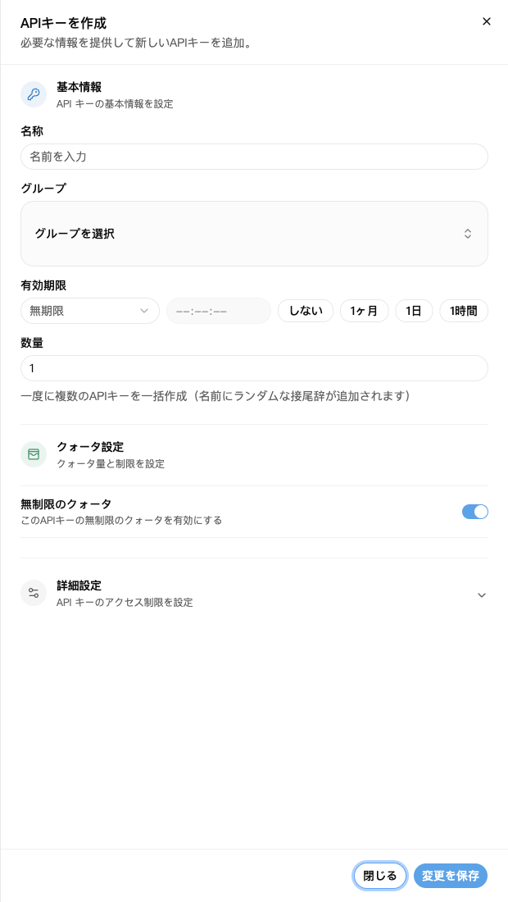
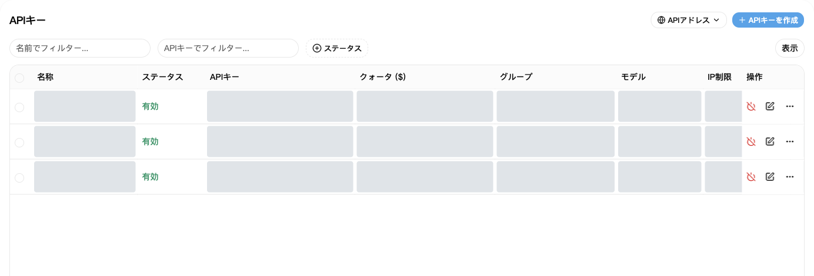
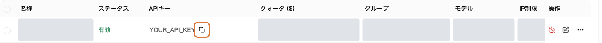

APIキーは、アプリからNexusAPIに接続するときに入力するキーです。

特定のPCやサーバーからだけキーを使いたい場合は、[IPホワイトリスト設定](/ja/guide/ip-whitelist)を確認してください。

## 1. キーを作る

1. [APIキー](https://nexusapi.link/keys)を開く。
2. 右上の「APIキーを作成」をクリック。
3. 次の表に沿って入力。
4. 「変更を保存」をクリック。

| 項目 | 入力する内容 |
| --- | --- |
| 名前 | 自分がわかる名前。例：`自分のPC` |
| グループ | サポートに案内されたもの。不明なら先に確認 |
| 数量 | `1` |
| 有効期限 | 初めてなら初期設定のままで可 |
| クォータ・詳細設定 | 特別な要望がなければ初期設定のまま |

灰色部分は個人情報を隠した箇所で、機能が使えないという意味ではありません。グループ・モデル・価格は現在の画面で確認してください。

「無制限」は無料という意味ではありません。利用分は残高またはプランから消費されます。

詳細設定の「ユーザーのクォータ照会を許可」をオンにすると、このキーを持つアプリからアカウントの残りクレジットと使用済みクレジットを照会できます。自分で使う場合は初期設定のままで構いません。キーを共有する前に、相手にこの情報を見せてよいか確認してください。

## 2. アプリに貼り付ける

1. 一覧に戻り、作ったキーを探す。
2. コピーボタンで全文をコピー。星印の表示を手入力しない。
3. アプリの「APIキー」欄に貼り付ける。
4. アドレスとモデル名は[アプリ別手順](/ja/tools)のとおりに入力。

枠で示したボタンでキー全体をコピーします。画像のキーは仮の値です。

プラットフォームのアドレスは、キー一覧右上の「APIアドレス」からコピーできます。`/v1` が必要かどうかは[アプリ別手順](/ja/tools)に従い、自分でパスを付け足さないでください。

**ここで作ったキーを使います。「セキュリティとアクセス」のアクセストークンは使いません。**

行のメニューの「接続情報をコピー」は、アドレスとキー全文を一緒にコピーします。**公開してよい通常のリンクではありません。** この形式に対応した信頼できるアプリだけで使い、通常の設定では上記の手順でキーを個別にコピーしてください。グループチャットやサポートには送らないでください。

## 3. キーが漏れたら

古いキーをすぐ無効化または削除し、新しいキーを作ってアプリの設定を入れ替えてください。

キーの全文をチャット、画像、公開コードに載せないでください。サポートも全文を必要としません。

## グループやキーを変更する

**グループ変更だけならキーの再作成は不要です。**

1. [APIキー](https://nexusapi.link/keys)で使用中のキーを探し、その行の編集ボタンを押す。
2. 利用が許可され、アプリに対応するグループを選んで保存する。見つからなければ適当に選ばずサポートへ。
3. [モデル広場](https://nexusapi.link/pricing)で新グループのモデルと価格を確認し、[モデル変更手順](/ja/billing/models-pricing#change-model)でアプリを変更してテストする。

グループを編集してもキーは変わりませんが、共有する全プログラムに影響します。1つのプログラムだけ変えるなら専用キーを作ると管理しやすくなります。

**キー交換：** 通常は新キーを作り、アプリで入れ替え、再起動して呼び出し成功を確認してから不要な旧キーを無効化します。漏えい時はテストを待たず即座に無効化してください。新旧のキーをサポートに送らないでください。

グループが「ユーザーに従う」「継承」「グループ横断」または `auto` の場合は、利用可能なグループ、モデル、料金を先にサポートへ確認してください。固定倍率だと決めつけたり、例に合わせるためだけに変更したりしないでください。

## クォータ、有効期限、モデル制限

1. [APIキー](https://nexusapi.link/keys)で対象キーの編集ボタンを押す。
2. 次の表で必要な項目だけ変更する。
3. 変更を保存する。共有するすべてのアプリに影響します。

| 制限したいこと | 設定 |
| --- | --- |
| キーが今後使える量 | 「クォータ設定」で「無制限のクォータ」をオフにし、表示単位で入力 |
| 使用期限 | 「有効期限」で日時を選ぶ。期限不要なら無期限を選択 |
| 使用できるモデル | 「詳細設定」の「モデル制限」で許可するモデルを選択 |
| 送信元IP | [IP設定手順](/ja/guide/ip-whitelist)を参照 |

**入力値は残りクォータであり、支払額や追加額ではありません。** 単位が `$` の欄に `10` を入れると、残りが `$10` のアカウントクレジットになります。人民元10元でも、以前の値に10を加える意味でもありません。実際の表示単位に従ってください。

毎月自動リセットされる予算ではありません。アカウントには別途残高や対応プランが必要です。無制限はこのキー固有の量的制限だけを解除します。

モデルの選択をすべて解除すると、このキーへの追加制限はなくなりますが、**グループにないモデルは使えるようになりません。** モデルやグループ変更は上記の手順を使ってください。

アプリごとに `オフィスPC`、`サーバーアプリ` など別名のキーを作ると、利用状況と停止を分けて管理できます。一時共有では無制限かつ無期限にしないことを勧めます。

Claude Codeで補助モデルが必要な場合は、利用可能と確認した補助モデルも許可してください。メインモデルだけの許可では一部の操作が失敗することがあります。名前は[アプリの手順](/ja/tools/claude-code)またはサポートの確認に従います。

## 一時停止、再開、削除

- **一時停止**：行の「無効にする」電源ボタンを押し、状態が「無効」に変わったことを確認します。このキーでの以後のリクエストは拒否されます。
- **再開**：同じ場所の「有効にする」を使う。期限切れやクォータ不足なら先に編集・保存してから有効化します。連打しても制限は直りません。
- **使用終了**：他のアプリが使っていないことを確認し、行のメニューで「削除」を選んで確認操作を行います。一時停止の代わりに削除しないでください。

ブラウザを閉じたりログアウトしたりしてもキーは停止しません。不審な利用時は先に無効化し、[ログを確認](/ja/billing/usage-and-billing#find-key-usage)してください。

### キーが使えないときの4項目

| 確認項目 | 対応 |
| --- | --- |
| 無効化・期限切れ | アプリで実際に使っているキーを探し、状態と期限を確認 |
| 利用可能な残高 | ウォレットとキーの残りクォータを両方確認。無制限でも残高があるとは限りません |
| 許可モデル | グループの対応モデルとキーの制限を確認。Claude Codeでは必要な補助モデルも確認 |
| 送信元IP | 明確にIPを拒否するエラーの場合は[手順](/ja/guide/ip-whitelist)で実際の出口を確認。すべてのIPを許可しない |

解決しなければエラー原文を保存し、[トラブル対処](/ja/faq/self-check)へ進んでください。繰り返し再送したり、キー全文をサポートへ送ったりしないでください。
