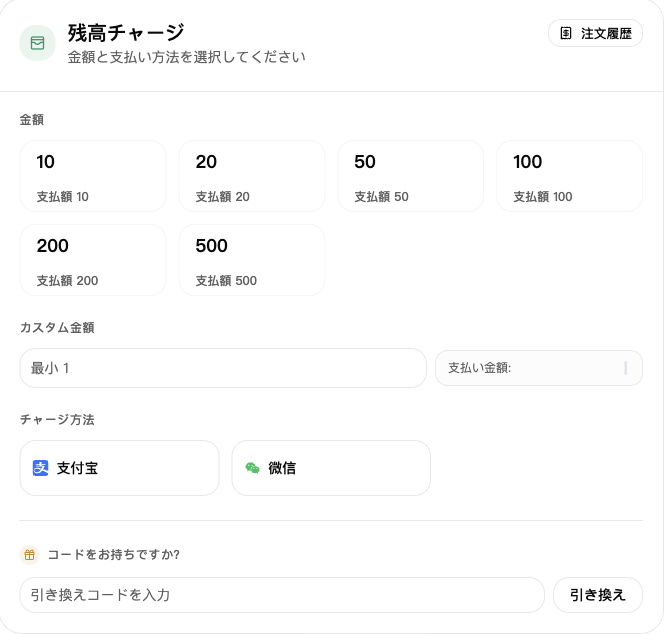

## 1. チャージする

1. [ウォレット](https://nexusapi.link/wallet)を開く。
2. チャージ欄で金額を選ぶか、希望額を入力。
3. 支払額と受け取るクレジットを確認し、支払い方法を選ぶ。
4. 支払い画面の指示に従う。
5. ウォレットに戻って更新し、残高が増えたことを確認。

残高の `$` は利用クレジットであり、支払った人民元の金額ではありません。[倍率と割引の例](/ja/billing/multipliers-and-discounts)を参照してください。

## 2. 交換コードやプランを使う

- **交換コード：** ウォレットのコード入力欄に貼り付け、交換ボタンを押す。
- **サブスクリプション：** 表示されている場合は、期限、利用枠、対象グループを確認してから購入。チャージ残高とは別です。迷ったら購入前にサポートへ確認。

## 3. 支払ったのに反映されない

ウォレットを更新し、注文履歴を確認します。まだ反映されなければ、次をサポートへ送ってください。

- ログインアカウント。
- 支払時刻、金額、支払い方法。
- 注文番号、支払い画面の画像。

機密情報は隠してください。**パスワード、認証コード、APIキーの全文は送らないでください。**

## 過去の支払注文を確認

1. [ウォレット](https://nexusapi.link/wallet)で注文履歴を開く。
2. 注文番号があれば「注文番号で検索...」に入力します。なければページを送り、支払時刻と金額を照合して状態を確認します。検索欄は時刻や金額のフィルターではありません。
3. ウォレット残高も更新して入金を確認する。支払画像だけでは残高反映の確認になりません。

| 注文状態 | 次の対応 |
| --- | --- |
| 成功 | ウォレットを更新して残高を確認。不明なら注文番号をサポートへ |
| 保留中 | 完了は未確認です。引き落とし済みなら証憑を保存して確認を依頼し、再支払しない |
| 有効期限切れ | 支払済みで未反映ならサポートへ。この状態は返金済みを意味しません |

見つからない、状態が不明な場合は時刻、注文番号、個人情報を隠した支払画像をサポートへ送り、すぐに再支払しないでください。モデル呼び出しは支払注文ではなく[利用ログ](/ja/billing/usage-and-billing)で確認します。
