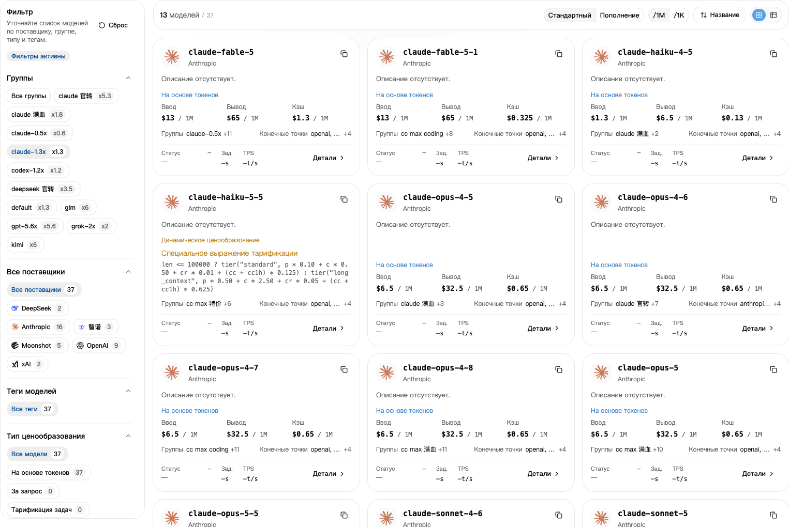
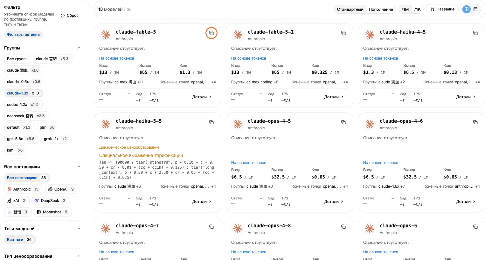

## 1. Сначала выберите группу

1. В разделе [Ключи API](https://nexusapi.link/keys) найдите используемый ключ и его **Группу**.
2. Откройте [Витрину моделей](https://nexusapi.link/pricing).
3. Слева выберите ту же группу.

**Не ориентируйтесь только на Все группы. Выберите свою группу, чтобы увидеть её цены.**

## 2. Скопируйте название модели

Найдите модель, скопируйте её название кнопкой и вставьте в поле модели приложения. Не вводите название по памяти.

Модель не найдена? Отправьте поддержке **приложение, нужную модель и текущую группу**, чтобы уточнить выбор группы.

Выберите свою группу, затем нажмите кнопку копирования справа вверху карточки модели. Группа и цены приведены для примера; сверяйтесь с текущей страницей.

Не уверены в совместимости? См. [выбор по приложению](/ru/tools#choose-model) и [протоколы](/ru/developer/model-protocols). Похожие имена не гарантируют совместимость.

## 3. Проверьте цену

- **Стандартный:** кредиты, списываемые за использование.
- **Пополнение:** ориентир стоимости по настройкам сайта; личные скидки и подписки могут отличаться.
- **`/1M`:** за миллион токенов. **`/1K`:** за тысячу. Сравнивайте в одинаковых единицах.

Отправленный модели текст — вход, её ответ — выход. Цены кэша и других услуг смотрите в деталях.

Если указаны чтение или запись кэша, тарифные ступени либо вызовы инструментов, проверьте каждый применимый пункт. Входная цена не обязательно отражает все расходы. При сомнениях сообщите поддержке модель и группу.

**Множитель группы уже включён в цену. Не умножайте её повторно.** См. [скидки](/ru/billing/multipliers-and-discounts) и [фактические списания](/ru/billing/usage-and-billing).

## 4. Проверьте скорость и долю успешных запросов

Если в деталях модели есть **Производительность**, откройте данные своей группы:

- **Время до первого токена:** ожидание начала ответа; обычно чем меньше, тем быстрее.
- **Скорость вывода:** число токенов в секунду после начала ответа; обычно чем больше, тем быстрее.
- **Доля успешных запросов:** процент успешных запросов за измеренный период.

Это историческая статистика, а не гарантия каждого вызова и не оценка качества ответов. Отсутствие данных не означает недоступность модели. Для помощи с выбором сообщите поддержке приложение и задачу.

## Смените модель

1. Выберите группу ключа на витрине и скопируйте совместимое имя. Для другой группы сначала выполните [инструкцию по ключам](/ru/guide/api-key#change-key).
2. Измените нужный параметр; только смена модели не требует нового ключа:

| Настройка | Что изменить |
| --- | --- |
| CC Switch | Основную модель текущего провайдера NexusAPI; сохранить и убедиться, что он активен |
| Claude Code вручную | `model` в пользовательских настройках из [инструкции](/ru/tools/claude-code) |
| Codex CLI вручную | Верхнеуровневый `model`, сохранив провайдера NexusAPI; см. [инструкцию](/ru/tools/codex-cli) |
| Расширение Claude Code | `ANTHROPIC_MODEL` в пользовательских настройках; см. [инструкцию](/ru/tools/cursor-vscode) |
| Своя программа | `model` запроса; при смене протокола адаптировать запрос по инструкции интерфейса |

3. Сохраните, перезапустите инструмент или редактор и в новом диалоге отправьте «Ответь только: подключение успешно. Не изменяй файлы».
4. Проверьте модель и группу в [журнале](https://nexusapi.link/usage-logs/common). Тест расходует кредиты. Не проверяйте маршрут вопросом к ИИ о его имени.

Старый диалог может сохранять прежние настройки или контекст. Сохраните важное и проверяйте в новом диалоге.
