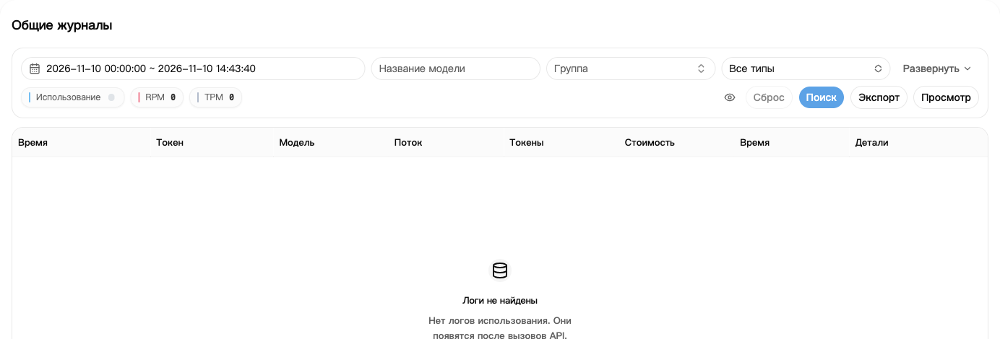
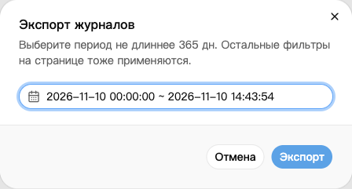

## 1. Найдите запрос

1. Откройте [Журнал использования](https://nexusapi.link/usage-logs/common).
2. Выберите дату запроса и нажмите **Поиск**.
3. Если записей много, отфильтруйте по модели или группе.
4. Откройте стоимость или детали нужной записи.

Запись может появиться не сразу. Подождите и обновите страницу, не отправляя запрос повторно ради проверки журнала.

### Найдите расход определённого ключа

1. В [Ключах API](https://nexusapi.link/keys) запишите **имя**, например `Рабочий компьютер`, не копируя секрет.
2. В журнале выберите период, нажмите **Развернуть** и найдите **Имя токена**. На телефоне откройте фильтры.
3. Укажите имя и найдите модели, время и списания совпавших записей.
4. При необходимости экспортируйте записи по разделу 3. После проверки сбросьте фильтры.

Используйте разные имена ключей. Записи одноимённых ключей могут не различаться по имени. Не вставляйте полный секрет `sk-...` в поле имени токена.

### Найдите запрос по ID

Если ошибка содержит Request ID, укажите его в **ID запроса** среди развёрнутых фильтров. Выберите период, включающий время ошибки, и выполните поиск. Если записи нет, отправьте ID и точную ошибку поддержке, не повторяя вызов ради записи.

Если номер явно обозначен как **ID вышестоящего запроса**, используйте это поле, а не ID запроса сайта. Для поиска сбоев выберите тип **Ошибка**, выполните поиск, затем верните **Все типы**. Отсутствие записи не доказывает отсутствие вызова или списания; обратитесь в поддержку.

## 2. Проверьте основные поля

| Поле | Что смотреть |
| --- | --- |
| Время, модель, группа | Ваш ли это запрос |
| Токены | Объём использования; в деталях могут быть вход, выход и кэш |
| Стоимость | Сколько кредитов списано |
| Время выполнения | Длительность запроса |

Значок подписки или кошелька рядом со стоимостью показывает источник списания. Списание из подписки не означает дополнительного списания из кошелька. Наведите указатель на значок, чтобы увидеть подпись.

Расходы на кэш и вызовы инструментов проверяйте в деталях записи; только входных и выходных токенов может быть недостаточно для объяснения суммы.

**Списание `$0.10` не всегда означает оплату 0,10 юаня.** См. [примеры стоимости](/ru/billing/multipliers-and-discounts).

## 3. Скачайте записи использования

1. При необходимости отфильтруйте журнал по модели или группе.
2. Нажмите **Экспорт** и выберите начало и конец периода.
3. Нажмите **Экспорт** ещё раз, чтобы скачать CSV-файл. Его можно открыть в Excel.

Другие фильтры страницы также применяются. Дождитесь окончания экспорта, прежде чем запускать следующий.

Сейчас максимальный период одного поиска или экспорта — **365 дней**; при изменении ориентируйтесь на подсказку страницы. Это не гарантия хранения журналов в течение 365 дней. Более длинный период разбейте по месяцам.

Файл может содержать IP-адреса и идентификаторы запросов. Перед передачей проверьте его и скройте личные сведения.

## 4. Если списание вызывает вопросы

При подозрительном расходе сначала отключите ключ в [Ключах API](https://nexusapi.link/keys), затем проверьте записи. При утечке создайте новый ключ и замените его в приложениях, не используйте старый.

При ошибке, неполном ответе или подозрении на повторное списание отправьте поддержке:

- Время, модель и группу.
- Текст ошибки и информацию, пришёл ли полный ответ.
- Скриншот записи и Request ID, если он есть в деталях.

**Не отправляйте полный API-ключ.** Сохраните записи и избегайте многократных повторов, создающих новые запросы.
