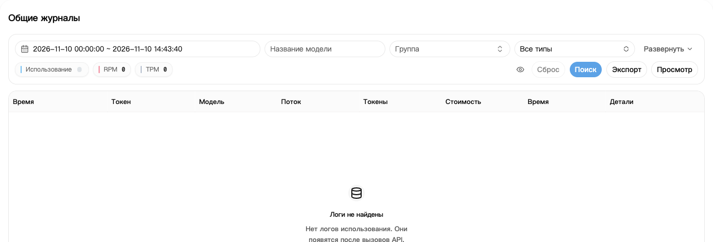
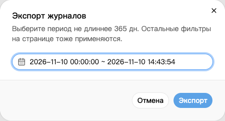

## 1. Найдите запрос

1. Откройте [Журнал использования](https://nexusapi.link/usage-logs/common).
2. Выберите дату запроса и нажмите **Поиск**.
3. Если записей много, отфильтруйте по модели или группе.
4. Откройте стоимость или детали нужной записи.

Запись может появиться не сразу. Подождите и обновите страницу, не отправляя запрос повторно ради проверки журнала.

## 2. Проверьте основные поля

| Поле | Что смотреть |
| --- | --- |
| Время, модель, группа | Ваш ли это запрос |
| Токены | Объём использования; в деталях могут быть вход, выход и кэш |
| Стоимость | Сколько кредитов списано |
| Время выполнения | Длительность запроса |

Значок подписки или кошелька рядом со стоимостью показывает источник списания. Списание из подписки не означает дополнительного списания из кошелька. Наведите указатель на значок, чтобы увидеть подпись.

Расходы на кэш и вызовы инструментов проверяйте в деталях записи; только входных и выходных токенов может быть недостаточно для объяснения суммы.

**Списание `$0.10` не всегда означает оплату 0,10 юаня.** См. [примеры стоимости](/ru/billing/multipliers-and-discounts).

## 3. Скачайте записи использования

1. При необходимости отфильтруйте журнал по модели или группе.
2. Нажмите **Экспорт** и выберите начало и конец периода.
3. Нажмите **Экспорт** ещё раз, чтобы скачать CSV-файл. Его можно открыть в Excel.

Другие фильтры страницы также применяются. Дождитесь окончания экспорта, прежде чем запускать следующий.

Сейчас максимальный период одного поиска или экспорта — **365 дней**; при изменении ориентируйтесь на подсказку страницы. Это не гарантия хранения журналов в течение 365 дней. Более длинный период разбейте по месяцам.

Файл может содержать IP-адреса и идентификаторы запросов. Перед передачей проверьте его и скройте личные сведения.

## 4. Если списание вызывает вопросы

При ошибке, неполном ответе или подозрении на повторное списание отправьте поддержке:

- Время, модель и группу.
- Текст ошибки и информацию, пришёл ли полный ответ.
- Скриншот записи и Request ID, если он есть в деталях.

**Не отправляйте полный API-ключ.** Сохраните записи и избегайте многократных повторов, создающих новые запросы.
