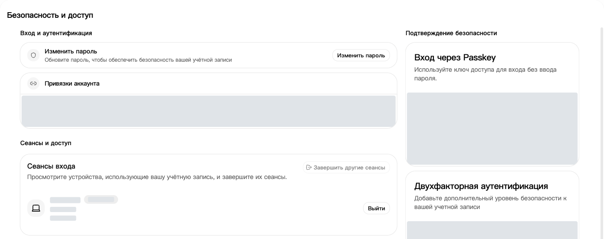
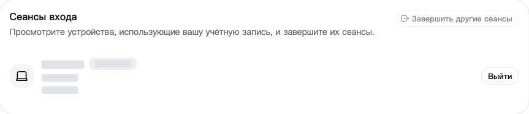
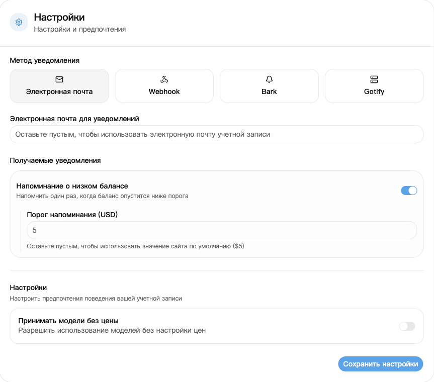

## 1. Войдите в аккаунт

На [странице входа](https://nexusapi.link/sign-in) укажите свой аккаунт и пароль. Обратитесь в поддержку, если аккаунта нет или пароль не удаётся восстановить.

## 2. Смените пароль и проверьте устройства

1. Откройте [Безопасность и доступ](https://nexusapi.link/security).
2. Нажмите **Изменить пароль**, заполните поля и сохраните.
3. Прокрутите до сеансов входа. Отзовите незнакомые сеансы или выйдите из остальных сеансов, чтобы отключить другие устройства.

Сеансы входа: проверьте устройства и при необходимости завершите незнакомые сеансы. Сведения об устройствах скрыты.

**Для приложений с моделями нужен ключ из раздела [Ключи API](/ru/guide/api-key). Токены в разделе «Безопасность и доступ» предназначены для API управления, а не для подключения моделей.**

## 3. При подозрении на утечку

| Ситуация | Что сделать сразу |
| --- | --- |
| Утечка пароля или неизвестный вход | Изменить пароль и отозвать незнакомые сеансы |
| Утечка API-ключа | Отключить или удалить старый ключ, создать новый и заменить его в приложении |

**Выход из сайта не отключает API-ключи.** Никому не отправляйте пароли, коды подтверждения и полные ключи.

## 4. Настройте уведомление о низком балансе

1. Откройте [Профиль](https://nexusapi.link/profile) и настройки уведомлений.
2. Выберите **Электронная почта** и укажите адрес для получения писем. Пустое поле использует адрес аккаунта; если его нет, введите адрес.
3. Включите **Напоминание о низком балансе** и укажите порог либо оставьте поле пустым для значения сайта.
4. Нажмите **Сохранить настройки**.

Порог задаётся в единицах кредита со страницы, а не в сумме оплаты в юанях. Уведомление отправляется один раз при падении баланса ниже порога, а не после каждого запроса. Не полагайтесь только на почту; перед использованием проверьте [кошелёк](https://nexusapi.link/wallet).

## Отображение и запись IP

### Изменение языка

В [Профиле](https://nexusapi.link/profile) выберите **Язык интерфейса** и дождитесь подтверждения. Настройка синхронизируется между устройствами с активным входом и может менять язык ошибок API.

### Восстановление скрытых пунктов

Если доступны **Личные настройки боковой панели**, включите нужные пункты и нажмите **Сохранить изменения**. Для возврата к исходным нажмите **Сбросить по умолчанию**, затем сохраните. Возвращаются только уже доступные меню, без новых прав. Если пункта нет, обратитесь в поддержку.

### Запись IP источника

В [Безопасности и доступе](https://nexusapi.link/security) переключите **Записывать IP-адрес** и сохраните настройки. Параметр действует для последующих журналов расхода и ошибок и не дополняет отсутствующие IP старых записей.

**Запись IP не равна белому списку.** Запись сохраняет источник, а [белый список](/ru/guide/ip-whitelist) отдельно ограничивает источники ключа. Включённая запись не мешает другим использовать ключ.

### Проверить собственные операции

Если в меню доступен **Журнал аудита**:

1. Откройте [журнал аудита](https://nexusapi.link/usage-logs/audit) и выберите период.
2. Для уточнения выберите **Категория** или **Результат**, затем **Поиск**.
3. Сверьте время, операцию и результат. После проверки сбросьте фильтры.

Здесь показаны операции собственного аккаунта. Вызовы моделей и списания проверяйте в [журнале использования](/ru/billing/usage-and-billing), а не в аудите.

## Настройка двухфакторной аутентификации

Если [Безопасность и доступ](https://nexusapi.link/security) показывает **Двухфакторная аутентификация**:

1. Нажмите **Включить** в этом блоке и выполните запрошенную проверку безопасности.
2. Сканируйте QR-код приложением-аутентификатором и следуйте шагам.
3. **Сначала надёжно сохраните резервные коды**, затем введите текущий код приложения и завершите **Включить 2FA**.
4. Проверьте активный статус. При входе следуйте подсказкам; если телефон недоступен, каждый резервный код используется один раз.

Для замены используйте **Сгенерировать резервные коды**, подтвердите личность и сохраните новые. **Все старые коды станут недействительны.** Не отправляйте QR-код, секрет настройки или коды поддержке и не публикуйте их на снимках. Если проверка не проходит, обратитесь в поддержку, не повторяйте попытки бесконечно и не удаляйте аккаунт.
