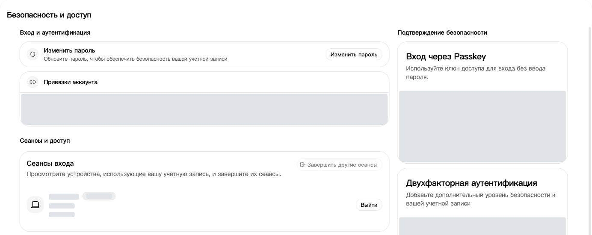
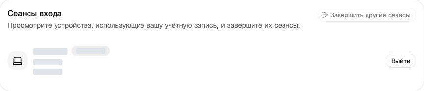
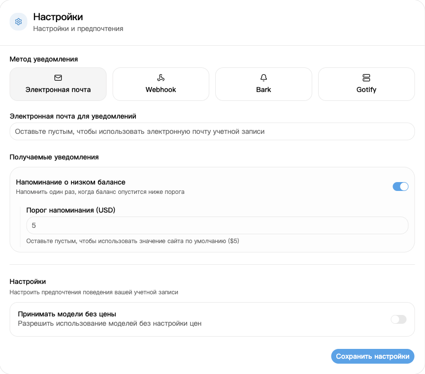

## 1. Войдите в аккаунт

На [странице входа](https://nexusapi.link/sign-in) укажите свой аккаунт и пароль. Обратитесь в поддержку, если аккаунта нет или пароль не удаётся восстановить.

## 2. Смените пароль и проверьте устройства

1. Откройте [Безопасность и доступ](https://nexusapi.link/security).
2. Нажмите **Изменить пароль**, заполните поля и сохраните.
3. Прокрутите до сеансов входа. Отзовите незнакомые сеансы или выйдите из остальных сеансов, чтобы отключить другие устройства.

Сеансы входа: проверьте устройства и при необходимости завершите незнакомые сеансы. Сведения об устройствах скрыты.

**Для приложений с моделями нужен ключ из раздела [Ключи API](/ru/guide/api-key). Токены в разделе «Безопасность и доступ» предназначены для API управления, а не для подключения моделей.**

## 3. При подозрении на утечку

| Ситуация | Что сделать сразу |
| --- | --- |
| Утечка пароля или неизвестный вход | Изменить пароль и отозвать незнакомые сеансы |
| Утечка API-ключа | Отключить или удалить старый ключ, создать новый и заменить его в приложении |

**Выход из сайта не отключает API-ключи.** Никому не отправляйте пароли, коды подтверждения и полные ключи.

## 4. Настройте уведомление о низком балансе

1. Откройте [Профиль](https://nexusapi.link/profile) и настройки уведомлений.
2. Выберите **Электронная почта** и укажите адрес для получения писем. Пустое поле использует адрес аккаунта; если его нет, введите адрес.
3. Включите **Напоминание о низком балансе** и укажите порог либо оставьте поле пустым для значения сайта.
4. Нажмите **Сохранить настройки**.

Порог задаётся в единицах кредита со страницы, а не в сумме оплаты в юанях. Уведомление отправляется один раз при падении баланса ниже порога, а не после каждого запроса. Не полагайтесь только на почту; перед использованием проверьте [кошелёк](https://nexusapi.link/wallet).
