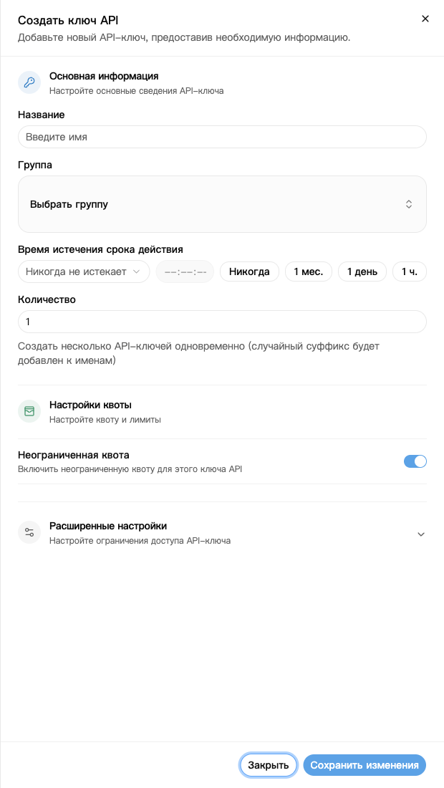
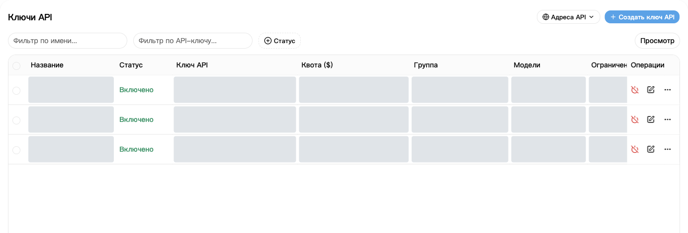
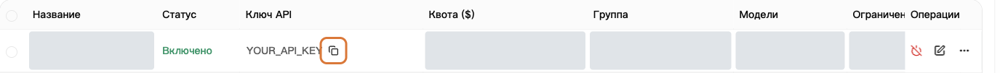

API-ключ — это ключ, который приложение использует для подключения к NexusAPI.

Чтобы разрешить использование ключа только с нужных компьютеров или серверов, следуйте [инструкции по белому списку IP](/ru/guide/ip-whitelist).

## 1. Создайте ключ

1. Откройте [Ключи API](https://nexusapi.link/keys).
2. Справа вверху нажмите **Создать ключ API**.
3. Заполните поля по таблице.
4. Нажмите **Сохранить изменения**.

| Поле | Что указать |
| --- | --- |
| Название | Понятное вам имя, например `Мой компьютер` |
| Группа | Группу от поддержки; если не знаете — уточните |
| Количество | `1` |
| Срок действия | Для первого запуска оставьте значение по умолчанию |
| Квота, дополнительные настройки | Оставьте по умолчанию, если нет особых требований |

Серые области скрывают личные сведения, а не обозначают недоступные функции. Группы, модели и цены сверяйте с текущей страницей.

Безлимитная квота не означает бесплатное использование: запросы расходуют баланс или лимит подписки.

Параметр **Разрешить просмотр квоты пользователя** в дополнительных настройках позволяет приложению с этим ключом читать остаток и расход кредитов аккаунта. Для личного использования оставьте значение по умолчанию; перед передачей ключа решите, должен ли получатель видеть эти сведения.

## 2. Вставьте ключ в приложение

1. Вернитесь к списку и найдите новый ключ.
2. Нажмите кнопку копирования. Не переписывайте текст со звёздочками.
3. Вставьте полный ключ в поле **API Key** приложения.
4. Адрес и модель укажите по [инструкции приложения](/ru/tools).

Скопируйте полный ключ кнопкой в рамке. На снимке указан заполнитель.

Адрес платформы можно скопировать через **Адреса API** справа вверху страницы ключей. Нужен ли `/v1`, смотрите в [инструкции приложения](/ru/tools); не добавляйте пути самостоятельно.

**Используйте этот ключ, а не токен из раздела «Безопасность и доступ».**

Пункт **Копировать данные подключения** в меню строки копирует адрес и полный ключ. **Это не ссылка для публичного обмена.** Используйте её только в доверенной программе с явной поддержкой этого формата; иначе копируйте ключ отдельно, как описано выше. Не отправляйте данные подключения в группу или поддержке.

## 3. Если ключ раскрыт

Немедленно отключите или удалите старый ключ, создайте новый и замените его в приложении.

Не публикуйте полные ключи в чатах, скриншотах и открытом коде. Поддержке полный ключ не нужен.

## Смените группу или ключ

**Для смены группы создавать новый ключ не обязательно:**

1. В [Ключах API](https://nexusapi.link/keys) найдите используемый ключ и нажмите **Изменить** в его строке.
2. Выберите разрешённую группу, совместимую с приложением, и сохраните. Если группы нет, уточните у поддержки, не выбирайте наугад.
3. На [витрине](https://nexusapi.link/pricing) выберите новую группу, проверьте модель и цену, затем [измените и протестируйте приложение](/ru/billing/models-pricing#change-model).

Смена группы не создаёт новый ключ, но затрагивает все использующие его программы. Для изменения только одной программы удобнее создать отдельный ключ.

**Замена ключа:** создайте новый, замените его в приложении, перезапустите и проверьте запрос, затем отключите ненужный старый. При утечке отключите старый сразу, не дожидаясь теста. Не отправляйте ключи поддержке.

Если указаны **Группа пользователя**, **Наследуется**, **Межгрупповой** или `auto`, сначала уточните у поддержки доступные группы, модели и стоимость. Не предполагайте фиксированный множитель и не меняйте группу только ради совпадения с примером.

## Квота, срок действия и ограничения моделей

1. В [Ключах API](https://nexusapi.link/keys) найдите ключ и нажмите **Изменить**.
2. Измените только нужные поля из таблицы.
3. Сохраните изменения. Они затронут все программы с этим ключом.

| Ограничение | Настройка |
| --- | --- |
| Сколько ключ ещё может использовать | В разделе **Настройки квоты** отключите **Неограниченная квота** и укажите значение в отображаемых единицах |
| Срок действия | Укажите дату и время в **Время истечения срока действия** либо нажмите **Никогда** для бессрочного использования |
| Разрешённые модели | Откройте **Расширенные настройки** и выберите модели в поле **Лимиты модели** |
| IP источника | Следуйте [инструкции IP](/ru/guide/ip-whitelist) |

**Квота — это остаток, не платёж и не добавляемая сумма.** Если единица поля `$`, значение `10` задаёт остаток `$10` кредитов аккаунта: не 10 CNY и не ещё 10 сверх старого значения. Ориентируйтесь на единицы поля.

Это не автоматически обновляемый месячный бюджет. Аккаунту всё равно нужны баланс или подходящий план. Неограниченная квота снимает только собственное ограничение этого ключа.

Если убрать все выбранные модели, дополнительное ограничение ключа снимается, но **модели вне его группы не открываются**. Для смены модели или группы используйте предыдущие шаги.

Создавайте отдельные ключи с понятными именами для разных программ, например `Рабочий компьютер` и `Сервер`. Не используйте одновременно безлимитную квоту и бессрочность для временной передачи ключа.

Если Claude Code нужны вспомогательные модели, разрешите и подтверждённые доступные вспомогательные модели. Разрешения только основной модели может не хватить для некоторых операций. Имена берите из [инструкции](/ru/tools/claude-code) или уточняйте у поддержки.

## Приостановка, включение и удаление ключа

- **Пауза**: нажмите кнопку питания **Отключить** и проверьте статус строки **Отключено**. Следующие запросы с ключом будут отклонены.
- **Возобновление**: нажмите **Включить** там же. При истечении срока или квоты сначала измените их и сохраните, затем включите. Повторные нажатия ограничение не исправят.
- **Завершение использования**: убедитесь, что ключ не нужен другим программам, выберите **Удалить** в меню строки и следуйте подтверждению. Удаление не заменяет временную паузу.

Выход с сайта и закрытие браузера не отключают ключ. При подозрительном расходе сначала отключите его, затем [проверьте журнал](/ru/billing/usage-and-billing#find-key-usage).

### Ключ не работает: четыре проверки

| Проверка | Действие |
| --- | --- |
| Отключён или просрочен | Найдите ключ, который реально использует программа, и проверьте статус и срок |
| Доступный остаток | Проверьте кошелёк и остаток квоты ключа. Безлимитная квота не означает наличие средств |
| Разрешённая модель | Проверьте модели группы и ограничения ключа, включая нужные вспомогательные модели Claude Code |
| Ограничение IP | Если ошибка явно запрещает IP, проверьте выход по [инструкции](/ru/guide/ip-whitelist). Не разрешайте все IP |

Если ошибка остаётся, сохраните её текст и выполните [самопроверку](/ru/faq/self-check). Не повторяйте запросы бесконечно и не отправляйте полный ключ поддержке.
