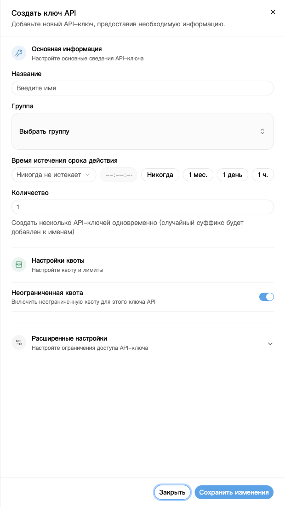
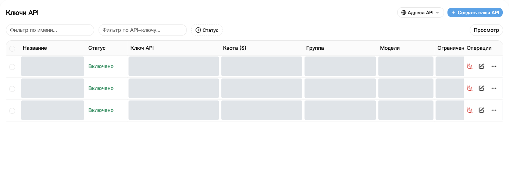
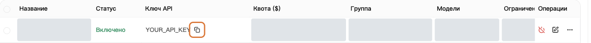

API-ключ — это ключ, который приложение использует для подключения к NexusAPI.

## 1. Создайте ключ

1. Откройте [Ключи API](https://nexusapi.link/keys).
2. Справа вверху нажмите **Создать ключ API**.
3. Заполните поля по таблице.
4. Нажмите **Сохранить изменения**.

| Поле | Что указать |
| --- | --- |
| Название | Понятное вам имя, например `Мой компьютер` |
| Группа | Группу от поддержки; если не знаете — уточните |
| Количество | `1` |
| Срок действия | Для первого запуска оставьте значение по умолчанию |
| Квота, дополнительные настройки | Оставьте по умолчанию, если нет особых требований |

Серые области скрывают личные сведения, а не обозначают недоступные функции. Группы, модели и цены сверяйте с текущей страницей.

Безлимитная квота не означает бесплатное использование: запросы расходуют баланс или лимит подписки.

Параметр **Разрешить просмотр квоты пользователя** в дополнительных настройках позволяет приложению с этим ключом читать остаток и расход кредитов аккаунта. Для личного использования оставьте значение по умолчанию; перед передачей ключа решите, должен ли получатель видеть эти сведения.

## 2. Вставьте ключ в приложение

1. Вернитесь к списку и найдите новый ключ.
2. Нажмите кнопку копирования. Не переписывайте текст со звёздочками.
3. Вставьте полный ключ в поле **API Key** приложения.
4. Адрес и модель укажите по [инструкции приложения](/ru/tools).

Скопируйте полный ключ кнопкой в рамке. На снимке указан заполнитель.

Адрес платформы можно скопировать через **Адреса API** справа вверху страницы ключей. Нужен ли `/v1`, смотрите в [инструкции приложения](/ru/tools); не добавляйте пути самостоятельно.

**Используйте этот ключ, а не токен из раздела «Безопасность и доступ».**

## 3. Если ключ раскрыт

Немедленно отключите или удалите старый ключ, создайте новый и замените его в приложении.

Не публикуйте полные ключи в чатах, скриншотах и открытом коде. Поддержке полный ключ не нужен.

## Смените группу или ключ

**Для смены группы создавать новый ключ не обязательно:**

1. В [Ключах API](https://nexusapi.link/keys) найдите используемый ключ и нажмите **Изменить** в его строке.
2. Выберите разрешённую группу, совместимую с приложением, и сохраните. Если группы нет, уточните у поддержки, не выбирайте наугад.
3. На [витрине](https://nexusapi.link/pricing) выберите новую группу, проверьте модель и цену, затем [измените и протестируйте приложение](/ru/billing/models-pricing#change-model).

Смена группы не создаёт новый ключ, но затрагивает все использующие его программы. Для изменения только одной программы удобнее создать отдельный ключ.

**Замена ключа:** создайте новый, замените его в приложении, перезапустите и проверьте запрос, затем отключите ненужный старый. При утечке отключите старый сразу, не дожидаясь теста. Не отправляйте ключи поддержке.
