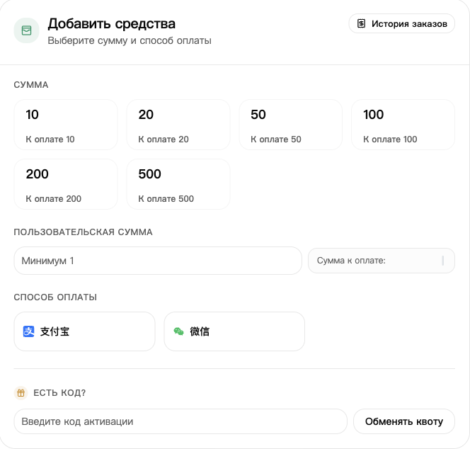

## 1. Пополните баланс

1. Откройте [Кошелёк](https://nexusapi.link/wallet).
2. В разделе пополнения выберите сумму или введите свою.
3. Проверьте сумму оплаты и получаемые кредиты, выберите способ оплаты.
4. Выполните инструкции платёжной страницы.
5. Вернитесь в кошелёк и обновите страницу, чтобы проверить баланс.

Баланс в `$` — это кредиты, а не сумма оплаты в юанях. См. [примеры стоимости](/ru/billing/multipliers-and-discounts).

## 2. Коды и подписки

- **Код:** вставьте код в поле обмена в кошельке и нажмите кнопку обмена.
- **Подписка:** если доступны планы, до покупки проверьте срок, лимит и разрешённые группы. Подписка отличается от баланса кошелька. Если не уверены, спросите поддержку до оплаты.

## 3. Оплатили, но баланс не пополнился

Обновите кошелёк и проверьте **Историю заказов**. Если начисления всё ещё нет, отправьте поддержке:

- Аккаунт для входа.
- Время, сумму и способ оплаты.
- Номер заказа и скриншот оплаты.

Скройте конфиденциальные данные. **Не отправляйте пароль, код подтверждения или полный API-ключ.**

## Найти прошлые платежи

1. В [Кошельке](https://nexusapi.link/wallet) откройте историю заказов.
2. Если есть номер, введите его в **Поиск по номеру заказа...**. Иначе просмотрите страницы, сопоставьте время и сумму и проверьте статус. Поле поиска не фильтрует по времени или сумме.
3. Обновите также баланс кошелька для проверки зачисления. Один снимок платежа не подтверждает поступление кредитов.

| Статус заказа | Следующий шаг |
| --- | --- |
| Успешно | Обновите кошелёк и проверьте баланс. При сомнениях передайте номер поддержке |
| Ожидает | Завершение не подтверждено. Если деньги списаны, сохраните чек и обратитесь в поддержку, не оплачивая повторно |
| Просрочено | Если оплата прошла, но кредиты не поступили, обратитесь в поддержку. Статус не означает возврат денег |

Если заказа нет или статус непонятен, передайте поддержке время, номер и квитанцию без личных данных. Не платите сразу повторно. Вызовы моделей смотрите в [журнале использования](/ru/billing/usage-and-billing), а не платёжных заказах.
