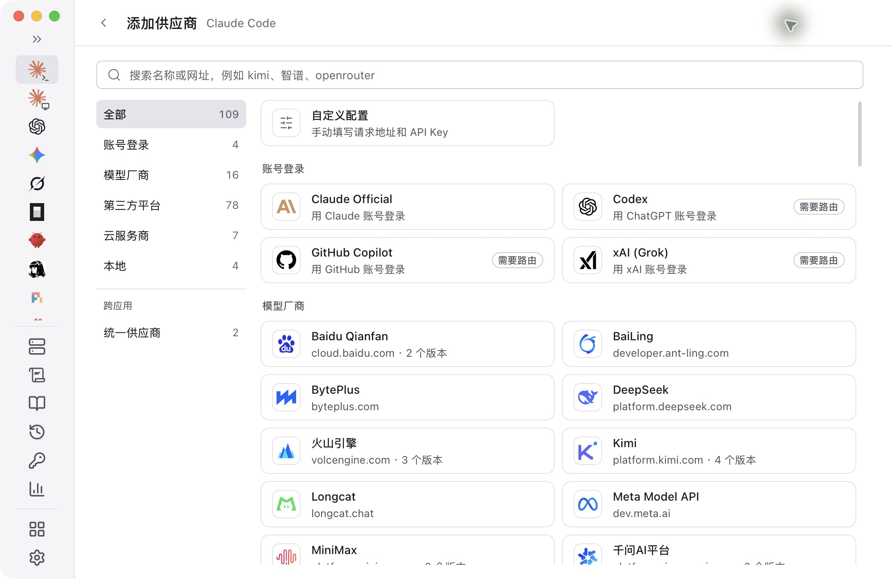
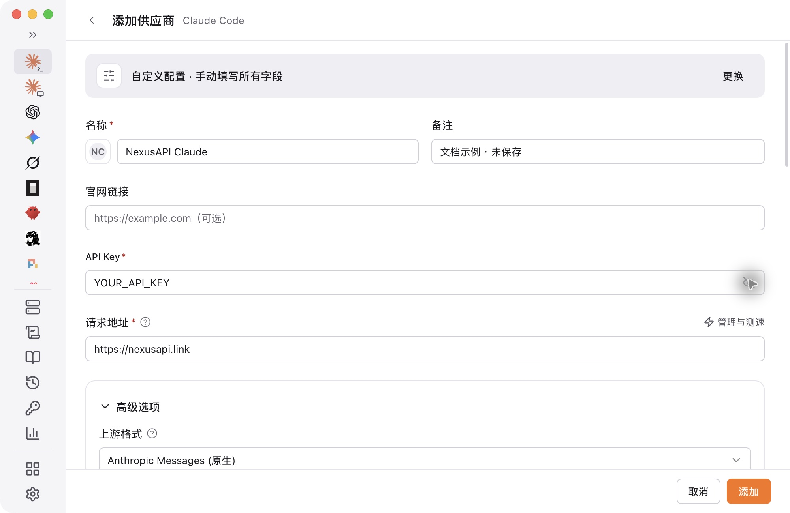
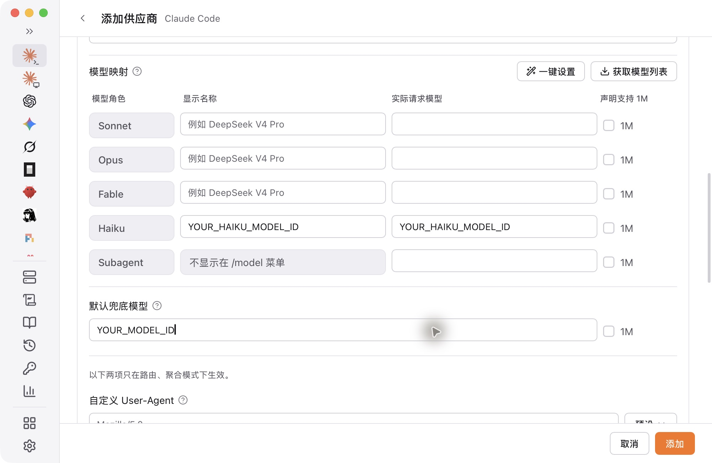

CC Switch управляет настройками. **Сначала установите [Claude Code](/ru/tools/claude-code) или [Codex CLI](/ru/tools/codex-cli), выполнив только установку, затем вернитесь сюда.** Отдельно менять их файлы не нужно.

## 1. Установите CC Switch

Выберите пакет на [официальной странице](https://github.com/farion1231/cc-switch/releases/latest):

- Windows: Windows `.msi`, для ARM — вариант `arm64`.
- macOS: откройте macOS `.dmg` и установите.
- Linux: подходящий `.deb` или `.AppImage`.

## 2. Добавьте своего провайдера

Слева выберите **Claude Code** или **Codex**, справа вверху **+ / Add provider**, затем пользовательскую конфигурацию. Не выбирайте Claude Desktop или шаблон другого сайта.



## 3. Заполните поля

[Создайте ключ](/ru/guide/api-key), выберите его группу в [Витрине моделей](https://nexusapi.link/pricing), скопируйте модель для инструмента. Укажите значения NexusAPI из таблицы ниже:

| Поле | Claude Code | Codex |
| --- | --- | --- |
| Название | NexusAPI Claude | NexusAPI Codex |
| Адрес | `https://nexusapi.link` | `https://nexusapi.link/v1` |
| API Key | Ваш полный ключ NexusAPI | Ваш полный ключ NexusAPI |
| Основная модель | Скопированная модель Claude Code / Messages | Скопированная модель Codex / Responses |

Claude Code: откройте дополнительные настройки. В «默认兜底模型» (модель по умолчанию) вставьте скопированное имя основной модели. Для Haiku укажите в поле фактически вызываемой модели вспомогательную модель, подтверждённую поддержкой. Замените заполнители на снимках.

Codex: укажите модель из таблицы; настройки моделей Claude Code не нужны. Настройте только нужное приложение, выберите Direct, остальные параметры оставьте по умолчанию и нажмите Add / Save.



Пример формы Claude Code. Замените заполнители; черновик не сохранён, подключение не проверено.



## 4. Включите и проверьте

Нажмите **Switch / Включить** для этого провайдера NexusAPI. Одного сохранения недостаточно. Заново откройте терминал и запустите нужный инструмент:

<Tabs>
<Tab title="Claude Code">
```bash
claude
```
</Tab>
<Tab title="Codex">
```bash
codex
```
</Tab>
</Tabs>

Отправьте «Ответь только: подключение успешно. Не меняй файлы». Проверьте полный ответ, модель и группу в [журнале](https://nexusapi.link/usage-logs/common). Тест расходует немного кредитов.

Команда не найдена: установите CLI. Остался официальный сервис: проверьте Enable и перезапустите. Нет модели: скопируйте из своей группы. Если ошибка указывает вспомогательную модель, уточните доступные Haiku / Sonnet / Opus. Ключ на скриншотах для поддержки скрывайте.

Официальный проект: [CC Switch](https://github.com/farion1231/cc-switch). Названия кнопок могут отличаться в зависимости от версии.

<span id="switch-back"></span>

## Изменить настройки или вернуть прежний сервис

- **Модель:** измените основную модель NexusAPI, сохраните, проверьте активацию и перезапустите. Модель должна быть доступна группе ключа; см. [смену модели](/ru/billing/models-pricing#change-model).
- **Прежний сервис:** в нужном приложении выберите ранее сохранённого провайдера, нажмите **Switch** и перезапустите. Если настройки удалены или не сохранены, сначала восстановите их; не угадывайте реквизиты.
- **Ручная настройка:** восстановите только изменённые параметры из своей копии. Без копии сначала спросите поддержку. Не удаляйте весь каталог и не публикуйте ключи из резервных копий.

Проверьте новым запросом и журналом соответствующего сервиса, а не самоописанием ИИ.
<span id="import-from-website"></span>

## Импорт с сайта

Если CC Switch установлен, можно начать импорт с сайта и сократить ручной ввод:

1. В [Ключах API](https://nexusapi.link/keys) откройте меню строки ключа и выберите **CC Switch**.
2. В **Импорт в CC Switch** выберите Claude или Codex, понятное имя и основную модель, доступную группе ключа и совместимую с программой. Если её нет, сначала проверьте группу.
3. Нажмите **Открыть CC Switch**, подтвердите импорт по подсказкам браузера и локального приложения. Если оно не открывается, проверьте установку или используйте ручную настройку.
4. В CC Switch проверьте адрес, модель и активную конфигурацию, затем перезапустите и протестируйте по разделу 4. **Открытие импорта не означает успешное переключение.**

Импорт передаёт выбранный ключ локальному CC Switch. Сгенерированная ссылка может содержать полный ключ: не отправляйте её другим и не публикуйте на снимках.

Поля вспомогательных моделей Claude Haiku, Sonnet и Opus заполняйте только при подтверждённых необходимости и доступности. Не копируйте заполнители, а уточняйте имена у поддержки. Если ключ ограничен по моделям, разрешите также нужные основную и вспомогательные модели.
