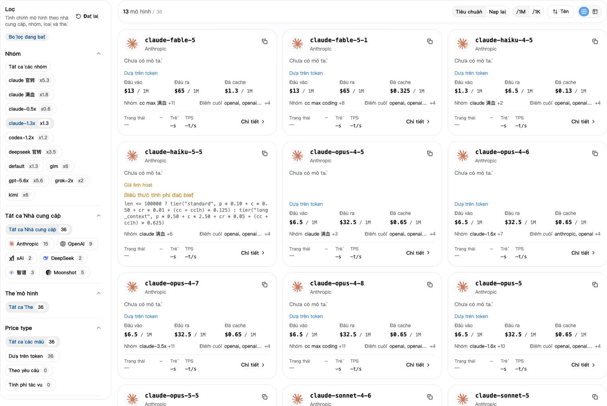
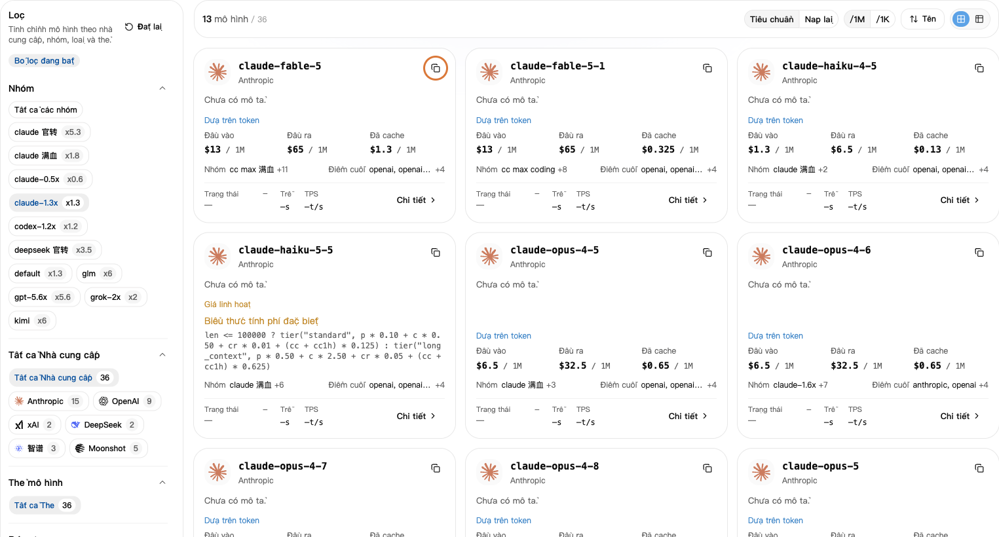

## 1. Chọn nhóm trước

1. Mở [Khóa API](https://nexusapi.link/keys), tìm khóa đang dùng và ghi lại **Nhóm**.
2. Mở [Quảng trường mô hình](https://nexusapi.link/pricing).
3. Chọn cùng nhóm ở bên trái.

**Không chỉ xem giá của Tất cả các nhóm. Chọn nhóm của bạn để xem đúng giá nhóm đó.**

## 2. Sao chép tên mô hình

Tìm mô hình cần dùng, bấm sao chép tên rồi dán vào ô mô hình của phần mềm. Không tự gõ theo trí nhớ.

Không tìm thấy? Gửi hỗ trợ **tên phần mềm, mô hình muốn dùng và nhóm hiện tại** để xác nhận nên chọn nhóm nào.

Chọn nhóm của bạn rồi bấm nút sao chép ở góc trên bên phải thẻ mô hình. Nhóm và giá trong ảnh chỉ để minh họa; hãy kiểm tra trang hiện tại.

Chưa rõ có tương thích? Xem [chọn theo phần mềm](/vi/tools#choose-model) và [giao thức đề xuất](/vi/developer/model-protocols). Tên giống nhau không bảo đảm dùng thay được.

## 3. Xem giá

- **Tiêu chuẩn:** số dư tài khoản bị trừ khi gọi.
- **Nạp lại:** chi phí tham khảo theo cài đặt trang; ưu đãi hoặc gói của bạn có thể khác.
- **`/1M`:** giá mỗi một triệu token. **`/1K`:** giá mỗi một nghìn token. Khi so sánh, chọn cùng đơn vị.

Nội dung gửi đi là đầu vào, câu trả lời là đầu ra. Phí bộ nhớ đệm hoặc phí khác xem trong **Chi tiết**.

Nếu chi tiết có phí đọc, ghi bộ nhớ đệm, giá theo bậc hoặc gọi công cụ, hãy xem từng mục áp dụng. Giá đầu vào chưa chắc là toàn bộ chi phí. Chưa rõ thì gửi mô hình và nhóm cho hỗ trợ.

**Giá đã gồm hệ số nhóm, không nhân thêm lần nữa.** Xem [ví dụ giảm giá](/vi/billing/multipliers-and-discounts) hoặc [phí đã trừ](/vi/billing/usage-and-billing).

## 4. Xem tốc độ và tỷ lệ thành công

Nếu chi tiết mô hình có **Hiệu suất**, mở để xem dữ liệu của nhóm đang dùng:

- **Thời gian tới token đầu tiên:** thời gian chờ câu trả lời bắt đầu; thường càng ngắn càng nhanh.
- **Tốc độ đầu ra:** số token mỗi giây sau khi bắt đầu trả lời; thường càng cao càng nhanh.
- **Tỷ lệ thành công:** tỷ lệ yêu cầu thành công trong khoảng thống kê.

Đây là thống kê lịch sử, không bảo đảm từng lần gọi và không thể hiện chất lượng câu trả lời. Không có dữ liệu không có nghĩa là không dùng được. Nếu khó chọn, gửi tên phần mềm và mục đích cho hỗ trợ.

## Đổi mô hình

1. Chọn nhóm của khóa trong Quảng trường mô hình rồi sao chép tên tương thích. Đổi sang nhóm khác thì xem [hướng dẫn khóa](/vi/guide/api-key#change-key) trước.
2. Sửa đúng vị trí; chỉ đổi mô hình không cần tạo khóa mới:

| Cách dùng | Sửa ở đâu |
| --- | --- |
| CC Switch | Mô hình chính của cấu hình NexusAPI hiện tại; lưu rồi xác nhận vẫn đang bật |
| Claude Code thủ công | `model` trong cài đặt người dùng theo [hướng dẫn](/vi/tools/claude-code) |
| Codex CLI thủ công | `model` ở đầu tệp, giữ Provider NexusAPI; xem [hướng dẫn](/vi/tools/codex-cli) |
| Tiện ích Claude Code | `ANTHROPIC_MODEL` trong cài đặt người dùng; xem [hướng dẫn](/vi/tools/cursor-vscode) |
| Chương trình tự viết | `model` trong yêu cầu; nếu đổi giao thức, chỉnh yêu cầu theo hướng dẫn giao diện tương ứng |

3. Lưu rồi mở lại công cụ hoặc trình soạn thảo. Trong hội thoại mới, gửi “Chỉ trả lời: kết nối thành công. Không sửa tệp.”
4. Kiểm tra mô hình và nhóm trong [nhật ký](https://nexusapi.link/usage-logs/common). Lượt thử dùng hạn mức. Không hỏi AI tên của nó để xác minh đường đi.

Hội thoại cũ có thể giữ cấu hình hay ngữ cảnh trước đó. Lưu nội dung quan trọng rồi kiểm tra bằng hội thoại mới.
