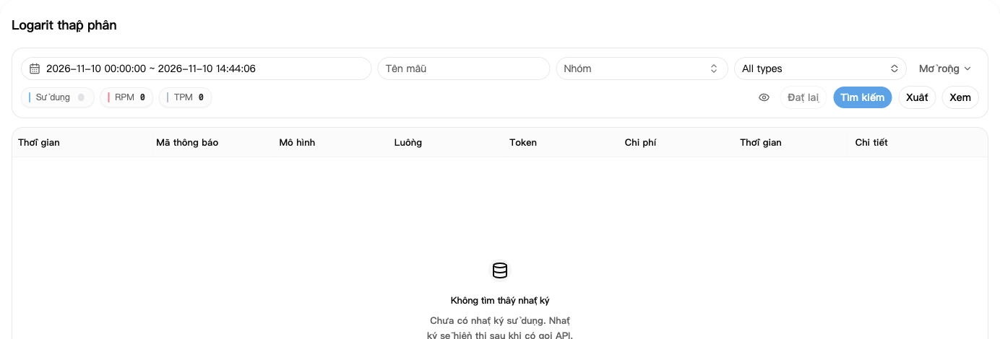
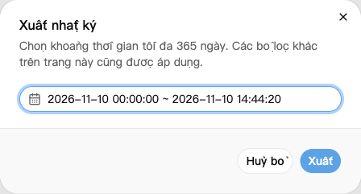

## 1. Tìm bản ghi lượt gọi

1. Mở [Nhật ký sử dụng](https://nexusapi.link/usage-logs/common).
2. Chọn ngày gọi và bấm **Tìm kiếm**.
3. Nếu có nhiều bản ghi, lọc theo mô hình hoặc nhóm.
4. Bấm chi phí hoặc phần chi tiết của bản ghi cần xem.

Bản ghi mới có thể xuất hiện chậm một chút. Chờ rồi tải lại, không gọi lặp chỉ để xem nhật ký.

## 2. Xem các mục chính

| Mục | Kiểm tra gì |
| --- | --- |
| Thời gian, mô hình, nhóm | Có đúng lượt gọi của bạn không |
| Tokens | Lượng sử dụng; chi tiết có thể tách đầu vào, đầu ra, bộ nhớ đệm |
| Chi phí | Số dư đã bị trừ |
| Thời gian xử lý | Lượt gọi mất bao lâu |

Biểu tượng gói hoặc ví cạnh chi phí cho biết nguồn bị trừ. Trừ hạn mức gói không có nghĩa là ví cũng bị trừ thêm lần nữa. Di chuột lên biểu tượng để xem nhãn.

Phí bộ nhớ đệm hoặc gọi công cụ xem trong chi tiết bản ghi; chỉ lượng đầu vào và đầu ra có thể chưa giải thích hết tổng phí.

**Phí `$0.10` không phải lúc nào cũng là 0,10 nhân dân tệ thực trả.** Xem [ví dụ chi phí](/vi/billing/multipliers-and-discounts).

## 3. Tải bản ghi sử dụng

1. Lọc nhật ký theo mô hình hoặc nhóm nếu cần.
2. Bấm **Xuất** và chọn thời gian bắt đầu, kết thúc.
3. Bấm **Xuất** lần nữa để tải tệp CSV, có thể mở bằng Excel.

Các bộ lọc khác trên trang vẫn được áp dụng. Chờ một lần xuất hoàn tất trước khi bắt đầu lần tiếp theo.

Hiện khoảng thời gian tối đa cho một lần tìm hoặc xuất là **365 ngày**; nếu thay đổi, làm theo thông báo trên trang. Điều này không bảo đảm nhật ký được lưu đủ 365 ngày. Nếu khoảng quá dài, hãy chia theo tháng.

Tệp có thể chứa IP và mã yêu cầu. Kiểm tra và che thông tin riêng tư trước khi chia sẻ.

## 4. Có thắc mắc về phí

Nếu lỗi, không nhận đủ câu trả lời hoặc nghi bị trừ lặp, gửi hỗ trợ:

- Thời gian, mô hình và nhóm.
- Nguyên văn lỗi và có nhận đủ câu trả lời hay không.
- Ảnh nhật ký; nếu chi tiết có Request ID thì sao chép kèm theo.

**Không gửi khóa API đầy đủ.** Giữ bản ghi và tránh thử lại nhiều lần làm phát sinh thêm lượt gọi.
