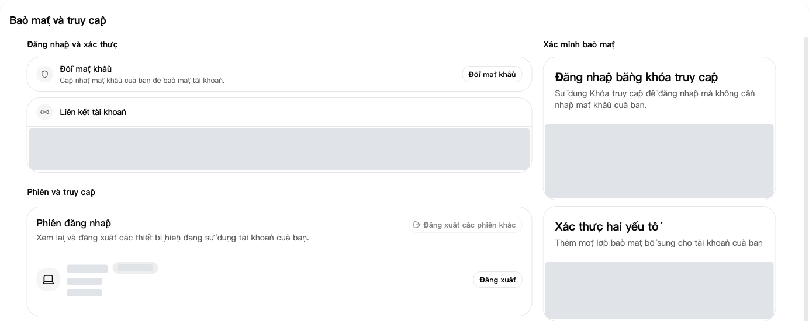
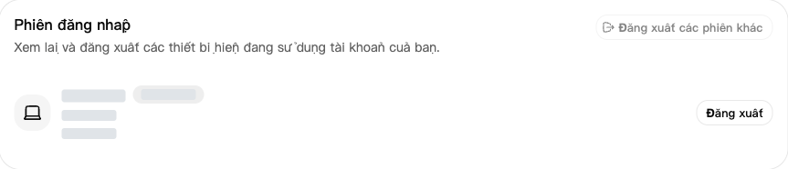
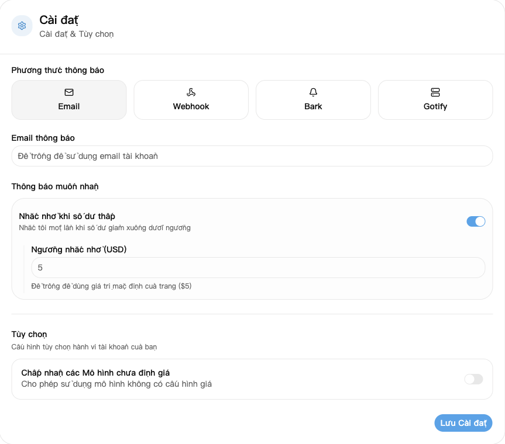

## 1. Đăng nhập

Mở [trang đăng nhập](https://nexusapi.link/sign-in), nhập tài khoản và mật khẩu của bạn. Chưa có tài khoản hoặc không khôi phục được mật khẩu thì liên hệ hỗ trợ.

## 2. Đổi mật khẩu và xem thiết bị

1. Mở [Bảo mật và truy cập](https://nexusapi.link/security).
2. Bấm đổi mật khẩu, điền theo hướng dẫn và lưu.
3. Kéo xuống phần phiên đăng nhập. Thu hồi phiên lạ, hoặc chọn đăng xuất các phiên khác để thoát khỏi thiết bị khác.

Phiên đăng nhập: kiểm tra thiết bị và đăng xuất phiên lạ nếu cần. Thông tin thiết bị đã được che.

**Phần mềm AI dùng khóa tạo tại [Khóa API](/vi/guide/api-key). Token trong Bảo mật và truy cập dành cho API quản lý, không cần tạo hay nhập để kết nối mô hình.**

## 3. Nghi lộ tài khoản hoặc khóa

| Tình huống | Làm ngay |
| --- | --- |
| Lộ mật khẩu hoặc có đăng nhập lạ | Đổi mật khẩu và thu hồi các phiên lạ |
| Lộ khóa API | Vô hiệu hóa hoặc xóa khóa cũ, tạo khóa mới và thay trong phần mềm |

**Chỉ đăng xuất trang web không vô hiệu hóa khóa API.** Không gửi mật khẩu, mã xác minh hoặc khóa đầy đủ cho ai.

## 4. Đặt nhắc nhở số dư thấp

1. Mở [Hồ sơ](https://nexusapi.link/profile) và tìm cài đặt thông báo.
2. Chọn **Email**, điền địa chỉ nhận được thư. Để trống sẽ dùng email tài khoản; nếu tài khoản chưa có email thì điền một địa chỉ.
3. Bật **Nhắc nhở khi số dư thấp** và điền ngưỡng, hoặc để trống để dùng mặc định của trang.
4. Bấm **Lưu Cài đặt**.

Ngưỡng dùng đơn vị hạn mức hiển thị trên trang, không phải số tiền nạp bằng nhân dân tệ. Chỉ nhắc một lần khi số dư giảm xuống dưới ngưỡng, không nhắc sau mỗi lượt gọi. Đừng chỉ dựa vào email; trước khi dùng vẫn có thể kiểm tra [ví](https://nexusapi.link/wallet).

## Hiển thị cá nhân và ghi IP

### Đổi ngôn ngữ giao diện

Mở [Hồ sơ](https://nexusapi.link/profile), chọn **Ngôn ngữ giao diện** và đợi báo lưu thành công. Cài đặt đồng bộ giữa thiết bị đã đăng nhập và có thể đổi ngôn ngữ lỗi API.

### Khôi phục menu đã ẩn

Nếu có **Cài đặt cá nhân thanh bên**, bật mục cần dùng rồi bấm **Lưu Thay đổi**. Muốn về mặc định, bấm **Đặt lại mặc định**, rồi lưu. Chỉ khôi phục menu đã được mở cho tài khoản, không cấp thêm quyền. Không có mục cần dùng thì hỏi hỗ trợ.

### Ghi IP nguồn

Trong [Bảo mật và truy cập](https://nexusapi.link/security), đổi **Ghi lại địa chỉ IP**, rồi bấm **Lưu Cài đặt**. Tùy chọn áp dụng cho nhật ký tiêu thụ và lỗi về sau, không điền lại IP thiếu trong bản ghi cũ.

**Ghi IP không phải danh sách trắng IP.** Ghi chỉ lưu nguồn; [danh sách trắng](/vi/guide/ip-whitelist) giới hạn riêng nguồn dùng khóa. Bật ghi không chặn người khác dùng khóa.

### Xem thao tác của chính tài khoản

Nếu menu có **Nhật ký kiểm toán**:

1. Mở [nhật ký kiểm toán](https://nexusapi.link/usage-logs/audit), chọn thời gian cần kiểm tra.
2. Muốn thu hẹp, chọn **Danh mục** hoặc **Kết quả**, rồi bấm **Tìm kiếm**.
3. Đối chiếu thời gian, thao tác và kết quả. Xong hãy đặt lại bộ lọc.

Đây là thao tác của chính tài khoản. Lượt gọi mô hình và phí xem ở [nhật ký sử dụng](/vi/billing/usage-and-billing), không phải nhật ký kiểm toán.

## Thiết lập xác thực hai yếu tố

Nếu [Bảo mật và truy cập](https://nexusapi.link/security) có **Xác thực hai yếu tố**:

1. Bấm **Bật** tại khu vực đó, hoàn thành xác minh bảo mật theo hộp thoại.
2. Quét mã QR bằng ứng dụng xác thực và làm theo các bước.
3. **Lưu mã dự phòng an toàn trước**, rồi nhập mã hiện tại của ứng dụng và hoàn tất **Bật 2FA**.
4. Xác nhận đã bật. Khi đăng nhập làm theo yêu cầu mã; nếu không dùng được điện thoại, mỗi mã dự phòng chỉ dùng một lần.

Để thay mã, dùng **Tạo lại Mã dự phòng**, xác minh danh tính và lưu mã mới. **Mọi mã cũ sẽ hết hiệu lực.** Không gửi QR, bí mật thiết lập hay mã dự phòng cho hỗ trợ hoặc trong ảnh. Không xác minh được thì liên hệ hỗ trợ, không thử liên tục hoặc tự xóa tài khoản.
