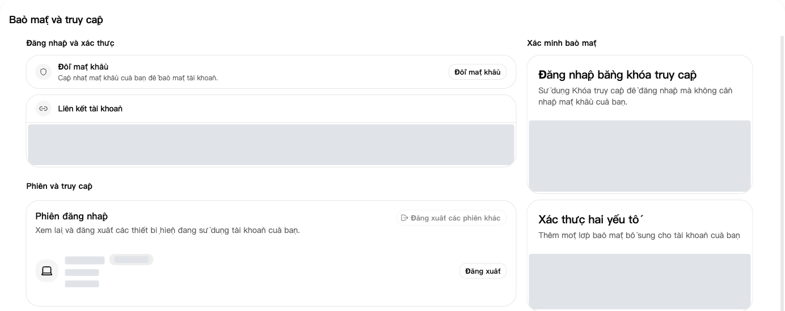
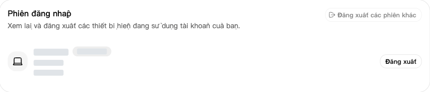
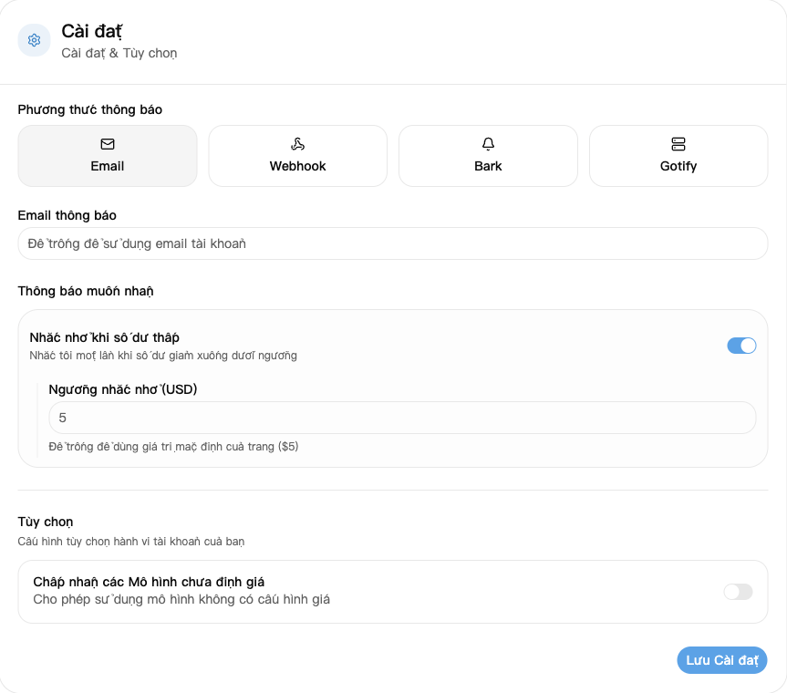

## 1. Đăng nhập

Mở [trang đăng nhập](https://nexusapi.link/sign-in), nhập tài khoản và mật khẩu của bạn. Chưa có tài khoản hoặc không khôi phục được mật khẩu thì liên hệ hỗ trợ.

## 2. Đổi mật khẩu và xem thiết bị

1. Mở [Bảo mật và truy cập](https://nexusapi.link/security).
2. Bấm đổi mật khẩu, điền theo hướng dẫn và lưu.
3. Kéo xuống phần phiên đăng nhập. Thu hồi phiên lạ, hoặc chọn đăng xuất các phiên khác để thoát khỏi thiết bị khác.

Phiên đăng nhập: kiểm tra thiết bị và đăng xuất phiên lạ nếu cần. Thông tin thiết bị đã được che.

**Phần mềm AI dùng khóa tạo tại [Khóa API](/vi/guide/api-key). Token trong Bảo mật và truy cập dành cho API quản lý, không cần tạo hay nhập để kết nối mô hình.**

## 3. Nghi lộ tài khoản hoặc khóa

| Tình huống | Làm ngay |
| --- | --- |
| Lộ mật khẩu hoặc có đăng nhập lạ | Đổi mật khẩu và thu hồi các phiên lạ |
| Lộ khóa API | Vô hiệu hóa hoặc xóa khóa cũ, tạo khóa mới và thay trong phần mềm |

**Chỉ đăng xuất trang web không vô hiệu hóa khóa API.** Không gửi mật khẩu, mã xác minh hoặc khóa đầy đủ cho ai.

## 4. Đặt nhắc nhở số dư thấp

1. Mở [Hồ sơ](https://nexusapi.link/profile) và tìm cài đặt thông báo.
2. Chọn **Email**, điền địa chỉ nhận được thư. Để trống sẽ dùng email tài khoản; nếu tài khoản chưa có email thì điền một địa chỉ.
3. Bật **Nhắc nhở khi số dư thấp** và điền ngưỡng, hoặc để trống để dùng mặc định của trang.
4. Bấm **Lưu Cài đặt**.

Ngưỡng dùng đơn vị hạn mức hiển thị trên trang, không phải số tiền nạp bằng nhân dân tệ. Chỉ nhắc một lần khi số dư giảm xuống dưới ngưỡng, không nhắc sau mỗi lượt gọi. Đừng chỉ dựa vào email; trước khi dùng vẫn có thể kiểm tra [ví](https://nexusapi.link/wallet).
