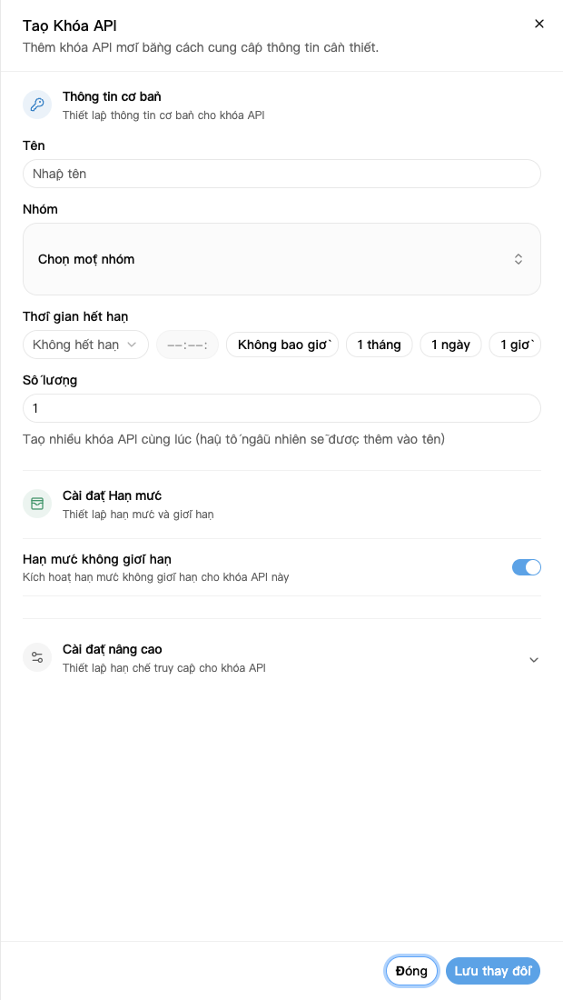
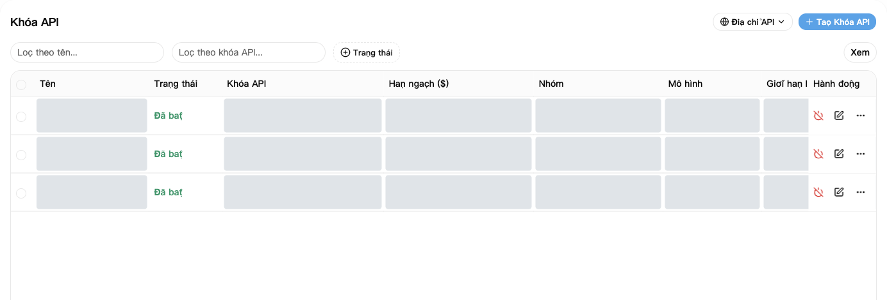
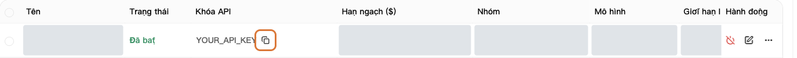

Khóa API là thông tin cần điền để phần mềm kết nối với NexusAPI.

## 1. Tạo khóa

1. Mở [Khóa API](https://nexusapi.link/keys).
2. Bấm **Tạo Khóa API** ở góc trên bên phải.
3. Điền theo bảng dưới đây.
4. Bấm **Lưu thay đổi**.

| Mục | Điền gì |
| --- | --- |
| Tên | Tên dễ nhận ra, ví dụ `Máy tính của tôi` |
| Nhóm | Nhóm do hỗ trợ cung cấp; chưa rõ thì hỏi trước |
| Số lượng | `1` |
| Hết hạn | Lần đầu có thể giữ mặc định |
| Hạn mức, cài đặt nâng cao | Giữ mặc định nếu không có yêu cầu riêng |

Vùng xám che dữ liệu cá nhân, không có nghĩa chức năng không dùng được. Nhóm, mô hình và giá ví dụ cần đối chiếu trang hiện tại.

Hạn mức không giới hạn không có nghĩa là miễn phí. Lượt gọi vẫn trừ số dư hoặc hạn mức gói.

Trong cài đặt nâng cao, **Cho phép tra cứu hạn mức người dùng** cho phép phần mềm giữ khóa này xem số dư hạn mức còn lại và đã dùng của tài khoản. Khi tự dùng có thể giữ mặc định; trước khi chia sẻ khóa, hãy xác nhận người nhận có được xem thông tin này không.

## 2. Dán vào phần mềm

1. Quay lại danh sách, tìm khóa mới tạo.
2. Bấm nút sao chép để lấy đầy đủ khóa. Không chép lại phần chữ có dấu sao.
3. Dán vào ô **API Key** của phần mềm.
4. Địa chỉ và tên mô hình điền theo [hướng dẫn phần mềm](/vi/tools).

Sao chép toàn bộ khóa bằng nút được khoanh. Khóa trong ảnh chỉ là giá trị giữ chỗ.

Để sao chép địa chỉ nền tảng, bấm **Địa chỉ API** ở góc trên bên phải trang khóa. Có cần thêm `/v1` hay không thì làm theo [hướng dẫn phần mềm](/vi/tools), không tự ghép đường dẫn.

**Dùng khóa tạo ở đây, không dùng token trong Bảo mật và truy cập.**

## 3. Nếu khóa bị lộ

Vô hiệu hóa hoặc xóa ngay khóa cũ, tạo khóa mới và thay lại trong phần mềm.

Không đăng khóa đầy đủ trong nhóm chat, ảnh hay mã công khai. Hỗ trợ cũng không cần khóa đầy đủ của bạn.

## Đổi nhóm hoặc khóa

**Đổi nhóm không bắt buộc tạo khóa mới:**

1. Trong [Khóa API](https://nexusapi.link/keys), tìm khóa đang dùng và bấm **Sửa** ở dòng đó.
2. Chọn nhóm đã được cấp và tương thích với phần mềm, rồi lưu. Không thấy nhóm thì hỏi hỗ trợ, đừng chọn ngẫu nhiên.
3. Trong [Quảng trường mô hình](https://nexusapi.link/pricing), chọn nhóm mới, kiểm tra mô hình và giá, rồi [đổi cấu hình và thử](/vi/billing/models-pricing#change-model).

Sửa nhóm không tạo khóa mới nhưng ảnh hưởng mọi chương trình dùng chung khóa. Chỉ muốn đổi một chương trình thì tạo khóa riêng sẽ dễ quản lý hơn.

**Đổi khóa:** bình thường, tạo khóa mới, thay trong phần mềm, mở lại và thử thành công rồi mới vô hiệu hóa khóa cũ không dùng nữa. Nếu khóa bị lộ, vô hiệu hóa ngay, không chờ thử xong. Không gửi khóa mới hay cũ cho hỗ trợ.
