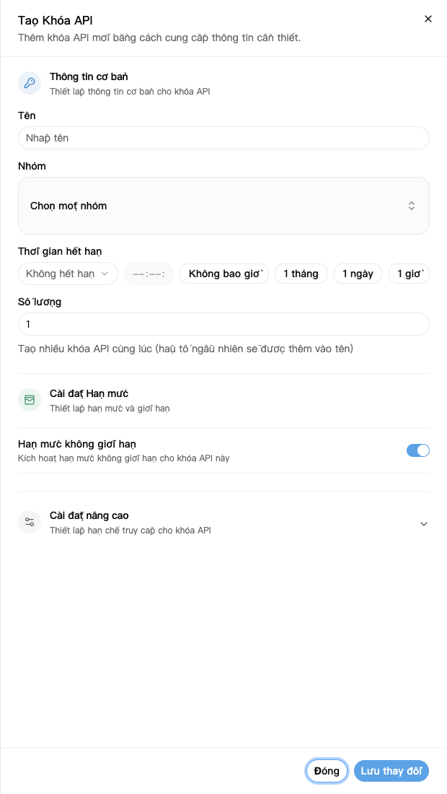
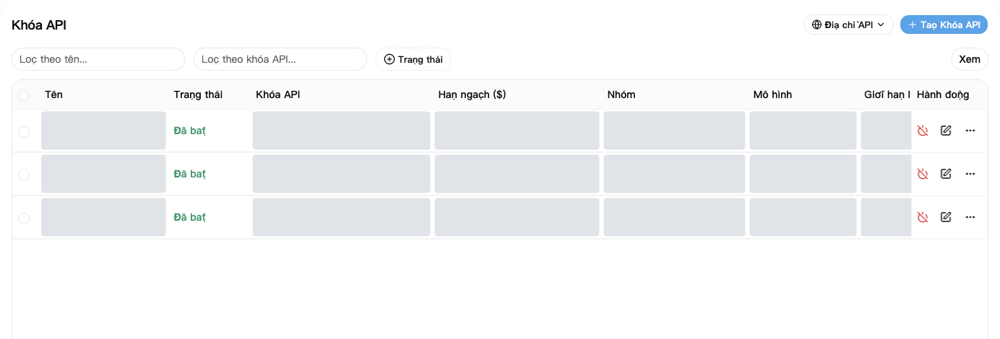
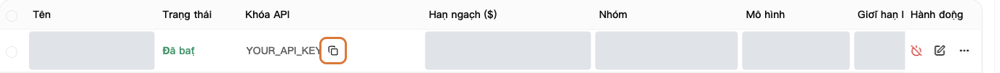

Khóa API là thông tin cần điền để phần mềm kết nối với NexusAPI.

Muốn chỉ cho phép máy tính hoặc máy chủ nhất định dùng khóa, hãy làm theo [hướng dẫn danh sách trắng IP](/vi/guide/ip-whitelist).

## 1. Tạo khóa

1. Mở [Khóa API](https://nexusapi.link/keys).
2. Bấm **Tạo Khóa API** ở góc trên bên phải.
3. Điền theo bảng dưới đây.
4. Bấm **Lưu thay đổi**.

| Mục | Điền gì |
| --- | --- |
| Tên | Tên dễ nhận ra, ví dụ `Máy tính của tôi` |
| Nhóm | Nhóm do hỗ trợ cung cấp; chưa rõ thì hỏi trước |
| Số lượng | `1` |
| Hết hạn | Lần đầu có thể giữ mặc định |
| Hạn mức, cài đặt nâng cao | Giữ mặc định nếu không có yêu cầu riêng |

Vùng xám che dữ liệu cá nhân, không có nghĩa chức năng không dùng được. Nhóm, mô hình và giá ví dụ cần đối chiếu trang hiện tại.

Hạn mức không giới hạn không có nghĩa là miễn phí. Lượt gọi vẫn trừ số dư hoặc hạn mức gói.

Trong cài đặt nâng cao, **Cho phép tra cứu hạn mức người dùng** cho phép phần mềm giữ khóa này xem số dư hạn mức còn lại và đã dùng của tài khoản. Khi tự dùng có thể giữ mặc định; trước khi chia sẻ khóa, hãy xác nhận người nhận có được xem thông tin này không.

## 2. Dán vào phần mềm

1. Quay lại danh sách, tìm khóa mới tạo.
2. Bấm nút sao chép để lấy đầy đủ khóa. Không chép lại phần chữ có dấu sao.
3. Dán vào ô **API Key** của phần mềm.
4. Địa chỉ và tên mô hình điền theo [hướng dẫn phần mềm](/vi/tools).

Sao chép toàn bộ khóa bằng nút được khoanh. Khóa trong ảnh chỉ là giá trị giữ chỗ.

Để sao chép địa chỉ nền tảng, bấm **Địa chỉ API** ở góc trên bên phải trang khóa. Có cần thêm `/v1` hay không thì làm theo [hướng dẫn phần mềm](/vi/tools), không tự ghép đường dẫn.

**Dùng khóa tạo ở đây, không dùng token trong Bảo mật và truy cập.**

**Sao chép thông tin kết nối** trong menu của dòng sao chép cả địa chỉ và khóa đầy đủ. **Đây không phải liên kết để chia sẻ công khai.** Chỉ dùng trong phần mềm tin cậy có hỗ trợ rõ định dạng này; thông thường hãy sao chép khóa riêng như trên. Không gửi thông tin kết nối vào nhóm chat hay cho hỗ trợ.

## 3. Nếu khóa bị lộ

Vô hiệu hóa hoặc xóa ngay khóa cũ, tạo khóa mới và thay lại trong phần mềm.

Không đăng khóa đầy đủ trong nhóm chat, ảnh hay mã công khai. Hỗ trợ cũng không cần khóa đầy đủ của bạn.

## Đổi nhóm hoặc khóa

**Đổi nhóm không bắt buộc tạo khóa mới:**

1. Trong [Khóa API](https://nexusapi.link/keys), tìm khóa đang dùng và bấm **Sửa** ở dòng đó.
2. Chọn nhóm đã được cấp và tương thích với phần mềm, rồi lưu. Không thấy nhóm thì hỏi hỗ trợ, đừng chọn ngẫu nhiên.
3. Trong [Quảng trường mô hình](https://nexusapi.link/pricing), chọn nhóm mới, kiểm tra mô hình và giá, rồi [đổi cấu hình và thử](/vi/billing/models-pricing#change-model).

Sửa nhóm không tạo khóa mới nhưng ảnh hưởng mọi chương trình dùng chung khóa. Chỉ muốn đổi một chương trình thì tạo khóa riêng sẽ dễ quản lý hơn.

**Đổi khóa:** bình thường, tạo khóa mới, thay trong phần mềm, mở lại và thử thành công rồi mới vô hiệu hóa khóa cũ không dùng nữa. Nếu khóa bị lộ, vô hiệu hóa ngay, không chờ thử xong. Không gửi khóa mới hay cũ cho hỗ trợ.

Nếu nhóm hiển thị **Theo nhóm người dùng**, **Kế thừa**, **Liên nhóm** hoặc `auto`, hỏi hỗ trợ để xác nhận nhóm, mô hình và phí thực tế. Không đoán theo một hệ số cố định hay đổi nhóm chỉ để giống ví dụ.

## Đặt hạn mức, thời hạn và giới hạn mô hình

1. Trong [Khóa API](https://nexusapi.link/keys), tìm khóa rồi bấm **Sửa**.
2. Chỉ đổi các mục cần thiết theo bảng dưới.
3. Lưu thay đổi. Mọi phần mềm dùng chung khóa đều bị ảnh hưởng.

| Muốn giới hạn gì | Cài đặt |
| --- | --- |
| Khóa còn được dùng bao nhiêu | Trong **Cài đặt Hạn mức**, tắt **Hạn mức không giới hạn** rồi nhập theo đơn vị hiển thị |
| Dùng đến khi nào | Chọn ngày giờ trong **Thời gian hết hạn**, hoặc bấm **Không bao giờ** để không đặt hạn |
| Mô hình được phép | Mở **Cài đặt nâng cao**, chọn mô hình ở **Giới hạn Mô hình** |
| IP nguồn | Theo [hướng dẫn IP](/vi/guide/ip-whitelist) |

**Đây là hạn mức còn lại, không phải tiền nạp hay số cộng thêm.** Nếu ô dùng đơn vị `$`, nhập `10` là đặt hạn mức còn lại `$10` tín dụng tài khoản, không phải 10 CNY hay cộng thêm 10 vào số cũ. Theo đơn vị hiển thị thực tế.

Đây không phải ngân sách tự đặt lại hằng tháng. Tài khoản vẫn cần số dư hoặc gói phù hợp. Bật không giới hạn chỉ bỏ hạn mức riêng của khóa.

Bỏ chọn toàn bộ mô hình là bỏ giới hạn bổ sung của khóa, **không mở các mô hình ngoài nhóm**. Đổi mô hình hoặc nhóm theo các bước phía trên.

Nên tạo khóa riêng với tên dễ nhận cho mỗi phần mềm, như `Máy tính văn phòng` và `Ứng dụng máy chủ`, để theo dõi và tắt riêng. Tránh vừa không giới hạn vừa không hết hạn cho khóa chia sẻ tạm.

Nếu Claude Code cần mô hình phụ, cũng phải cho phép các mô hình phụ đã được xác nhận dùng được. Chỉ cho phép mô hình chính có thể làm một số thao tác lỗi. Dùng tên theo [hướng dẫn](/vi/tools/claude-code) hoặc hỗ trợ xác nhận.

## Tạm dừng, bật lại hoặc xóa khóa

- **Tạm dừng**: bấm nút nguồn có nhãn **Vô hiệu hóa**, kiểm tra trạng thái dòng chuyển thành **Đã tắt**. Yêu cầu tiếp theo dùng khóa sẽ bị từ chối.
- **Bật lại**: dùng **Bật** tại cùng vị trí. Nếu hết hạn hoặc hết hạn mức, sửa và lưu trước rồi bật lại. Bấm nhiều lần không giải quyết giới hạn.
- **Không dùng nữa**: xác nhận không còn phần mềm phụ thuộc, chọn **Xóa** trong menu của dòng rồi làm theo xác nhận. Không dùng xóa thay cho tạm dừng.

Đóng trình duyệt hoặc đăng xuất không tắt khóa. Nếu tiêu thụ đáng ngờ, tắt khóa trước rồi [kiểm tra nhật ký](/vi/billing/usage-and-billing#find-key-usage).

### Khóa không dùng được: kiểm tra bốn mục

| Kiểm tra | Cách xử lý |
| --- | --- |
| Đã tắt hoặc hết hạn | Tìm đúng khóa phần mềm đang dùng, kiểm tra trạng thái và thời hạn |
| Hạn mức còn lại | Xem cả số dư ví và hạn mức khóa. Hạn mức không giới hạn không có nghĩa còn tiền |
| Mô hình được phép | Kiểm tra mô hình trong nhóm và giới hạn khóa, gồm mô hình phụ cần cho Claude Code |
| Giới hạn IP | Nếu lỗi nói rõ IP không được phép, đối chiếu IP ra ngoài theo [hướng dẫn](/vi/guide/ip-whitelist). Không cho phép mọi IP |

Nếu vẫn lỗi, giữ thông báo và theo [tự kiểm tra](/vi/faq/self-check). Không thử lại liên tục hoặc gửi khóa đầy đủ cho hỗ trợ.
