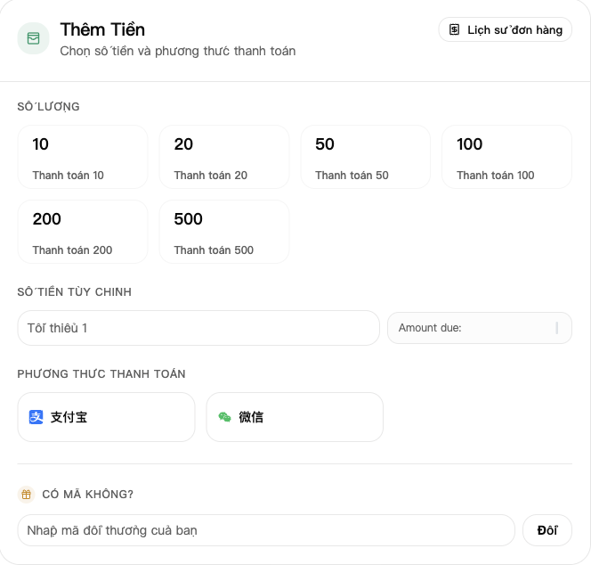

## 1. Nạp tiền

1. Mở [Ví](https://nexusapi.link/wallet).
2. Trong **Thêm Tiền**, chọn số tiền hoặc nhập số tiền khác.
3. Kiểm tra số tiền cần trả và số dư nhận được, rồi chọn cách thanh toán.
4. Làm theo hướng dẫn trên trang thanh toán.
5. Quay lại Ví, tải lại trang và kiểm tra số dư.

Số dư `$` là hạn mức sử dụng dịch vụ, không phải số nhân dân tệ đã thanh toán. Xem [ví dụ hệ số và giá](/vi/billing/multipliers-and-discounts).

## 2. Mã quy đổi và gói đăng ký

- **Mã quy đổi:** dán vào ô mã trong Ví và bấm **Đổi**.
- **Gói đăng ký:** nếu có hiển thị, kiểm tra thời hạn, hạn mức và nhóm sử dụng trước khi mua. Gói khác với số dư nạp tiền. Chưa rõ có phù hợp không thì hỏi hỗ trợ trước.

## 3. Đã trả tiền nhưng chưa nhận số dư

Tải lại Ví rồi xem **Lịch sử đơn hàng**. Nếu vẫn thiếu, gửi hỗ trợ:

- Tài khoản đăng nhập.
- Thời gian, số tiền và cách thanh toán.
- Mã đơn hàng, ảnh thanh toán.

Che thông tin nhạy cảm. **Không gửi mật khẩu, mã xác minh hoặc khóa API đầy đủ.**

## Xem đơn thanh toán cũ

1. Mở [Ví](https://nexusapi.link/wallet), vào lịch sử đơn hàng.
2. Nếu có mã đơn, nhập vào **Tìm kiếm theo số đơn hàng...**. Nếu không, chuyển trang và đối chiếu thời gian, số tiền rồi xem trạng thái. Ô tìm kiếm không lọc theo thời gian hay số tiền.
3. Làm mới số dư ví để xác nhận tiền đã vào. Chỉ có ảnh thanh toán chưa chứng minh tài khoản đã nhận hạn mức.

| Trạng thái đơn | Bước tiếp theo |
| --- | --- |
| Thành công | Làm mới ví và kiểm tra số dư. Chưa rõ thì gửi mã đơn cho hỗ trợ |
| Đang chờ | Chưa xác nhận hoàn tất. Nếu đã bị trừ tiền, giữ chứng từ và nhờ kiểm tra, không thanh toán lần nữa |
| Hết hạn | Đã trả tiền nhưng chưa nhận hạn mức thì liên hệ hỗ trợ. Trạng thái này không có nghĩa đã hoàn tiền |

Không thấy đơn hoặc chưa rõ trạng thái thì gửi thời gian, mã đơn và ảnh đã che riêng tư cho hỗ trợ, không thanh toán lại ngay. Chi tiết gọi mô hình xem ở [nhật ký sử dụng](/vi/billing/usage-and-billing), không phải đơn thanh toán.
