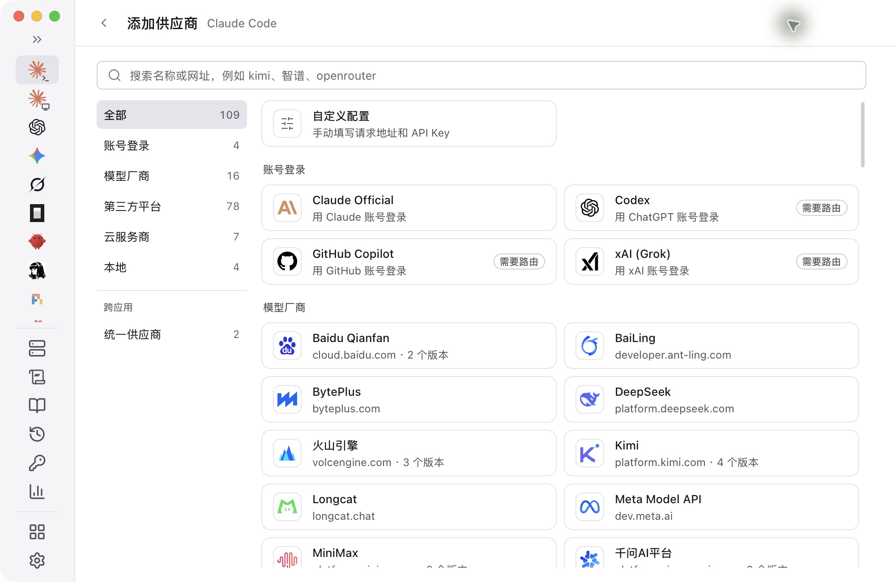
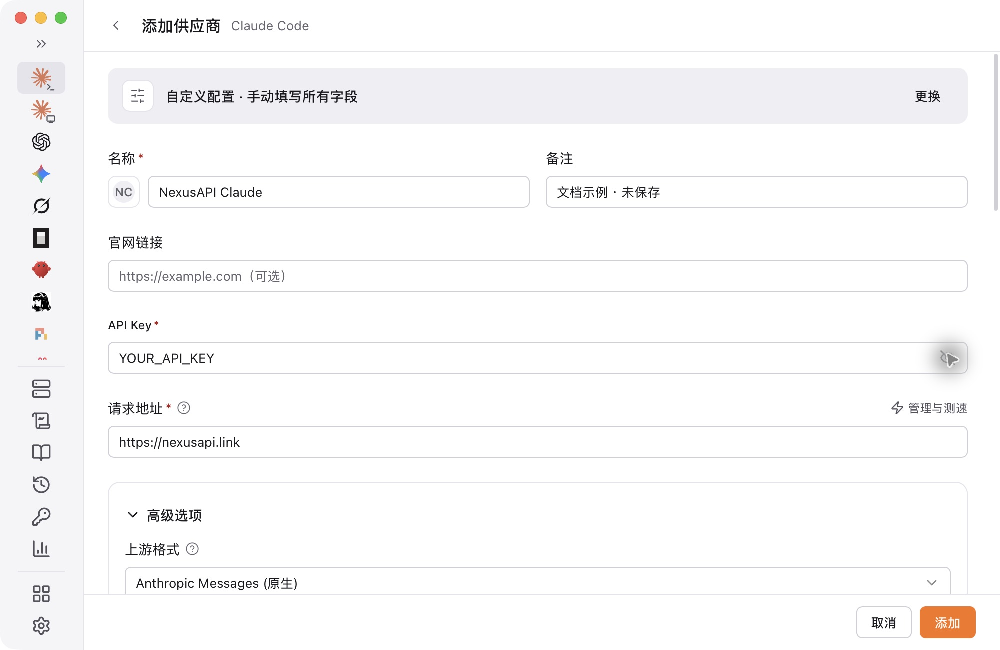
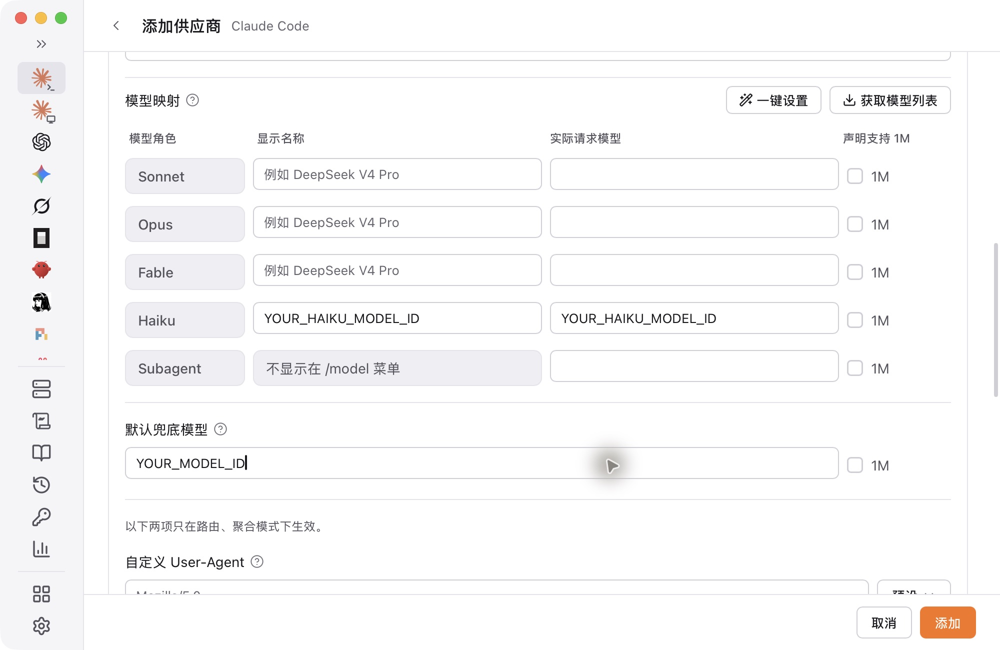

CC Switch quản lý cấu hình. **Cài [Claude Code](/vi/tools/claude-code) hoặc [Codex CLI](/vi/tools/codex-cli) trước, chỉ làm bước cài rồi quay lại đây.** Không cần tự sửa thêm file cấu hình của chúng.

## 1. Cài CC Switch

Mở [tải chính thức](https://github.com/farion1231/cc-switch/releases/latest), chọn đúng hệ điều hành:

- Windows: chọn Windows `.msi`; máy ARM chọn bản `arm64`.
- macOS: mở macOS `.dmg` và cài theo hướng dẫn.
- Linux: chọn `.deb` hoặc `.AppImage` phù hợp.

## 2. Thêm nhà cung cấp tùy chỉnh

Chọn **Claude Code** hoặc **Codex** bên trái, bấm **+ / Add provider** góc trên phải, rồi chọn cấu hình tùy chỉnh. Không chọn Claude Desktop hay mẫu của trang khác.



## 3. Điền theo bảng

[Tạo khóa](/vi/guide/api-key), chọn cùng nhóm trong [Quảng trường mô hình](https://nexusapi.link/pricing), sao chép mô hình cho công cụ. Điền thông số NexusAPI theo bảng dưới đây:

| Mục | Claude Code | Codex |
| --- | --- | --- |
| Tên | NexusAPI Claude | NexusAPI Codex |
| Địa chỉ | `https://nexusapi.link` | `https://nexusapi.link/v1` |
| khóa API | Khóa NexusAPI đầy đủ của bạn | Khóa NexusAPI đầy đủ của bạn |
| Mô hình chính | Tên Claude Code / Messages đã sao chép | Tên Codex / Responses đã sao chép |

Claude Code: mở tùy chọn nâng cao. Điền tên mô hình chính đã sao chép vào “默认兜底模型” (mô hình dự phòng mặc định). Với Haiku, điền mô hình phụ được bộ phận hỗ trợ xác nhận vào trường mô hình yêu cầu thực tế. Thay các giá trị giữ chỗ trong ảnh.

Codex: dùng mô hình trong bảng, không cần ánh xạ mô hình Claude Code. Chỉ cấu hình ứng dụng cần dùng, chọn Direct, giữ mặc định các mục khác rồi bấm Add / Save.



Ví dụ biểu mẫu Claude Code. Thay các giá trị giữ chỗ; bản nháp chưa lưu, chưa kết nối.



## 4. Bật và kiểm tra

Bấm **Switch / Bật** trên cấu hình NexusAPI. Chỉ lưu chưa đổi dịch vụ. Mở lại terminal và chạy công cụ tương ứng:

<Tabs>
<Tab title="Claude Code">
```bash
claude
```
</Tab>
<Tab title="Codex">
```bash
codex
```
</Tab>
</Tabs>

Gửi “Chỉ trả lời: kết nối thành công. Không sửa file.” Kiểm tra đủ câu trả lời và mô hình, nhóm trong [nhật ký](https://nexusapi.link/usage-logs/common). Lượt thử này tiêu thụ một lượng nhỏ số dư.

Không có lệnh: cài CLI trước. Vẫn dùng dịch vụ chính thức: kiểm tra Enable và mở lại. Mô hình lỗi: chép lại từ nhóm của khóa. Nếu lỗi gọi tên mô hình phụ, xác nhận tên Haiku / Sonnet / Opus khả dụng. Che khóa trong ảnh gửi hỗ trợ.

Dự án chính thức: [CC Switch](https://github.com/farion1231/cc-switch). Tên nút có thể thay đổi theo phiên bản.

<span id="switch-back"></span>

## Đổi cấu hình hoặc quay lại dịch vụ cũ

- **Đổi mô hình:** sửa mô hình chính NexusAPI, lưu, xác nhận vẫn đang bật rồi mở lại công cụ. Mô hình phải có trong nhóm khóa; xem [đổi mô hình](/vi/billing/models-pricing#change-model).
- **Quay lại dịch vụ cũ:** trong đúng ứng dụng, chọn nhà cung cấp đã lưu trước đó, bấm **Switch**, rồi mở lại. Nếu đã xóa hoặc không sao lưu, lấy lại cấu hình trước, không đoán thông tin đăng nhập.
- **Cấu hình thủ công:** chỉ khôi phục phần đã sửa từ bản sao của bạn. Chưa có bản sao thì hỏi hỗ trợ. Không xóa cả thư mục hay công khai khóa trong bản sao lưu.

Kiểm tra bằng yêu cầu mới và bản ghi của dịch vụ tương ứng, không chỉ dựa vào lời tự giới thiệu của AI.
<span id="import-from-website"></span>

## Nhập cấu hình từ website

Nếu đã cài CC Switch, có thể bắt đầu nhập từ website để giảm nhập tay:

1. Trong [Khóa API](https://nexusapi.link/keys), mở menu của dòng khóa rồi chọn **CC Switch**.
2. Ở **Nhập vào CC Switch**, chọn Claude hoặc Codex, tên dễ nhận và mô hình chính tương thích phần mềm, có trong nhóm khóa. Không thấy mô hình thì kiểm tra nhóm trước.
3. Bấm **Mở công tắc CC**, xác nhận nhập theo trình duyệt và ứng dụng cục bộ. Không mở được thì kiểm tra cài đặt hoặc dùng cách thủ công.
4. Trong CC Switch kiểm tra địa chỉ, mô hình và cấu hình đang bật, rồi khởi động lại và thử theo phần 4. **Mở hộp thoại nhập không có nghĩa đã chuyển thành công.**

Nhập cấu hình sẽ chuyển khóa cho CC Switch trên máy. Liên kết tạo ra có thể chứa khóa đầy đủ, không gửi cho người khác, chụp hoặc công khai.

Chỉ điền các ô mô hình phụ Haiku, Sonnet, Opus của Claude khi đã xác nhận cần và dùng được. Chưa rõ tên thì hỏi hỗ trợ, không sao chép giá trị mẫu. Nếu khóa có giới hạn mô hình, cũng phải cho phép mô hình chính và các mô hình phụ cần dùng.
