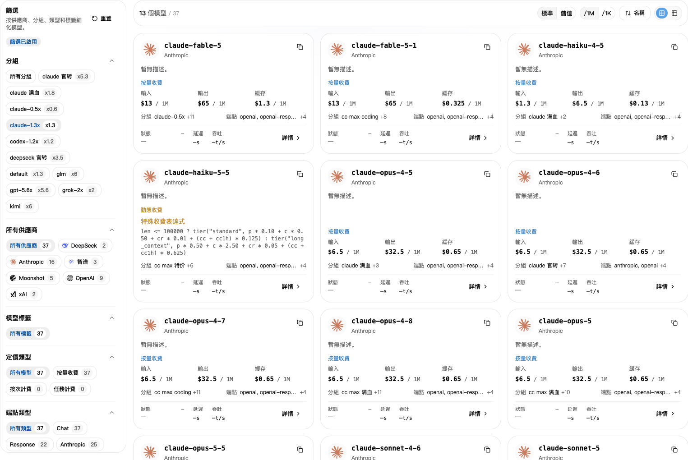
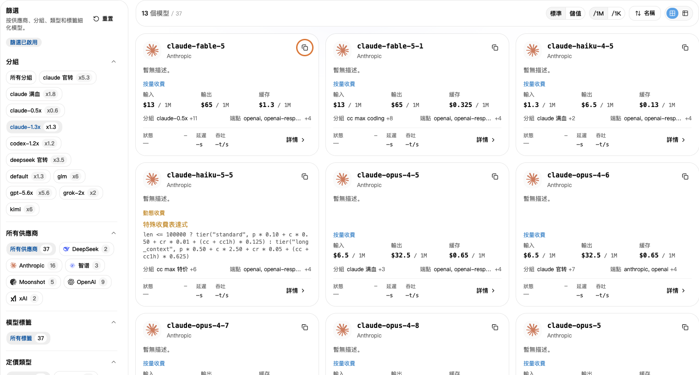

## 1. 先選分組

1. 開啟 [API 金鑰](https://nexusapi.link/keys)，找到正在使用的 Key，記下「分組」。
2. 開啟[模型廣場](https://nexusapi.link/pricing)。
3. 在左側選同一個分組。

**不要只看「所有分組」的價格。選自己的分組，才是對應價格。**

## 2. 複製模型名稱

搜尋要用的模型，點複製模型名稱，貼到軟體的「模型」欄位。不要憑印象手動輸入。

找不到模型？把**軟體名稱、想用的模型、目前分組**傳給客服，確認應該選哪個分組。

先選自己的分組，再按模型右上角的複製按鈕。示例分組與價格僅供示範，以目前頁面為準。

不確定模型能否用於你的軟體？先看[按軟體選模型](/zh-TW/tools#choose-model)，查具體名稱則看[模型推薦協定](/zh-TW/developer/model-protocols)。不要只因名稱相似就替換。

## 3. 看價格

- **標準**：呼叫時扣除的帳戶額度。
- **儲值**：按網站設定換算的成本參考；個人優惠或方案可能不同。
- **`/1M`**：每 100 萬 Tokens 的價格；**`/1K`**：每 1,000 Tokens 的價格。比較時選同一單位。

傳給模型的內容算「輸入」，模型回覆的內容算「輸出」。有快取等其他費用，點「詳情」看說明。

詳情若列出快取讀取、快取寫入、級距價格或工具呼叫費用，按對應項目查看，不要把輸入單價當成全部費用。不確定就把模型和分組傳給客服。

**頁面價格已含所選分組倍率，不用再乘一次。** 看折扣請開[倍率與折扣](/zh-TW/billing/multipliers-and-discounts)；看實際扣費請開[使用日誌](/zh-TW/billing/usage-and-billing)。

## 4. 看速度與成功率

模型詳情若顯示「效能」，開啟後查看對應分組資料：

- **首字延遲**：開始收到回覆要等多久，通常越短越快。
- **輸出速度**：開始回覆後每秒輸出多少 Tokens，通常越高越快。
- **成功率**：統計範圍內請求成功的比例。

這些是歷史統計，不是每次呼叫的保證，也不代表回答品質。沒有資料不等於不能用；不知怎麼選時，把使用軟體與用途傳給客服。

## 更換模型

1. 在模型廣場選目前 Key 的分組，複製適用於軟體的新模型名。跨分組更換，先按[金鑰教學](/zh-TW/guide/api-key#change-key)確認分組。
2. 按使用方式改對應位置；只換模型不必重新建立 Key：

| 使用方式 | 改哪裡 |
| --- | --- |
| CC Switch | 編輯目前 NexusAPI 設定的主模型，儲存後確認此設定已啟用 |
| Claude Code 手動設定 | 按[教學](/zh-TW/tools/claude-code)修改使用者設定的 `model` |
| Codex CLI 手動設定 | 按[教學](/zh-TW/tools/codex-cli)修改設定頂部的 `model`，保留 NexusAPI Provider |
| Claude Code 編輯器擴充功能 | 按[教學](/zh-TW/tools/cursor-vscode)修改使用者設定的 `ANTHROPIC_MODEL` |
| 自己寫程式 | 修改請求中的 `model`；更換協定時也要按對應介面調整請求 |

3. 儲存並重啟工具或編輯器，在新對話傳「請只回覆：連線成功，不要修改檔案」。
4. 到[使用日誌](https://nexusapi.link/usage-logs/common)確認本次模型與分組。測試消耗少量額度，不要問 AI「你是什麼模型」來判斷。

舊對話可能保留原設定或歷史上下文；先保存重要內容，再用新對話驗證。
