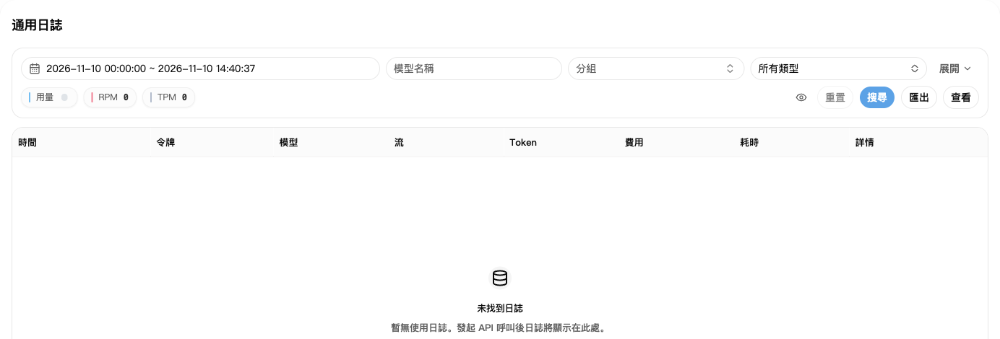
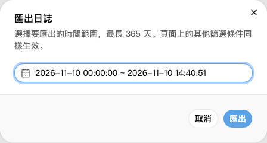

## 1. 找到呼叫紀錄

1. 開啟[使用日誌](https://nexusapi.link/usage-logs/common)。
2. 選發生呼叫的日期，點「搜尋」。
3. 紀錄太多時，再按模型或分組篩選。
4. 找到對應紀錄，點費用或詳情入口看明細。

剛呼叫完沒看到紀錄，稍等後重新整理即可，不要為了查日誌重複呼叫。

## 2. 主要看這幾項

| 項目 | 看什麼 |
| --- | --- |
| 時間、模型、分組 | 是不是你剛才的呼叫 |
| Tokens | 這次的文字用量；詳情可能分輸入、輸出、快取 |
| 費用 | 扣了多少帳戶額度 |
| 耗時 | 呼叫用了多久 |

費用旁若顯示方案或錢包圖示，表示從哪裡扣除。方案扣減不代表錢包又扣一次；把滑鼠移到圖示可看說明。

快取或工具呼叫等費用，以該筆紀錄明細為準，不要只拿輸入、輸出用量猜總價。

**日誌裡的 `$0.10` 不一定是人民幣 0.10 元。** 實付成本對照見[倍率與折扣](/zh-TW/billing/multipliers-and-discounts)。

## 3. 下載使用紀錄

1. 在使用日誌依需要篩選模型或分組。
2. 點「匯出」，選開始與結束時間。
3. 再點「匯出」，下載 CSV 檔案，可用 Excel 開啟。

匯出會保留目前頁面的其他篩選條件。一次只匯出一份，完成後再匯出下一份。

目前單次查詢或匯出的時間跨度最多 **365 天**，之後以頁面提示為準；不代表歷史日誌保證保留 365 天。範圍太長時，按月分開查詢或匯出。

匯出檔案可能含 IP、請求編號等資訊，轉傳前先檢查並遮蓋隱私。

## 4. 扣費有疑問怎麼辦

發生錯誤、沒收到完整結果，或懷疑重複扣費時，把以下內容傳給客服：

- 發生時間、模型和分組。
- 錯誤原文，以及有沒有收到完整回覆。
- 對應日誌截圖；詳情有 Request ID（請求編號）時一起複製。

**不要傳送完整 API Key。** 先保留紀錄，避免反覆重試產生更多呼叫。
