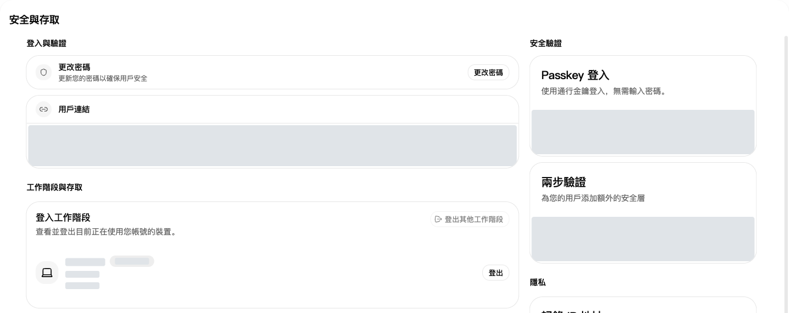
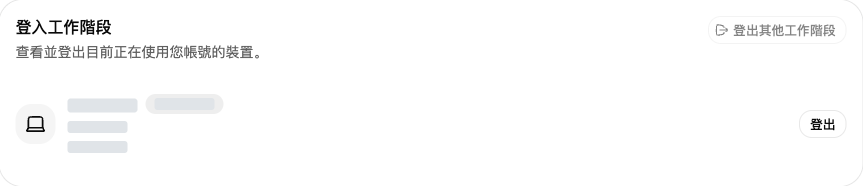
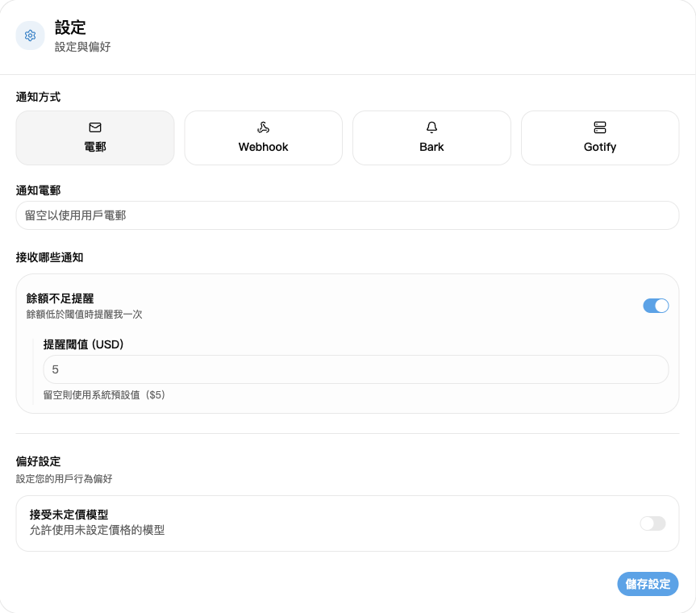

## 1. 登入帳號

開啟[登入頁](https://nexusapi.link/sign-in)，輸入自己的帳號和密碼。沒有帳號或無法找回密碼，請聯絡客服。

## 2. 修改密碼、查看登入裝置

1. 開啟[安全與存取](https://nexusapi.link/security)。
2. 修改密碼：點「變更密碼」，按提示填寫並儲存。
3. 查看裝置：往下找「登入工作階段」。有不認識的裝置，撤銷對應工作階段；要登出其他裝置，選「登出其他工作階段」。

登入工作階段：檢查裝置，必要時登出陌生工作階段。圖中裝置資訊已隱藏。

**設定模型軟體，只用 [API 金鑰](/zh-TW/guide/api-key)頁建立的 Key。「安全與存取」裡的存取權杖用於管理介面，不必為模型軟體建立或填寫。**

## 3. 懷疑帳號或金鑰外洩

| 情況 | 立即做什麼 |
| --- | --- |
| 密碼外洩或出現陌生登入 | 修改密碼，登出陌生裝置的工作階段 |
| API Key 外洩 | 在金鑰頁停用或刪除舊 Key，建立新 Key，再替換軟體設定 |

**只登出網頁，不會停用 API Key。** 不要把密碼、驗證碼或完整 Key 傳給任何人。

## 4. 設定餘額不足提醒

1. 開啟[個人資料](https://nexusapi.link/profile)，找到通知設定。
2. 選「電子郵件」，填可收信的通知信箱；留空使用帳號信箱，沒有信箱先填寫。
3. 開啟「餘額不足提醒」，填「提醒閾值」；不確定填多少，留空使用網站預設值。
4. 點「儲存設定」。

門檻按頁面顯示的額度單位填寫，不是人民幣儲值金額。餘額從門檻以上降到以下時提醒一次，不會每次呼叫都提醒；不要只靠郵件判斷餘額，使用前仍可到[錢包](https://nexusapi.link/wallet)查看。
