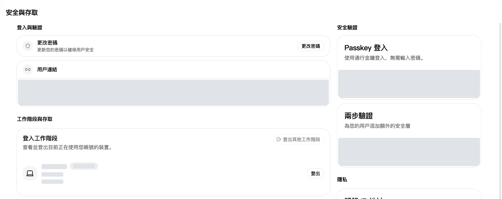
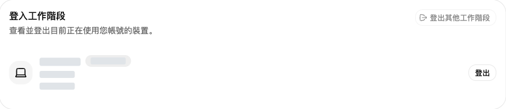
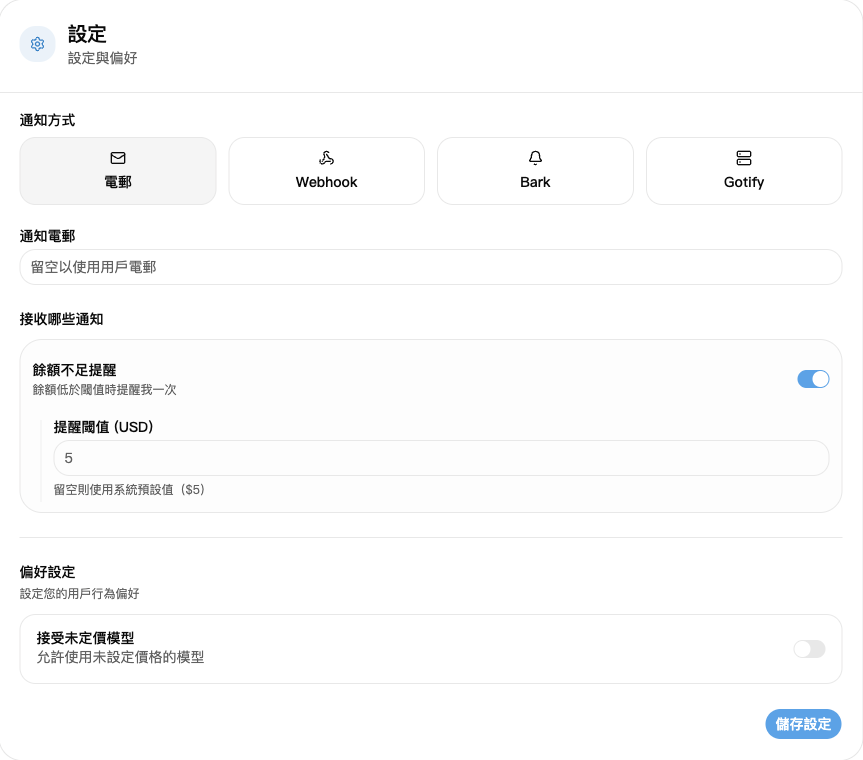

## 1. 登入帳號

開啟[登入頁](https://nexusapi.link/sign-in)，輸入自己的帳號和密碼。沒有帳號或無法找回密碼，請聯絡客服。

## 2. 修改密碼、查看登入裝置

1. 開啟[安全與存取](https://nexusapi.link/security)。
2. 修改密碼：點「變更密碼」，按提示填寫並儲存。
3. 查看裝置：往下找「登入工作階段」。有不認識的裝置，撤銷對應工作階段；要登出其他裝置，選「登出其他工作階段」。

登入工作階段：檢查裝置，必要時登出陌生工作階段。圖中裝置資訊已隱藏。

**設定模型軟體，只用 [API 金鑰](/zh-TW/guide/api-key)頁建立的 Key。「安全與存取」裡的存取權杖用於管理介面，不必為模型軟體建立或填寫。**

## 3. 懷疑帳號或金鑰外洩

| 情況 | 立即做什麼 |
| --- | --- |
| 密碼外洩或出現陌生登入 | 修改密碼，登出陌生裝置的工作階段 |
| API Key 外洩 | 在金鑰頁停用或刪除舊 Key，建立新 Key，再替換軟體設定 |

**只登出網頁，不會停用 API Key。** 不要把密碼、驗證碼或完整 Key 傳給任何人。

## 4. 設定餘額不足提醒

1. 開啟[個人資料](https://nexusapi.link/profile)，找到通知設定。
2. 選「電子郵件」，填可收信的通知信箱；留空使用帳號信箱，沒有信箱先填寫。
3. 開啟「餘額不足提醒」，填「提醒閾值」；不確定填多少，留空使用網站預設值。
4. 點「儲存設定」。

門檻按頁面顯示的額度單位填寫，不是人民幣儲值金額。餘額從門檻以上降到以下時提醒一次，不會每次呼叫都提醒；不要只靠郵件判斷餘額，使用前仍可到[錢包](https://nexusapi.link/wallet)查看。

## 個人顯示設定與 IP 記錄

### 修改介面語言

開啟[個人資料](https://nexusapi.link/profile)，在「介面語言」選語言並等待儲存成功。會同步到已登入裝置，也可能改變 API 錯誤訊息的語言。

### 恢復隱藏的選單

若有「左側邊欄個人設定」，開啟項目並點「儲存變更」。恢復預設時，點「重置為預設」再儲存。只能恢復已開放的選單，不能增加權限；沒有目標選項時聯絡客服。

### 記錄呼叫來源 IP

在[安全與存取](https://nexusapi.link/security)切換「記錄 IP 地址」，再點「儲存設定」。它控制後續用量與錯誤日誌是否記錄 IP，不會補寫舊紀錄缺少的 IP。

**記錄 IP 不等於 IP 白名單。** 記錄只保存來源，[白名單](/zh-TW/guide/ip-whitelist)才限制 Key 的來源；開啟記錄不能阻止別人使用 Key。

### 查看自己的操作紀錄

若選單顯示「稽核日誌」，可查看自己帳號的操作：

1. 開啟[稽核日誌](https://nexusapi.link/usage-logs/audit)，選擇要核對的時段。
2. 需要縮小範圍時，選「分類」或「結果」，再點「搜尋」。
3. 核對時間、操作及結果。查完點「重置」，避免舊篩選影響下次查看。

這裡只查自己帳號的操作。模型呼叫與扣費仍查[使用日誌](/zh-TW/billing/usage-and-billing)，不要混淆。

## 設定兩步驗證

若[安全與存取](https://nexusapi.link/security)顯示「兩步驗證」：

1. 點該區域「啟用」，按彈窗完成安全驗證。
2. 使用驗證器應用掃描設定 QR 碼，照頁面步驟操作。
3. **先妥善保存備用代碼**，再輸入驗證器目前的驗證碼，完成「啟用 2FA」。
4. 確認狀態已啟用。登入依提示輸入驗證碼；手機無法使用時，每個備用代碼只能使用一次。

使用「重新生成備用代碼」更換時，完成身分驗證並保存新代碼，**所有舊代碼會失效**。QR 碼、設定密鑰與代碼不能提供客服或放在截圖。無法驗證時聯絡客服，不要反覆嘗試或自行刪除帳號。
